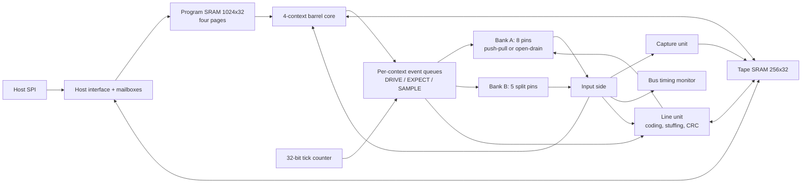

# Escapement

**No pin edge is ever late, whatever program runs. Proved, for every program, on the
netlist that goes to silicon.**

Escapement is a programmable protocol engine for the
[Jane Street protocol emulator competition](https://blog.janestreet.com/protocol-emulator-asic-competition/),
built on IHP's 130 nm SG13CMOS5L process through Tiny Tapeout as an 8 × 4 tile design.
Four hardware contexts run firmware that schedules pin changes at absolute clock ticks.
Each change is checked when it is queued: if its deadline can still be met it happens on
exactly that tick, and if not, the context stops with a fault that says why. A late edge
is not one of the possible outcomes, and that is proved for every program, not checked
one firmware at a time.

UART, SPI, I2C, CAN, PS/2, WS2812, 1-Wire, JTAG, ARM SWD, low-speed USB, 10BASE-T
Ethernet, HDMI-CEC, DALI, SENT, DShot and many more are firmware: the repository holds
80 programs, and none of those protocols is in the hardware. What the hardware adds is
time and the work that firmware cannot do bit by bit: a line unit for the bits of packet
protocols, a capture unit that records timestamped pin changes, and a bus timing monitor
that checks other devices against their datasheets.



## Where to read

| | |
| --- | --- |
| [The write-up](docs/00-WRITEUP.md) | The design, why it is built this way, and how each claim is checked |
| [The site](https://parthdoom.github.io/escapement/) | The firmware running in your browser, the die, the proofs' latest runs and the FPGA bench |
| [Verification](docs/04-VERIFICATION.md) | Every method, every result, and how to rerun them |
| [How it was built](docs/07-STORY.md) | The project's history, from the first question to version 3 |

The rest of the documentation is in [docs/](docs/): architecture, instruction set, the
normative machine semantics, host protocol, physical design, power, bring-up, the line
unit, the bus monitor and the decision log.

## Status

| | |
| --- | --- |
| Layout | 8 × 4 tiles (1724.16 × 710.64 µm), 37,230 standard cells and two SRAM macros, 61.9% utilisation. Signed off at 20 ns at every corner, so the chip is rated for clocks up to 50 MHz (25 MHz by default); worst setup slack +1.480 ns, worst hold slack +0.180 ns. LVS, DRC and antenna clean, and the `ttihp27a` shuttle's precheck passes. The CI harden and the local one produce the same netlist, bit for bit ([physical design](docs/03-PHYSICAL-DESIGN.md)) |
| Proofs | "Never late" is proved unbounded with the program memory a free input, so for every program; the sign-off netlist is proved equivalent to the RTL. In CI on the final commit all 100 proof tasks pass: the 39 unbounded core proofs (PDR, one per assertion group), six more proofs and four cover checks, the bounded check from reset (47 tasks, 67 assertion lines, depth 20), and the tripwire, line unit and non-interference proofs (four tasks); 15 planted bugs each make their proof fail. ([verification](docs/04-VERIFICATION.md)) |
| Tests | 1,507 software tests; 12 chip tests on the RTL and on the final gate-level netlist; 9 firmware tests through the pins; 191 random programs and 74 firmware cases co-simulated against the RTL on two builds; the line unit against its model over 3.8 million edges; 80 of 80 timing certificates; 1,010 planted RTL faults, 892 caught, 57 proved harmless, 61 argued, none surviving; decoders written by other people (sigrok's, IRMP, Wireshark's, rtl_433, rc-switch) agree with 72 of the 80 programs, each judge with a control that must fail; 719 timing bugs planted in the firmware, none certified that can fault; every firmware case still passes with its pins a tick slower each way. |
| Hardware | Version 3's RTL on a Sipeed Tang Primer 25K, driven by a Raspberry Pi Pico W running the bring-up script, passes all six bring-up stages and 71 of 71 firmware runs against the reference model (every program at the time, 15 November); the same bitstream talks 10BASE-T Ethernet with a laptop both ways, and debugs a real RP2040 over SWD while an outside logic analyser and sigrok's decoder confirm every access ([the bench](https://parthdoom.github.io/escapement/fpga/)) |
| Power | 4.42 mW sending UART and 3.38 mW stopped, at 25 MHz and the typical corner ([power](docs/15-POWER.md)) |

## Quick start

```sh
pip install -r test/requirements.txt          # cocotb, pytest, pyyaml; Icarus Verilog for RTL
make sw-test                                  # assembler, ISS, certificates, models
make cert                                     # timing certificate for every firmware
make proof-table                              # each certificate beside the measured leads
make test                                     # chip-level RTL tests
make cosim                                    # ISS against RTL, in lockstep
```

The assembler and the certificate checker also run on their own, from `sw/`:
`python -m escasm ../firmware/uart_tx.asm -l -o uart_tx.json` and
`python -m escert ../firmware/uart_tx.asm`. The [toolchain](docs/05-TOOLCHAIN.md) chapter
covers the proofs, mutation testing, hardening and the FPGA builds.

## Repository layout

| Path | Contents |
| --- | --- |
| `src/` | RTL and the Tiny Tapeout flow configuration |
| `macro/` | The IHP SRAM macro views (vendored, unmodified) |
| `firmware/` | Protocol and device firmware in Escapement assembly |
| `protocols/` | Timing tables that `escgen` turns into transmitter firmware |
| `isa/isa.yaml` | The single source of instruction encodings |
| `sw/` | Assembler (`escasm`), instruction-set simulator (`esciss`), certificate checker (`escert`), firmware generator (`escgen`), protocol learner (`esclearn`), host library (`eschost`), tape tools (`esctape`), bus models (`escmodels`), USB/IP bridge to a Linux kernel (`escusbip`), RP2350 demo host (`rp2350`) |
| `test/` | Chip-level, co-simulation, host, unit, monitor and mutation tests |
| `formal/` | SymbiYosys proofs |
| `scripts/` | Local hardening, precheck, power and timing analysis |
| `asic/reports/` | Recorded physical measurements |
| `fpga/` | FPGA builds: the Tang Primer 25K bench and a ULX3S build |
| `site/` | The project site, with the in-browser playground that runs `sw/` under Pyodide |

## Licence

Apache-2.0 ([LICENSE](LICENSE)). The SRAM macro views come from
[IHP-Open-PDK](https://github.com/IHP-GmbH/IHP-Open-PDK) (Apache-2.0); see
[macro/](macro/).

AI coding assistants were used for writing code.
