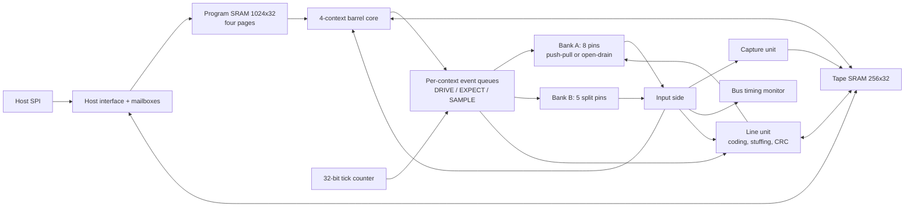

# Escapement

**No pin edge is ever late, whatever program runs. Proved for every program, and the
signed-off netlist is proved equivalent to the design the proof is about.**

Escapement is a programmable protocol engine for the
[Jane Street protocol emulator competition](https://blog.janestreet.com/protocol-emulator-asic-competition/),
built for IHP's 130 nm SG13CMOS5L process and Tiny Tapeout as an 8 × 4 tile design.
Four hardware contexts run firmware that schedules pin changes at absolute clock ticks.
Each change is checked when it is queued: if its deadline can still be met it happens on
exactly that tick, and if not, the context stops with a fault that says why. A late edge
is not one of the possible outcomes, and that is proved for every program, not checked
one firmware at a time.

UART, SPI, I2C, CAN, PS/2, WS2812, 1-Wire, JTAG, ARM SWD, low-speed USB, 10BASE-T
Ethernet, HDMI-CEC, DALI, SENT, DShot and many more are firmware: the repository holds
90 programs, and none of those protocols is in the hardware. Eight of them are for protocols
drawn at random from a public pool of 24 and written on version 3.1 as tagged. The draw was
sealed by a hash committed before any was written, and all eight fit
([the held-out round](heldout/RESULTS.md)). What the hardware adds is
time and the work that firmware cannot do bit by bit: a line unit for the bits of packet
protocols, a capture unit that records timestamped pin changes, and a bus timing monitor
that checks other devices against their datasheets.



## Where to read

| Document | What it covers |
| --- | --- |
| [The write-up](docs/00-WRITEUP.md) | The design, why it is built this way, and how each claim is checked |
| [The site](https://parthdoom.github.io/escapement/) | The firmware running in your browser, the die, the proofs' latest runs and the FPGA bench |
| [Verification](docs/04-VERIFICATION.md) | Every method, every result, and how to rerun them |
| [How it was built](docs/07-STORY.md) | The project's history, from the first question to version 3.2 |

The rest of the documentation is in [docs/](docs/): architecture, instruction set, the
normative machine semantics, host protocol, physical design, power, bring-up, the line
unit, the bus monitor, the demos (VGA and OLED Pong, the DOOM console), the decision log, and the [tool bugs](docs/24-TOOL-BUGS.md) the design
has met.

## Results

| Aspect | Result |
| --- | --- |
| Layout | 8 × 4 tiles (1724.16 × 710.64 µm), 39,588 standard cells and two SRAM macros, 64.4% utilisation. Signed off at 20 ns at every corner, so the chip is rated for clocks up to 50 MHz (25 MHz by default); worst setup slack into a flip-flop +3.015 ns, worst hold slack +0.216 ns; the slow corner passes setup down to 17.0 ns, so 58 MHz is possible but not rated. Every electrical rule met at every corner: no slew or capacitance violation, and 9 fanout flags on the roots of gated clocks, accepted. LVS, DRC and antenna clean, and the `ttihp27a` shuttle's precheck passes. The CI harden and the local one produce the same netlist, bit for bit ([physical design](docs/03-PHYSICAL-DESIGN.md)) |
| Proofs | "Never late" is proved unbounded with the program memory a free input, so for every program; each of the 55 instructions is proved to do what the specification says, against a checker written from the specification alone; the sign-off netlist is proved equivalent to the RTL. In CI on the final commit all PENDING-CI proof tasks pass: the 44 unbounded core proofs (PDR, one per assertion group), PENDING-CI more proofs and PENDING-CI cover checks, the bounded check from reset (52 tasks, 72 assertion lines, depth 20), and the tripwire, line unit and non-interference proofs (four tasks); PENDING-CI planted bugs each make their proof fail. ([verification](docs/04-VERIFICATION.md)) |
| Tests | 1,876 software tests; 12 chip tests on the RTL and on the final gate-level netlist; 9 firmware tests through the pins; 191 random programs and 84 firmware cases co-simulated against the RTL on two builds; the line unit against its model over 3.8 million edges; 90 of 90 timing certificates; 1,033 planted RTL faults, 919 caught, 55 proved harmless, 59 argued, none surviving; decoders written by other people (sigrok's, IRMP, Wireshark's, rtl_433, rc-switch) agree with all 80 of the 90 programs they can read (the other ten have no outside decoder or nothing for one to read), each judge with a control that must fail; 823 timing bugs planted in the firmware, none certified that can fault; every firmware case still passes with its pins up to three ticks slower each way. |
| Hardware | The chip's RTL on a Sipeed Tang Primer 25K, driven by a Raspberry Pi Pico W running the bring-up script, runs all 90 programs and 5 bench programs, and every one matches the reference model and stays within its timing certificate, `modbus_full` and two held-out programs spanning two pages among them: all but the 14-second `westminster` chime on version 3.1 from 21 to 25 November 2026 and on version 3.2 on 26 November 2026, and the chime on version 3.2 on 28 November 2026 ([its run](fpga/tangprimer25k/results/2026-11-28-westminster/README.md)). Version 3.1's bitstream talks 10BASE-T Ethernet with a laptop both ways and answers its ping, debugs a real RP2040 over SWD while an outside logic analyser and sigrok's decoder confirm every access, and enumerates on a laptop's USB port as a keyboard that types exactly the line it is given ([the bench](https://parthdoom.github.io/escapement/fpga/)). With a Pico W running DOOM as its host, it streams the game's frames to an OLED and plays its sound, with no word lost on the host link ([the DOOM console](docs/25-DOOM-CONSOLE.md)). It refuses a program asking for a late edge and one asking for a pin it does not own exactly where `escert` and the model said, with no such edge reaching a pin, and it learns a 433 MHz remote's protocol from its own capture of the remote's recorded frames and runs the certified transmitter and receiver generated from it ([the refusal](fpga/tangprimer25k/README.md#the-chip-refuses) and [learning](fpga/tangprimer25k/README.md#learned-on-the-bench) benches, on version 3.1 on 24 November 2026 and on version 3.2 on 27 November 2026) |
| Held-out round | Eight protocols drawn at random from a public pool of 24, the drawn list sealed by a hash committed before any was written: a MIL-STD-1553B remote terminal, an S/PDIF transmitter, a Microwire 93C46 EEPROM master, a DHT22 host, a BiSS C master, a PS/2 host, a SNES pad reader and an M-Bus slave. Each was written on version 3.1 from its specification, tested against a bus model written by a separate session barred from the firmware, certified, co-simulated on the RTL, judged by sigrok where a decoder exists (six of eight) and run on the FPGA bench. All eight fit, each with stated limits, and no instruction was missing; the round found no bug in the chip and one in `escert`, now fixed ([results](heldout/RESULTS.md), [the seal](heldout/README.md)) |
| Power | 2.16 mW sending UART and 1.41 mW stopped, at 25 MHz and the typical corner, from gate-level simulation of the signed-off layout with the wiring extracted from its routes. Measured the way every earlier version was, after clock-tree synthesis with the wiring estimated from placement, 1.85 and 1.27 mW, against 4.42 and 3.36 mW for version 3.1 ([power](docs/15-POWER.md)) |

## Quick start

```sh
pip install -r test/requirements.txt          # cocotb, pytest, pyyaml (Python 3.10 or later); Icarus Verilog for RTL
make quickstart                               # one program: assemble, certify, simulate, judge, then the RTL
make sw-test                                  # assembler, ISS, certificates, models
make cert                                     # timing certificate for every firmware
make proof-table                              # each certificate beside the measured leads
make test                                     # chip-level RTL tests
make cosim                                    # ISS against RTL, in lockstep
```

The assembler and the certificate checker also run on their own, from `sw/`:
`python -m escasm ../firmware/uart_tx.asm -l -o uart_tx.json` and
`python -m escert ../firmware/uart_tx.asm`. The [toolchain](docs/05-TOOLCHAIN.md) chapter
covers the proofs, mutation testing, hardening and the FPGA builds.

## Repository layout

| Path | Contents |
| --- | --- |
| `src/` | RTL and the Tiny Tapeout flow configuration |
| `macro/` | The IHP SRAM macro views (vendored, unmodified) |
| `firmware/` | Protocol and device firmware in Escapement assembly |
| `protocols/` | Timing tables that `escgen` turns into transmitter firmware, and for pulse codes into receivers |
| `isa/isa.yaml` | The single source of instruction encodings |
| `sw/` | Assembler (`escasm`), instruction-set simulator (`esciss`), certificate checker (`escert`), firmware generator (`escgen`), protocol learner (`esclearn`), host library (`eschost`), tape tools (`esctape`), bus models (`escmodels`), USB/IP bridge to a Linux kernel (`escusbip`), RP2350 demo host (`rp2350`) |
| `test/` | Chip-level, co-simulation, host, unit, monitor and mutation tests |
| `formal/` | SymbiYosys proofs, and the instruction checker (`esc_isa_check.v`) that the proofs and the co-simulation hold the core to |
| `scripts/` | Local hardening, precheck, power and timing analysis |
| `asic/reports/` | Recorded physical measurements |
| `fpga/` | FPGA builds: the Tang Primer 25K bench and a ULX3S build |
| `site/` | The project site, with the in-browser playground that runs `sw/` under Pyodide |

## Licence

Apache-2.0 ([LICENSE](LICENSE)). The SRAM macro views come from
[IHP-Open-PDK](https://github.com/IHP-GmbH/IHP-Open-PDK) (Apache-2.0); see
[macro/](macro/).

AI coding assistants were used for writing code.
