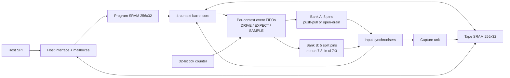

# Escapement

**A programmable protocol engine that never runs late silently.**

Escapement is a protocol emulator ASIC for the
[Jane Street protocol emulator competition](https://blog.janestreet.com/protocol-emulator-asic-competition/),
built for IHP's 130 nm SG13CMOS5L process through Tiny Tapeout. Firmware schedules pin
changes at absolute clock ticks. Each change is **admitted or refused when it is queued**:
an admitted event happens on its exact tick, and an impossible one raises a visible fault
instead of a late edge.

UART, SPI (controller and target), I2C, CAN, PS/2, WS2812, 1-Wire, JTAG, ARM SWD, NEC
infrared and whole devices such as a 24C02 EEPROM or a 25xx SPI memory are firmware.
None of them is in the hardware.

> Escapement either meets the deadline it accepted, or tells you why it refused.

## Design principles

1. **The chip knows time, not protocols.** The silicon makes one promise: an output event
   happens exactly at its deadline or is refused at enqueue, never late. A new protocol,
   or a device nobody planned for, is a new program, not a respin.
2. **Pay only for work.** A register bank that is not written does not see the clock, and
   a memory that is not read is not selected. Sending UART costs 3.0 mW, and a stopped
   chip 2.3 mW (typical corner, measured on gate-level workloads; [power](docs/15-POWER.md)).
   A logic-analyser capture runs with no instruction fetches at all.
3. **Every claim has a second, mechanical check.** Formal proofs, lockstep co-simulation
   of the RTL against a separate Python model, mutation testing, static timing
   certificates for firmware, and a 32-bit execution digest that checks silicon against
   the model with one read.

## What is on the chip



- **Four hardware contexts** in a fixed barrel: each runs its own program with its own
  pins, so a slow protocol in one context never changes another context's timing.
- **Two pin banks, 18 protocol signals.** Bank A is the eight bidirectional pins; bank B
  turns the five dedicated inputs and outputs the host link leaves free into split
  pins. Each context sees one bank as its eight logical pins, so a module runs on
  either bank unchanged, and the banks run at the same time: PS/2 and JTAG on bank A
  with SPI and UART on bank B is 11 signals at once.
- **Deadline-checked events.** DRIVE sets pins, EXPECT checks that an input holds or
  arrives within a window, and SAMPLE captures an input bit, all at exact ticks.
- **The tape**, a second SRAM shared by firmware loads and stores, a timestamped capture
  unit and the host. One memory serves as device storage, logic-analyser buffer and
  replay source.
- **Self-measurement.** Per context, the chip records its minimum scheduling lead and
  maximum queue occupancy, so a static timing certificate can be checked against the
  hardware.
- **Execution digest.** A 32-bit signature of every commit, register write and pin
  change in a run, readable over SPI and predicted by the reference model.

## Results

| | |
| --- | --- |
| Process | IHP SG13CMOS5L (130 nm), Tiny Tapeout, **6×4 tiles** (1289.28 × 710.64 µm) |
| Clock | 25 MHz, timing met at all three corners |
| Physical | 25,601 cells and two SRAM macros, 58.0% utilisation; LVS, DRC and antenna clean; Tiny Tapeout precheck passes |
| Power | 3.0 mW sending UART, 2.3 mW stopped (typical corner) |
| Firmware | 18 programs; every one except the replay template, whose deadlines come from captured data, carries a static timing certificate (CHECKED for all inputs) |
| Verification | ISS and RTL agree tick for tick on every firmware and on random programs; "never late" proved for all time; 28 of 28 RTL mutants killed; the final netlist is proved equivalent to the RTL, and the chip tests pass on it too |

Details: [physical design](docs/03-PHYSICAL-DESIGN.md), [verification](docs/04-VERIFICATION.md),
[power](docs/15-POWER.md), [measurements](asic/reports/area.csv).

## Documentation

| Document | Contents |
| --- | --- |
| [Architecture](docs/01-ARCHITECTURE.md) | Blocks, pipeline, events, tape, pins and host |
| [ISA reference](docs/02-ISA.md) | Instructions, encodings and timing rules |
| [Machine semantics](docs/11-SEMANTICS.md) | The normative, cycle-exact definition of the machine |
| [Host protocol](docs/12-HOST-PROTOCOL.md) | The SPI command set |
| [Tape and digest](docs/13-TAPE-AND-DIGEST.md) | Why one timestamped memory, and how the digest works |
| [Firmware guide](docs/14-FIRMWARE-GUIDE.md) | Idioms for writing new protocols |
| [Verification](docs/04-VERIFICATION.md) | Methods, results and how to rerun them |
| [Physical design](docs/03-PHYSICAL-DESIGN.md) | Floorplan, routing, timing and sign-off |
| [Power](docs/15-POWER.md) | Measurement method and the clock-gating design |
| [Bring-up](docs/16-BRING-UP.md) | First silicon on the demo board: checklist, staged script and what each failure means |
| [Design decisions](docs/06-DECISIONS.md) | What was chosen, what was rejected, and why |
| [Toolchain](docs/05-TOOLCHAIN.md) | Pinned flow and local reproduction |
| [References](docs/09-REFERENCES.md) | Specifications and sources |

## Repository layout

| Path | Contents |
| --- | --- |
| `src/` | RTL and the Tiny Tapeout flow configuration |
| `macro/` | The IHP SRAM macro views (vendored, unmodified) |
| `firmware/` | Protocol and device firmware in Escapement assembly |
| `isa/isa.yaml` | The single source of instruction encodings |
| `sw/` | Assembler (`escasm`), instruction-set simulator (`esciss`), certificate checker (`escert`), host library (`eschost`), tape tools (`esctape`), bus models (`escmodels`), RP2350 demo host (`rp2350`) |
| `test/` | Chip-level, co-simulation, host, unit and mutation tests |
| `formal/` | SymbiYosys proofs |
| `scripts/` | Local hardening, precheck, power and routing analysis |
| `asic/reports/` | Recorded physical measurements |

## Quick start

```sh
pip install -r test/requirements.txt          # cocotb, pytest, pyyaml; Icarus Verilog for RTL
make sw-test                                  # assembler, ISS, certificates, models
make cert                                     # timing certificate for every firmware
make test                                     # chip-level RTL tests
make cosim                                    # ISS vs RTL lockstep
```

The assembler and certificate checker also run on their own, from `sw/`:
`python -m escasm ../firmware/uart_tx.asm -l -o uart_tx.json` and
`python -m escert ../firmware/uart_tx.asm`.

See [toolchain](docs/05-TOOLCHAIN.md) for formal, mutation and hardening.

## Licence

Apache-2.0 ([LICENSE](LICENSE)). The SRAM macro views come from
[IHP-Open-PDK](https://github.com/IHP-GmbH/IHP-Open-PDK) (Apache-2.0); see
[macro/](macro/RM_IHPSG13_1P_256x32_c2_bm_bist/README.md).

AI coding assistants were used for writing code.
