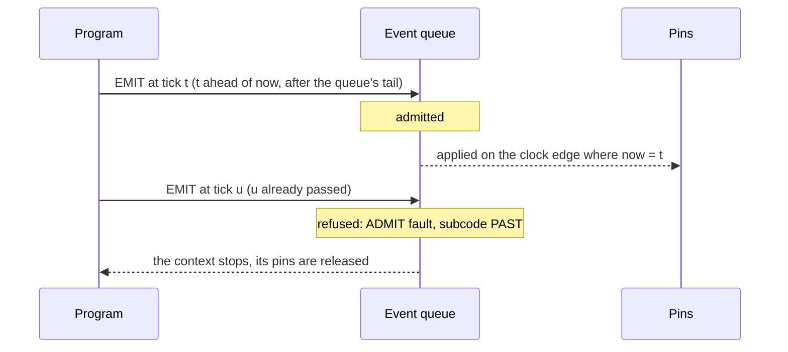
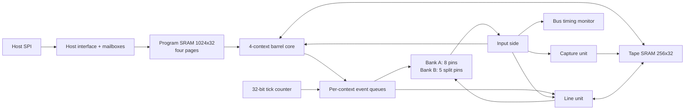

# Escapement: a protocol engine that is never late

Escapement is a programmable protocol engine on IHP's 130 nm SG13CMOS5L process, built
through Tiny Tapeout on 8 × 4 tiles. Four hardware contexts run firmware that schedules pin
changes at absolute clock ticks, and each change is checked at the moment it is
scheduled: if its deadline can still be met it happens on exactly that tick, and if not
the program stops with a fault that names the reason. A late edge is not one of the
possible outcomes. That property is proved formally for every program, for all time, and
the gate-level netlist that goes to fabrication is proved equivalent to the RTL the proof
is about. Around this one guarantee sit 80 firmware programs, from UART and I2C to a USB
keyboard and 10BASE-T Ethernet, a line unit that does the per-bit work of packet
protocols, a capture unit that turns the chip into a logic analyser, and a bus timing
monitor that checks other devices against their datasheets.

## 1. A promise about time

A protocol is mostly a promise about time. A UART at 115,200 baud promises that every bit
lasts 8.68 µs; an I2C target promises to hold its data steady for a minimum time after
the clock falls; a USB device promises to answer a packet within a few bit times. A
microcontroller that speaks a protocol in firmware keeps these promises by being fast
enough on average. When it is not, because an interrupt arrived at the wrong moment or a
loop took one path too many, the edge comes out late, and nothing in the system notices.
The failure is silent, depends on timing that tests rarely reproduce, and is found, if at
all, by the device at the other end.

The competition asked for a chip that emulates protocols. Escapement's answer is to make
time the one thing the hardware is exact about and to leave everything else to firmware.
The chip knows nothing about UART or I2C; it knows how to put a change on a pin at a given
tick, how to check an input at a given tick, and how to refuse a request it cannot honour.
A protocol, or a device nobody planned for, is then a new program rather than a new chip,
and the timing of every program rests on the same small piece of hardware.

## 2. Deciding an edge, and making it

A program never drives a pin. It prepares an **event**, which says what the pins should
become and the tick at which that should happen, and hands it to its context's event
queue. The deadline is absolute, a value of the chip's 32-bit tick counter, not a delay
from "now". This is the choice everything else rests on: an absolute deadline means the
same thing however long the program took to compute it, so the time a program spends
deciding what to do next never leaks into when its edges happen.

The check happens at **admission**, when the event enters the queue. An event is admitted
only if its deadline is strictly after the current tick and strictly after the last event
already queued, and only if it touches pins its context owns. If any rule fails, the event
is not queued, the context stops with a fault whose subcode (PAST, ORDER, OWNER, MASK or
OVERLAP) names the rule, its pins are released, and the other three contexts carry on.
At the other end of the queue, **retirement** applies the head event on the clock edge
whose tick equals its deadline. Because admission has already refused anything that could
not be on time, a head event can never be found past due. The chip still checks for that
case, and the formal proof shows the check can never fire.

The result is that every edge a program asked for either happens on its tick or was
refused, visibly, before it could be late. A program that falls behind its own schedule,
for example because a computation took longer than the gap between two bits, produces a
fault at a known point instead of a stretched bit. The guarantee does not depend on the
program having been analysed; a program nobody has looked at is as safe as one that has
been certified.

Checking a deadline means comparing 32-bit ticks, and at the chip's rated 50 MHz there is
no time to compare and then drive a pin in the same 20 ns cycle. The chip therefore makes
each comparison a cycle early and keeps the answer in a register. That is safe because
the compared values change only at a context's own commit, four cycles before they are
used, and the proofs check, in every cycle that uses one, that the early answer equals the
late one.

## 3. Four programs that cannot disturb one another

The core runs four **contexts**, each with its own program counter, registers and event
queue, in a fixed rotation called a **barrel**: in cycle t the context numbered t mod 4
fetches, and its instruction commits three cycles later. Each context therefore issues one
instruction every four ticks whatever the others do. The barrel is there for isolation
rather than speed. A busy context cannot slow a quiet one and a waiting context leaves its
slot empty, so the instruction timing of a program can be worked out from that program
alone. This is what lets a timing certificate, computed for one program, still hold when
four programs run together. It also makes the pipeline simple: the next instruction of a
context starts only after the previous one has committed, so there are no hazards, no
forwarding and no stalls.

A few protocols want more throughput from one program. When a context's partner is
switched off, **pair mode** lets it use both slots and issue every two ticks, with a fetch
prediction that is checked at commit, so a wrong guess costs an empty slot and never a
wrong result. The program store holds 1,024 words in four **pages** of 256, and each
context fetches from the page its configuration names, so four programs assembled
separately can each start at address 0 with no linking step.

The 13 protocol pins form two **banks**: bank A is the eight bidirectional pins, push-pull
or open-drain, and bank B turns the five dedicated outputs and inputs that the host link
leaves free into split pins. Every instruction refers to eight logical pins, and each
context sees one bank through them, so a firmware module runs on either bank unchanged and
both banks can be busy at once. Each physical pin has one owner context, and admission
refuses a DRIVE on a pin its context does not own. On an open-drain pin the value in an
event is the bus level asked for, so there is no register state that drives an
open-drain pin high, and I2C's "never drive SDA high" rule holds by construction.

The host can stop one context, rewrite its program and restart it while the others run.
A **non-interference proof** compares two copies of the chip that see the same inputs on
everything a context j can observe but differ freely in every command and program word
aimed at the other contexts, and shows that j's commits, state and pins are the same in
both. A program can therefore be swapped beside a running one without moving one of its
edges. The claim has a stated scope, which the host software enforces: j uses none of the
shared units, since another context may own them.

## 4. Work that firmware cannot do bit by bit

Firmware is fast enough for most protocols, but not for all of the per-bit work some of
them ask for, and a chip that knows only time would be a poor instrument. Three units do
what a program cannot do per bit, all on the same timebase and the same queue discipline.

**The line unit.** At 24 MHz a low-speed USB bit lasts 16 ticks, four instructions, and in
that time firmware would have to apply NRZI coding, insert a stuffed bit after six ones
and update a CRC. The line unit does that work for one owner context while the firmware
stays in charge of whole packets. A SEND event starts a packet at its deadline, so a
packet is admitted and retired like any other event. When receiving, the unit takes its
bit strobe from a recovered clock (UART-like, USB, CAN), from a cell decoder for Manchester
codes (10BASE-T) or from an external clock pin (listening to an SPI bus between two other
devices), removes stuffed bits, checks the CRC, writes the bits to the tape and records
the tick on which the packet ended. That end tick is what makes certified replies
possible: the firmware sets its deadline to "end of the host's packet plus a constant", and
the certificate checker proves the constant. A 187-instruction USB keyboard enumerates on
a real Linux kernel through USB/IP with the simulated chip at the other end, and every
reply is proved to leave exactly 72 ticks after the end of the host's packet, which is 75
ticks or 4.69 bit times at the pins, inside USB's 2 to 6.5.

A 10BASE-T bit is 100 ns in two halves, and at 50 MHz one sample per tick cannot tell an
edge at the bit boundary from one in its middle once the standard's jitter is added. The
chip therefore samples every protocol pin on the falling clock edge as well, the only place
it looks at a pin between ticks, and the line unit's decoder places each edge to half a
tick.

**The tape and the capture unit.** A second SRAM, the **tape**, is shared by firmware
loads and stores, the line unit, the capture unit and the host, and none of them ever makes
another wait in a way a program can see. The capture unit writes a record of the pin levels
and the tick whenever a watched pin changes, and the host can read records during a run in
cycles the core leaves free, so a capture streams out for as long as the host keeps up and
a record is never overwritten before it has been read. A capture record has the same shape
as a DRIVE event, levels and a tick, so a recorded waveform replays tick for tick, and on
the Tiny Tapeout demo board PulseView records from the chip through its existing logic
analyser driver.

**The bus timing monitor.** EXPECT lets a program check that another device answers its
own edges in time. The monitor checks traffic between other devices, which the chip only
watches. It holds four rules of one shape, "the next edge of pin B comes at least MIN and
at most MAX ticks after an edge of pin A", which covers setup and hold times, pulse widths,
clock periods and timeouts, and it checks them on every tick of a run without the program
doing anything. Each rule counts its violations, and the first is recorded with its rule,
tick and measured interval. The `i2c_timing` firmware uses it to report an I2C device that
breaks its datasheet. The monitor extends what the chip certifies from its own edges to
other people's.

## 5. Proving the promise

The central claims are proved with SymbiYosys, on properties written into the RTL. The
program memory is a free input of the proofs, so they cover every program anyone will
ever load, and the tick counter may start anywhere, so the 32-bit wrap is reachable.

**Never late.** The statement "no queue head is ever past its deadline" is proved
unbounded by an assume-guarantee split. A per-context proof shows by induction that a
queue fed only with admitted events never has a late head; the core proof shows that every
event the core pushes satisfies those assumptions. The split is drawn so that neither side
assumes what the other proves, and together they cover every reachable state, counter wrap
included. Around this property sit the others the guarantee needs: an open-drain pin is
never driven high, an unowned pin is never driven, a faulted context drives none of its
pins, a commit always belongs to the context that owns the slot, the configuration never
changes during a run, a live program write never touches a running context's fetch, and
each register that holds a decision made a cycle early equals that decision made on time.

**The netlist is the design.** The gate-level netlist from the sign-off flow is proved
sequentially equivalent to the RTL, so the properties hold for what is fabricated and not
only for the source. The clock-gated register banks and the latch banks, which have no
direct RTL counterpart, are proved equal to ordinary enabled flip-flops at every instant,
with a gated clock that cannot glitch.

**Tripwires.** Twelve of the proved properties, among them "never late", "an open-drain pin
is never driven high" and "an unowned pin is never driven", are also built into the silicon
as small monitors that set a sticky flag the first time their property is seen broken. The
proofs say no flag can ever set. Their value is on real silicon, where a manufacturing
defect or a wrong assumption about the environment would appear as a named, broken
property rather than as a puzzling failure.

Every proof runs in continuous integration on each change it depends on, and planted
faults show that the proofs can fail: a proof that passes whatever the design does
proves nothing. In the final run all 100 tasks pass: the 39 unbounded core proofs, six more proofs and four cover checks in one job, the bounded check from reset as 47 tasks covering 67 assertion lines to depth 20 in a second, and the tripwire, line unit and non-interference proofs in a third; 15 planted bugs each make their proof fail.

## 6. Checking the checks

Proofs cover the properties that were written down. The rest of the design is checked by
methods chosen so that each can catch what the others miss.

**Two implementations of one specification.** The machine is defined once, cycle by
cycle, in a normative specification ([11-SEMANTICS](11-SEMANTICS.md)), and implemented
twice: in the RTL and in a Python instruction-set simulator that shares nothing with it but
the instruction encodings. A shared decoder could make two models agree on the same bug,
so execution, timing rules and faults are written separately. A co-simulation runs both
side by side and compares every commit, every register, every pin, the queues and the
memories on every tick. In the final run it compared 191 random programs (19,850 commits; 9 more were too long for a program page) and 74 firmware cases, each against independent bus models, on both the behavioural RTL and the standard-cell build, and found no difference. The simulator is the one in the site's
playground, so what runs in the browser is the model the RTL is held to.

**The digest.** On every clock edge where something happens, the chip folds what happened
into a 32-bit execution digest, and the simulator predicts it exactly. After a run on
silicon, one read over SPI compares the whole run with the model.

**Certificates, and the chip checking them.** A static analyser, `escert`, walks every
path of a firmware and proves a lower bound on how early each event is queued before its
deadline: a program whose bound is positive can never be refused, for any input. The chip
measures the same quantity while it runs, the minimum lead of every context, so the
certificate and the silicon check each other. In the VGA Pong firmware, for example, the
certificate proves that every edge of the video signal is queued at least 1,597 ticks
early in the sync context and 8 ticks early in the picture context, and the simulator, the
RTL, the gate-level netlist and the FPGA all measure exactly 1,597 and 8.
All 80 programs are certified for every input. Across the 74 co-simulated firmware cases, 74 contexts have a finite bound, and the lead measured on the RTL equals the bound in 59 of them and exceeds it in the other 15; it is never below.

**Mutation testing.** To check the tests themselves, faults are planted in the RTL one at
a time across every module and simulated on the PDK's standard-cell models; a fault the
tests do not notice is a hole in the tests. Each surviving fault is read against the RTL
and either closed with a new test, proved to change no output, or excluded with a written
argument. The final campaign planted 1,010 faults: 892 were caught by a test, 57 were proved to change no output, and 61 are excluded with a written argument, most of them reset or start values that nothing reads before they are reloaded. None survives.

**Real devices as oracles.** Models written from datasheets can share a misreading with the
firmware they test. Recordings of real hardware, from a USB Power Delivery charger to a
DS18B20 temperature sensor, an SD card and a model railway's DCC command station, are used
as test oracles instead. They found real bugs: the UART receiver lost a byte sent straight
after a stop bit by an STM32 at 460,800 baud, and the I2C EEPROM firmware, standing in for
a 24LC02B, faulted at clocks below 20 MHz. The second showed the admission rule doing its
job: the firmware was refused with a fault, not run with a late edge. A test that judged I2C
timing from the waveform itself, rather than from the model, found that the RTL and the
simulator both measured monitor intervals one tick short, a bug the lockstep comparison
could never have seen because the two agreed.

**Outside judges.** For every program whose protocol someone else's software can read,
that software reads the pins of its simulated run and must decode what the test asked for:
sigrok's decoders, the IRMP infrared library, Wireshark's dissectors, the rtl_433 receiver
and rc-switch's receiver code. They agree with 72 of the 80 programs, and each judge has a
control: the same recording with one pulse inverted must fail it. The same runs are repeated with every pin
delayed a tick each way, more than a real chip's pads and board add, and every protocol still
works.

## 7. The silicon

Version 3 occupies 8 × 4 Tiny Tapeout tiles, 1724.16 × 710.64 µm, with 37,230 standard
cells, a 1,024 × 32 program store and a 256 × 32 tape, at 61.9% utilisation. The chip is
limited by wiring rather than by cell area: only four metal layers carry signals in a Tiny
Tapeout block on this process, each SRAM blocks three of them over its footprint, and only
one layer runs horizontally for signals. The first 8 × 4 layouts overflowed that layer. The
final floorplan puts both memories in one column on the east side, so the logic is a single
rectangle with no macro across its horizontal paths, and timing-driven placement keeps the
core's commit logic together.

The layout is signed off at 20 ns at all three corners, so the chip is rated for clocks up
to 50 MHz; the worst setup slack at the slow corner is +1.480 ns and the worst hold slack
at the fast corner +0.180 ns. LVS, DRC and antenna checks are clean, the shuttle's precheck
passes, and the CI harden and the local one produce the same netlist bit for bit.

Power follows one rule: pay only for work. Register banks that are not being written do not
see the clock, most of their storage is latches at about half the area of flip-flops, and
each memory is selected only in the cycles that read it. The first netlist spent 93% of its
busy power doing nothing. Version 3 uses 4.42 mW sending a UART and 3.38 mW stopped, at
25 MHz and the typical corner, and what a stopped chip still spends is the clocked storage
that must keep running and the clock tree ([power](15-POWER.md)).

## 8. On the bench

There is no chip yet, so the chip's RTL runs on an FPGA. A Sipeed Tang Primer 25K plays the
chip, with plain flip-flops for the clock gates and latch banks and block RAM for the
memories, and a Raspberry Pi Pico W plays the Tiny Tapeout demo board, running the
repository's bring-up script unchanged through a small shim. The script tests the link,
every memory and every pin, then loads every firmware, runs it, and compares the chip's
digest, state and measured leads with the model's prediction and the certificate.

Version 3's RTL, the same Verilog that was hardened for silicon, passes all six bring-up
stages and 71 of 71 firmware runs (every program at the time, 15 November). The FPGA build differs from the silicon in one place
that matters for timing: the half-tick sampler's falling-edge register is clocked through
an inverter that leaves the FPGA's global clock network, so that bitstream fails two of its
own build checks and was packed by hand for the run ([the bench](https://parthdoom.github.io/escapement/fpga/)).

The same bitstream also talks 10BASE-T Ethernet with a laptop. Only resistors, capacitors and
a patch cable cut open at one end connect the Dock to the laptop's Ethernet port. `eth_tx`
sent 20 of 20 test frames, and the laptop received all of them intact. `eth_rx` received 20
of 20 frames of the laptop's own traffic (DHCP, ARP and multicast), each with a good frame
check sequence. On the receive side an FPGA pin's input threshold stands in for the line
receiver, so the bias network had to be tuned to it. The capture unit made that possible: it
recorded the line's edges at the pin
([the Ethernet bench](../fpga/tangprimer25k/README.md#ethernet-10base-t-2026-11-16)).

On the same bench the chip also debugged a real RP2040 over Serial Wire Debug, as a debug
probe would. The RP2040's debug port is multi-drop: two cores and a rescue port share the
wires, they start dormant, and a probe must wake them and select one. `swd_idcode` gained
both, and the chip read the debug port's ID, the AHB-AP's ID and a word of the boot ROM, from
core 0 and then from core 1. An outside judge watched: the target Pico, running a third-party
logic analyser firmware beside its debug port, recorded the two wires, and sigrok's `swd`
decoder read every access after the wake-up off the wire exactly as the chip reported it,
with each SWCLK phase at the 640 ns the firmware is built for. The control, one SWDIO pulse
inverted, fails the comparison
([the SWD bench](../fpga/tangprimer25k/README.md#swd-the-chip-debugs-an-rp2040-2026-11-17)).

## 9. What it does

The same small set of mechanisms covers a wide range of work, and four examples show its
reach.

**Record it, speak it.** Point the chip at a transmitter it has never seen, such as an
infrared remote. The capture unit records the waveform, `esclearn` works out the protocol's
timing table from the recording, `escgen` turns the table into firmware that `escert`
certifies, and the chip then sends new messages in that protocol, such as a button the
remote never sent. A recording that fits no model is refused with the reason
([20-LEARN](20-LEARN.md)).

**Pong on a monitor.** Two contexts drive a VGA monitor at 640 × 480 and 60 Hz from five
bank B pins: one makes the syncs, the other draws a framebuffer from the tape and runs the
game in the vertical blank. Every edge of the picture has a deadline fixed in advance and
only the colours come from data, so the certificate proves that no edge is ever late
([21-VGA-PONG](21-VGA-PONG.md)).

**Pong on a screen of its own.** On the FPGA bench the same game runs on an SSD1306 OLED
as a small system of four programs, one per context and each on its own page: a display
driver that speaks I2C to the screen, a text layer with its own font, the game, and a menu.
They talk to each other only through queues on the tape, and the host does nothing but
pass on the players' key presses, while every I2C edge stays certified
([23-OLED-PONG](23-OLED-PONG.md)).

**Protocols after the silicon froze.** The design was frozen on 12 November. Nine protocols
were added after it, none of them touching the hardware. Four are timing tables for
`escgen`: Samsung, Sharp and Panasonic infrared, and WS2801 LEDs. Panasonic's table spells
out the manufacturer's fixed bits itself, so the host sends only the rest of the frame.
Five are hand-written:

- an XY2-100 laser-scanner link, in four cooperating contexts;
- SAE J1850 VPW, the GM diagnostic bus;
- an Oregon Scientific weather sensor;
- a FlexRay frame, with both of its CRCs computed on the chip;
- a host for ST's single-wire debug port.

Each got what the earlier programs have: a model written from the specification, planted
bugs its tests must catch, a timing certificate, lockstep runs on the RTL, the pad audit,
and a reader written by someone else, from IRMP to rtl_433.

## 10. Limits

The guarantee is about the chip's own edges. Its inputs pass through two-flop
synchronisers, so an input change reaches the logic two ticks after the clock edge that
samples it, and a pulse shorter than a tick may not be seen at all, as on any synchronous
design; because every input sees the same delay, intervals between input edges are still
measured correctly. The non-interference result holds
within its stated scope, for a context that uses none of the shared units. Certificates
cover the programs they were computed for, and a program without one is still never late,
only possibly refused. The FPGA bench tests the design, its firmware and its host interface
on real pins, not the silicon: the hardened netlist, the clock gates and latch banks and
the SRAM macros are covered by the gate-level suites, the equivalence proofs and timing
sign-off instead.

## 11. How it got here

The first version already had the central idea: four contexts, events with absolute
deadlines, and admission instead of lateness. Each later version added one capability
while keeping that idea intact: the tape, capture and digest; the second pin bank;
streaming capture; the line unit; deadline decisions made a cycle early to reach 50 MHz;
pair mode and live reload with the non-interference proof; program pages and proof
tripwires on the larger die; and, in version 3, the line unit's receive strobes, the
half-tick sampler and the bus timing monitor. [07-STORY](07-STORY.md) tells that history
with the reasons behind each step, and [06-DECISIONS](06-DECISIONS.md) records every
decision with the alternatives that were rejected.
