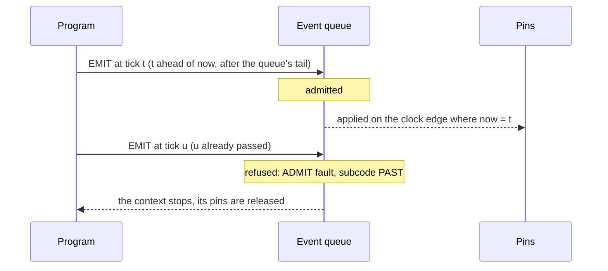
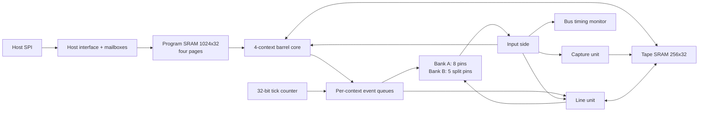
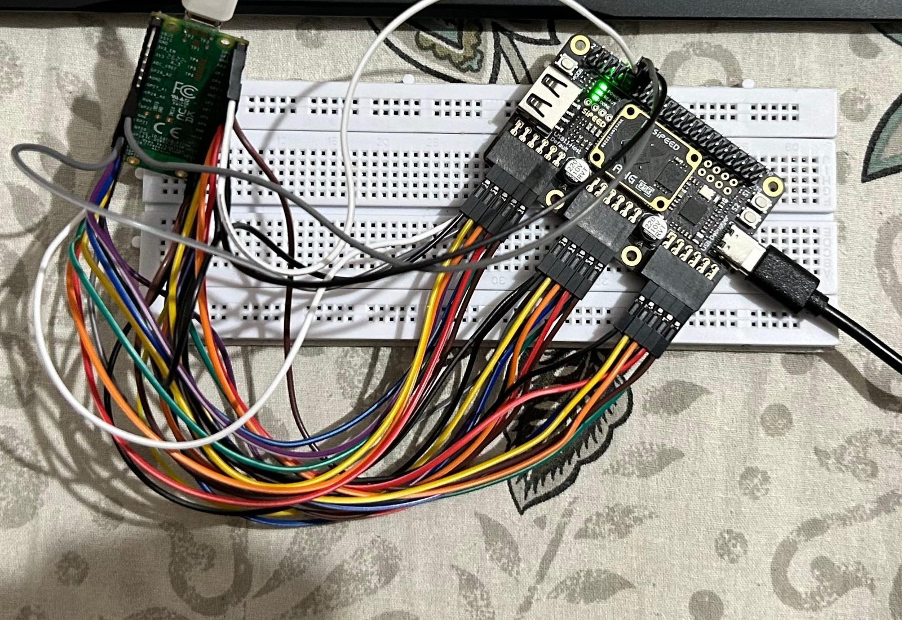
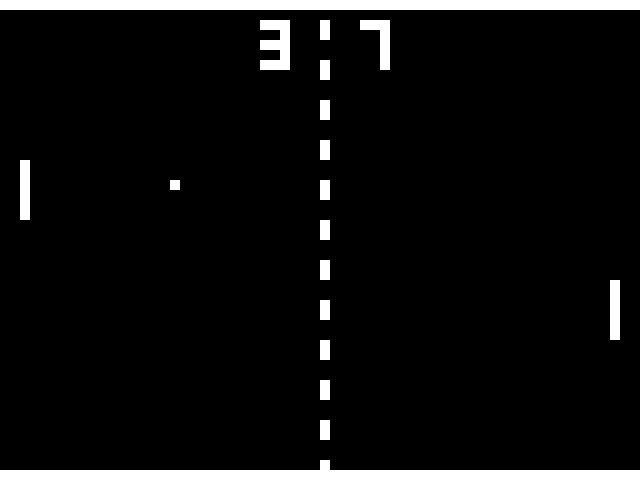
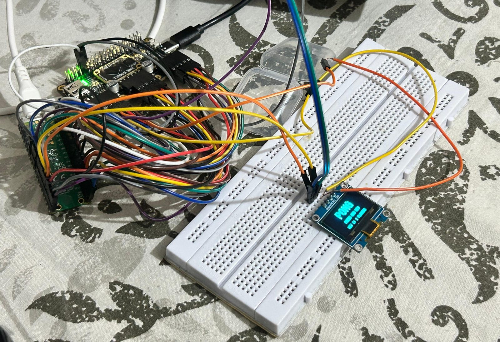
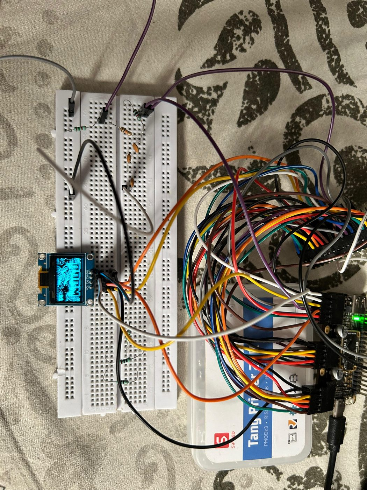

# Escapement: a protocol engine that is never late

Escapement is a programmable protocol engine on IHP's 130 nm SG13CMOS5L process, built
through Tiny Tapeout on 8 × 4 tiles. Four hardware contexts run firmware that schedules pin
changes at absolute clock ticks, and each change is checked at the moment it is
scheduled: if its deadline can still be met it happens on exactly that tick, and if not
the program stops with a fault that names the reason. A late edge is not one of the
possible outcomes. That property is proved formally for every program, for all time, and
the gate-level netlist that goes to fabrication is proved equivalent to the RTL the proof
is about. Around this one guarantee sit 82 firmware programs, from UART and I2C to a USB
keyboard and 10BASE-T Ethernet, and three units for what firmware cannot do bit by bit: a
line unit, a capture unit and a bus timing monitor. On an FPGA build of the same RTL, the
chip has answered a laptop's ping, typed into it as a USB keyboard, and been DOOM's display
and sound processor.

## 1. A promise about time

A protocol is mostly a promise about time. A UART at 115,200 baud promises that every bit
lasts 8.68 µs; an I2C target promises to hold its data steady for a minimum time after
the clock falls; a USB device promises to answer a packet within a few bit times. A
microcontroller that speaks a protocol in firmware keeps these promises by being fast
enough on average. When it is not, because an interrupt arrived at the wrong moment or a
loop took one path too many, the edge comes out late and nothing notices: the failure
depends on timing that tests rarely reproduce, and is found, if at all, by the device at
the other end.

The competition asked for a chip that emulates protocols. Escapement's answer is to make
time the one thing the hardware is exact about and to leave everything else to firmware.
The chip knows nothing about UART or I2C; it knows how to put a change on a pin at a given
tick, how to check an input at a given tick, and how to refuse a request it cannot honour.
A protocol, or a device nobody planned for, is then a new program rather than a new chip,
and the timing of every program rests on the same small piece of hardware.

## 2. Deciding an edge, and making it

A program never drives a pin. It prepares an **event**, which says what the pins should
become and the tick at which that should happen, and hands it to its context's event
queue. The deadline is absolute, a value of the chip's 32-bit tick counter, not a delay
from "now". This is the choice everything else rests on: an absolute deadline means the
same thing however long the program took to compute it, so the time a program spends
deciding what to do next never leaks into when its edges happen.

The check happens at **admission**, when the event enters the queue. An event is admitted
only if its deadline is strictly after the current tick and strictly after the last event
already queued, and only if it touches pins its context owns. If any rule fails, the event
is not queued, the context stops with a fault whose subcode (PAST, ORDER, OWNER, MASK or
OVERLAP) names the rule, its pins are released, and the other three contexts carry on.
At the other end of the queue, **retirement** applies the head event on the clock edge
whose tick equals its deadline. Because admission has already refused anything that could
not be on time, a head event can never be found past due. The chip still checks for that
case, and the formal proof shows the check can never fire.

Every edge a program asks for therefore either happens on its tick or is refused, visibly,
before it can be late. A program that falls behind its own schedule, because a computation
took longer than the gap between two bits, faults at a known point instead of sending a
stretched bit, and this holds whether or not anyone has analysed the program.

At the rated 50 MHz there is no time to compare two 32-bit ticks and then drive a pin
within one 20 ns cycle, so the chip makes each comparison a cycle early and keeps the
answer. The compared values change only at the context's own commit, four cycles before
the answer is used, and the proofs check that every early answer equals the one made on
time.

## 3. Four programs that cannot disturb one another

The core runs four **contexts**, each with its own program counter, registers and event
queue, in a fixed rotation called a **barrel**: in cycle t the context numbered t mod 4
fetches, and its instruction commits three cycles later. Each context therefore issues one
instruction every four ticks whatever the others do. The barrel is there for isolation
rather than speed: a busy context cannot slow a quiet one, so the timing of a program can be
worked out from that program alone, and a certificate computed for one program still holds
when four run together. It also keeps the pipeline free of hazards and stalls, since a
context's next instruction starts only after its previous one commits.

A few protocols want more throughput from one program. When a context's partner is
switched off, **pair mode** lets it use both slots and issue every two ticks, with a fetch
prediction that is checked at commit, so a wrong guess costs an empty slot and never a
wrong result. The program store holds 1,024 words in four **pages** of 256, and each
context fetches from the page its configuration names, so four programs assembled
separately can each start at address 0 with no linking step. A program too long for one
page can **span** its partner's page as well, when that partner is off.

The 13 protocol pins form two **banks**: bank A is the eight bidirectional pins, push-pull
or open-drain, and bank B turns the five dedicated outputs and inputs that the host link
leaves free into split pins. Each context sees one bank through eight logical pins, so a
firmware module runs on either bank unchanged, and which logical pin it uses is an
assembler parameter, so a board's pinout ([info](info.md)) changes settings, not code.
Each physical pin has one owner context, and admission refuses a DRIVE on a pin its
context does not own. On an open-drain pin an event names the bus level it wants, so no
register state can drive the pin high, and I2C's "never drive SDA high" rule holds by
construction.

The host can stop one context, rewrite its program and restart it while the others run.
A **non-interference proof** compares two copies of the chip that see the same inputs on
everything a context j can observe but differ freely in every command and program word
aimed at the other contexts, and shows that j's commits, state and pins are the same in
both. A program can therefore be swapped beside a running one without moving one of its
edges. The claim has a stated scope, which the host software enforces: j uses none of the
shared units, since another context may own them.

## 4. Work that firmware cannot do bit by bit

Firmware is fast enough for most protocols, but not for all of the per-bit work some of
them ask for, and a chip that knows only time would be a poor instrument. Three units do
what a program cannot do per bit, all on the same timebase and the same queue discipline.

**The line unit.** At 24 MHz a low-speed USB bit lasts 16 ticks, four instructions: too few
for firmware to apply NRZI coding, stuff a bit after six ones and update a CRC. The line
unit does that work for one context while the firmware stays in charge of whole packets,
and a SEND event starts a packet at its deadline like any other event. When receiving, the
unit recovers the bit clock (UART-like, USB, CAN), decodes Manchester cells (10BASE-T) or
follows an external clock pin (listening to an SPI bus between two other devices). It
removes stuffed bits, checks the CRC, writes the bits to the tape and records the tick on
which the packet ended. That tick makes certified replies possible: the firmware sets its
deadline to "end of the host's packet plus a constant", and the certificate checker
proves the constant. A 187-instruction USB keyboard enumerates on a Linux kernel through
USB/IP and on a laptop's USB port, and every reply is proved to leave 72 ticks after the
host's packet ends, 4.69 bit times at the pins, inside USB's 2 to 6.5.

A 10BASE-T bit is 100 ns in two halves, and at 50 MHz one sample per tick cannot tell an
edge at the bit boundary from one in its middle once the standard's jitter is added. Every
protocol pin is therefore also sampled on the falling clock edge, and the decoder places
each edge to half a tick.

**The tape and the capture unit.** A second SRAM, the **tape**, is shared by the firmware,
the line unit, the capture unit and the host, and none of them ever makes another wait in a
way a program can see. The capture unit records the pin levels and the tick whenever a
watched pin changes, and the host reads records during a run, so a capture streams for as
long as the host keeps up. A record has the same shape as a DRIVE event, so a recorded
waveform replays tick for tick, and PulseView records from the chip through its existing
logic analyser driver.

**The bus timing monitor.** EXPECT lets a program check that another device answers its
own edges in time; the monitor checks traffic between other devices, which the chip only
watches. Its four rules share one shape, "the next edge of pin B comes at least MIN and at
most MAX ticks after an edge of pin A", which covers setup and hold times, pulse widths,
clock periods and timeouts, checked on every tick with no help from the program. The
`i2c_timing` firmware uses it to report an I2C device that breaks its datasheet.

## 5. Proving the promise

The central claims are proved with SymbiYosys, on properties written into the RTL. The
program memory is a free input of the proofs, so they cover every program anyone will
ever load, and the tick counter may start anywhere, so the 32-bit wrap is reachable.

**Never late.** The statement "no queue head is ever past its deadline" is proved
unbounded by an assume-guarantee split. A per-context proof shows by induction that a
queue fed only with admitted events never has a late head; the core proof shows that every
event the core pushes satisfies those assumptions. The split is drawn so that neither side
assumes what the other proves, and together they cover every reachable state, counter wrap
included. Around it sit the other properties the guarantee needs, among them that an
open-drain pin is never driven high, a faulted context drives none of its pins, a live
program write never touches a running context's fetch, and every decision made a cycle
early equals the one made on time.

**The netlist is the design.** The gate-level netlist from the sign-off flow is proved
sequentially equivalent to the RTL, so the properties hold for what is fabricated and not
only for the source. The clock-gated register banks and the latch banks, which have no
direct RTL counterpart, are proved equal to ordinary enabled flip-flops at every instant,
with a gated clock that cannot glitch.

**Tripwires.** Twelve of the proved properties, never late among them, are also built into
the silicon as small monitors that set a sticky flag the first time their property is seen
broken. The proofs say no flag can ever set. On real silicon, a manufacturing defect or a
wrong assumption about the environment would then appear as a named, broken property
rather than as a puzzling failure.

Every proof runs in continuous integration on each change it depends on, and planted
faults show that the proofs can fail, since a proof that passes whatever the design does
proves nothing. In the final run all 110 proof tasks pass, and each of 15 planted bugs
makes its proof fail.

## 6. Checking the checks

Proofs cover the properties that were written down. The rest of the design is checked by
methods chosen so that each can catch what the others miss.

**Two implementations of one specification.** The machine is defined once, cycle by
cycle, in a normative specification ([11-SEMANTICS](11-SEMANTICS.md)), and implemented
twice: in the RTL and in a Python instruction-set simulator that shares nothing with it but
the instruction encodings, so the two cannot agree on a bug through shared code. A
co-simulation runs both side by side and compares every commit, register, pin, queue and
memory on every tick. In the final run it compared 191 random programs and 76 firmware
cases, each against independent bus models, on both the behavioural RTL and the
standard-cell build, and found no difference.

**The digest.** On every clock edge where something happens, the chip folds what happened
into a 32-bit execution digest, and the simulator predicts it exactly. After a run on
silicon, one read over SPI compares the whole run with the model.

**Certificates, and the chip checking them.** A static analyser, `escert`, walks every
path of a firmware and proves a lower bound on how early each event is queued before its
deadline: a program whose bound is positive can never be refused, for any input. The chip
measures the same quantity while it runs, the minimum lead of every context, so the
certificate and the silicon check each other. In the VGA Pong firmware, for example, the
certificate proves that every edge of the video signal is queued at least 1,597 ticks
early in the sync context and 8 ticks early in the picture context, and the simulator, the
RTL, the gate-level netlist and the FPGA all measure exactly 1,597 and 8. All 82 programs
are certified for every input, and in the co-simulated cases the lead the RTL measures
equals the bound in 59 of 76 contexts and exceeds it in the rest; it is never below.

**Planted timing bugs.** A checker that accepted everything would pass that test too, so
escert is attacked the way the RTL's tests are. A campaign plants the timing bugs firmware
authors make, one at a time in each shipped program (a wait deleted, a delay cut to a
quarter, a branch inverted), and attacks each mutant on the simulator with random inputs,
its bus models and a host that never pauses. Of 729 mutants, escert certified 533, none of
which faulted under any search; refuted 178, each with inputs that reproduce the fault; and
could not decide 18, which are never counted as safe. A certificate is about timing, not
function: 121 of the certified mutants still break their protocol, and the bus models catch
them. The campaign also found three bugs in escert itself.

**Mutation testing.** To check the tests themselves, faults are planted in the RTL one at
a time across every module and simulated on the PDK's standard-cell models; a fault the
tests do not notice is a hole in the tests, to be closed with a new test, proved to change
no output, or excluded with a written argument. The final campaign planted 1,017 faults:
902 were caught by a test, 57 were proved to change no output, and 58 are excluded, most
of them reset or start values that nothing reads before they are reloaded. None survives.

**Real devices as oracles.** Models written from datasheets can share a misreading with the
firmware they test, so recordings of real hardware, from a USB Power Delivery charger to an
SD card and a model railway's command station, serve as oracles too. They found real bugs:
the UART receiver lost a byte sent straight after a stop bit at 460,800 baud, and the I2C
EEPROM firmware faulted at clocks below 20 MHz, refused by admission rather than run late.

**Outside judges.** For every program whose protocol someone else's software can read,
that software reads the pins of its simulated run and must decode what the test asked for:
sigrok's decoders, the IRMP infrared library, Wireshark's dissectors, the rtl_433 receiver
and rc-switch's receiver code. They agree with 74 of the 82 programs, and each judge has a
control: the same recording with one pulse inverted must fail it. The same runs are
repeated with every pin delayed by up to three ticks each way, more than a real chip's pads
and board add, and every protocol still works.

## 7. The silicon

Version 3.1 occupies 8 × 4 Tiny Tapeout tiles, 1724.16 × 710.64 µm, with 38,514 standard
cells, a 1,024 × 32 program store and a 256 × 32 tape, at 62.6% utilisation. It is limited
by wiring, not cell area: in a Tiny Tapeout block on this process four metal layers carry
signals, one of them horizontally, and each SRAM blocks three of them over its footprint. The first 8 × 4 layouts overflowed the horizontal layer, so the final
floorplan puts both memories in one column on the east side and leaves the logic a single
rectangle with no macro across its horizontal paths.

The layout is signed off at 20 ns at all three corners, so the chip is rated for clocks up
to 50 MHz. The slow corner passes setup down to 16.6 ns, which makes 60 MHz possible, though
not yet rated, and the worst hold slack, at the fast corner, is +0.098 ns. Every electrical
rule is met at every corner, after trial hardens traced version 3.0's slew and capacitance
violations to a repair step that underestimated wire loads and judged slew only at the fast
corner. LVS, DRC and antenna checks are clean, the shuttle's precheck passes, and the CI
harden and the local one produce the same netlist bit for bit.

Power follows one rule: pay only for work. Register banks that are not being written do not
see the clock, most of their storage is latches at about half the area of flip-flops, and
each memory is selected only in the cycles that read it. The first netlist spent 93% of its
busy power doing nothing. Version 3.1 uses 4.42 mW sending a UART and 3.36 mW stopped, at
25 MHz and the typical corner; what a stopped chip still spends goes to the storage that
must stay clocked and to the clock tree ([power](15-POWER.md)).

## 8. On the bench

There is no chip yet, so the chip's RTL runs on an FPGA. A Sipeed Tang Primer 25K plays the
chip, and a Raspberry Pi Pico W plays the Tiny Tapeout demo board, running the repository's
bring-up script unchanged through a small shim. The script tests the link, every memory and every pin, then runs
every firmware and compares the chip's digest, state and measured leads with the model's
prediction and the certificate.

Version 3.1's RTL, the same Verilog that was hardened for silicon, runs 80 of the 82
programs, all but the 14-second `westminster` chime, which has no bench bundle, and
`pwm_audio`, which has run on the bench as the DOOM console's sound (section 9), and every
one matches the reference model and stays within its timing certificate, `modbus_full`
spanning two pages among them (21 and 22 November)
([the bench](https://parthdoom.github.io/escapement/fpga/)).

The same bitstream talks 10BASE-T Ethernet with a laptop through resistors, capacitors and
a patch cable cut open at one end. `eth_tx` sent 20 of 20 frames intact, `eth_rx` received
the laptop's own traffic with a good check sequence on every frame, and `eth_trx` answered
its ARP requests and pings, with the Pico as the IP stack; the capture unit, recording the
line at the pin, showed how to bias an FPGA input to serve as the line receiver
([the Ethernet bench](../fpga/tangprimer25k/README.md#ethernet-10base-t-2026-11-16)).

The chip also debugged a real RP2040 over Serial Wire Debug: `swd_idcode` woke its
multi-drop port, selected each core and read the debug port's ID, the AHB-AP's ID and a word
of the boot ROM, and sigrok's `swd` decoder, reading a third-party analyser's recording,
saw every access exactly as the chip reported it
([the SWD bench](../fpga/tangprimer25k/README.md#swd-the-chip-debugs-an-rp2040-2026-11-17)).
And with no USB hardware, `usb_hid` enumerated on a laptop's USB port through two resistors
and typed the line it was given, a number drawn on the laptop for each run, exactly, in six
runs out of six ([the USB bench](../fpga/tangprimer25k/README.md#usb-keyboard-2026-11-22)).

## 9. What it does

The same small set of mechanisms covers a wide range of work, and four examples show its
reach.

**Record it, speak it.** Point the chip at a transmitter it has never seen, such as an
infrared remote. The capture unit records the waveform, `esclearn` works out the protocol's
timing table, `escgen` turns the table into certified firmware, and the chip then sends new
messages in that protocol, such as a button the remote never sent. The same table gives a
receiver, which reads frames that were never recorded, and a recording that fits no model
is refused with the reason ([20-LEARN](20-LEARN.md)).

**Pong, on two screens.** Two contexts drive a VGA monitor at 640 × 480 and 60 Hz from five
bank B pins: one makes the syncs, the other draws a framebuffer from the tape and runs the
game in the vertical blank. Only the colours come from data, so the certificate proves that
no edge is ever late ([21-VGA-PONG](21-VGA-PONG.md)). On the FPGA bench the same game runs on
an SSD1306 OLED as four programs, a display driver, a text layer, the game and a menu, which
talk only through queues on the tape ([23-OLED-PONG](23-OLED-PONG.md)).

**DOOM, with the chip as its input/output processor.** A Raspberry Pi Pico W runs the
shareware DOOM and hands every frame and sound to the chip over the host link. One context
streams the frames to the OLED over I2C, a second plays the sound as pulse-width modulation
into a laptop's headset jack, a third checks the I2C bus and a fourth can record the sound
pin. The host pushes only into mailboxes with room, and in a three-minute run 523,797 words
went over the link with none lost. It needed two pieces of firmware and no hardware: a PWM
sound player with every edge certified, and a stream mode that lets the I2C writer send a
frame from the mailbox while the host renders the next ([25-DOOM-CONSOLE](25-DOOM-CONSOLE.md)).

**Protocols without new hardware.** Version 3's hardware was complete on 14 November.
Since then OLED Pong, an I2C burst writer, the DOOM console's sound player and nine more
protocols have been added with no hardware change: four timing tables for `escgen` (Samsung, Sharp and
Panasonic infrared, WS2801 LEDs) and five hand-written programs, from an XY2-100
laser-scanner link in four cooperating contexts to a FlexRay frame with both of its CRCs
computed on the chip. Each got what the earlier programs have: a model written from the
specification, planted bugs, a certificate, lockstep runs on the RTL, the pad audit and an
outside reader. Version 3.1's one new capability, span, came for a Modbus device with its
whole data model, and every earlier program runs on it unchanged.

## 10. Limits

The guarantee is about the chip's own edges. Its inputs pass through two-flop
synchronisers, so an input change reaches the logic two ticks late and a pulse shorter than
a tick may not be seen, as on any synchronous design; every input sees the same delay, so
intervals between input edges are still measured correctly. The non-interference result holds within its stated scope, for a
context that uses none of the shared units. Certificates cover the programs they were
computed for, and a program without one is still never late, only possibly refused. The
FPGA bench tests the design, its firmware and its host interface on real pins, not the
silicon: the hardened netlist, the clock gates and latch banks and the SRAM macros are
covered by the gate-level suites, the equivalence proofs and timing sign-off instead.

## 11. Check it yourself

`make quickstart` takes one program from its source to the chip's RTL in about a minute. It
assembles `uart_tx`, certifies it, runs it on the simulator, lets sigrok's UART decoder read
the pin, asks for a schedule the program cannot keep and shows it refused, then loads the
program into the RTL over the SPI host port and compares the chip's execution digest with
the simulator's. Each headline claim above rests on a check that runs in continuous
integration and can be rerun:

| Claim | Checked by | Rerun |
| --- | --- | --- |
| No edge is ever late, for every program | the unbounded core proof, one PDR task per assertion group (`formal/esc_core.sby`) | `make formal` |
| The proofs can fail | 15 planted bugs, each of which must make its proof fail (`formal/teeth.sh`) | `make formal-teeth` |
| The fabricated netlist is the design | sequential equivalence of the sign-off netlist and the RTL (`formal/equiv.sh`) | `make equiv` |
| A program can be swapped beside a running one | the non-interference proof (`formal/esc_ni_ind.sby`) | `make formal-v2` |
| The RTL is the machine the specification defines | lockstep co-simulation against the instruction-set simulator | `make cosim-parallel` |
| Every program is certified, and the chip measures the bound | `escert`, and each bound beside the lead the RTL measures | `make cert proof-table` |
| The certificate checker refuses what can fault | 729 planted firmware timing bugs | `make fw-mutants` |
| The tests notice a broken design | 1,017 planted RTL faults | `make mutation` |
| The programs speak the protocol, not our model of it | decoders written by other people, each with a control that must fail | `make judges` |
| The protocols survive pad and board delays | every case with its pins up to three ticks slower each way | `make pad-audit` |
| The layout meets 20 ns and every electrical rule at every corner | the CI harden's sign-off reports, summarised in [physical design](03-PHYSICAL-DESIGN.md#sign-off-results) | `make harden` |
| It runs on real pins | the FPGA bench: six bring-up stages, every program, Ethernet, SWD and USB with real equipment, and the DOOM console | [the bench](../fpga/tangprimer25k/README.md) |

[Verification](04-VERIFICATION.md) gives each result in full, the workflow that produces it
and how long it takes; the [results page](https://parthdoom.github.io/escapement/#results)
shows the latest run of each on master.

## 12. How it got here

The first version already had the central idea, and each later one added a capability
while keeping it intact. [07-STORY](07-STORY.md) tells that history with the reasons behind
each step, and [06-DECISIONS](06-DECISIONS.md) records every decision with the alternatives
that were rejected.
