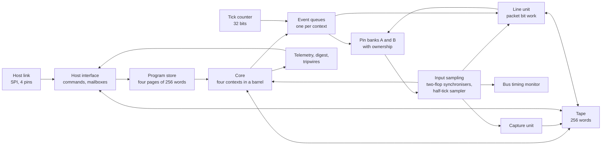

# Architecture

This chapter is a guided tour of the machine. It explains what each block does, why it is
built that way, and how the blocks share one sense of time. The exact, cycle-by-cycle
definition of every behaviour described here is in [11-SEMANTICS](11-SEMANTICS.md).

## The problem, and the one idea

A protocol is mostly a promise about time. A UART at 115,200 baud promises that each bit
lasts 8.68 µs. An I2C target promises to hold its data line steady for a minimum time
after the clock falls. A USB device promises to answer a packet within a fixed number of
bit times. A chip that speaks many protocols in firmware, as a microcontroller does when
it bit-bangs, has to keep all of these promises at once, and it usually keeps them by
being fast enough on average. When it is not fast enough, for example because an
interrupt arrived at the wrong moment, the edge simply comes out late, and nothing in the
system notices.

Escapement is built around a different arrangement. A program never drives a pin
directly. Instead it prepares an **event**, which says what the pins should become and the
exact clock tick at which that should happen, and hands the event to a small timing unit.
The timing unit checks the event at the moment it is handed over. If the event can still
happen on time, it is **admitted** and is applied on exactly that tick. If it cannot,
because its tick has already passed or is out of order with the events before it, it is
**refused**, and the program stops with a fault that names the reason. There is no third
outcome: an admitted event is never late. This property is proved formally, for every
program, in [04-VERIFICATION](04-VERIFICATION.md).

The rest of the chip is built around that one idea. Checking an input, sampling a bit,
recording a waveform and measuring the chip's own timing all use the same timebase and
the same queue discipline. The result is a chip that "knows time, not protocols": UART,
SPI, I2C, CAN, USB and the rest are all firmware, and a protocol nobody planned for is a
new program rather than a new chip.

## A tour in one picture

Reading the picture from left to right: a **host**, such as a microcontroller or a PC
with a USB-to-SPI adapter, loads programs into the **program store** and starts them. The
**core** runs four programs at once, one per **context**. Each program turns its work into
events, which wait in its own **event queue** until the **tick counter** reaches their
deadlines, and then change the **pins**. Everything that comes back from the pins passes
through **input sampling** before any part of the chip looks at it. Alongside the core sit
four helpers that share the same timebase: the **tape**, a second memory for data and
recordings; the **capture unit**, which records pin changes onto the tape; the **line
unit**, which does the per-bit work of packet protocols such as USB, CAN and Ethernet; and
the **bus timing monitor**, which checks the timing of traffic between other devices.
Finally, the chip measures itself, and the host can read those measurements at any time.

The sections below take these blocks one at a time.

## Time

The chip has one clock and one 32-bit **tick counter**, `now`, which counts clock cycles
from the start of a run. Every deadline in the machine is an absolute value of this
counter, not a delay relative to "now". This choice is what makes the guarantee
possible: an absolute deadline means the same thing however long the program took to
compute it, so the time a program spends deciding what to do next never leaks into when
its edges happen.

At the default clock of 25 MHz a tick is 40 ns; the chip is rated for clocks up to 50 MHz,
where a tick is 20 ns. The counter wraps after 2^32 ticks (171.8 s at 25 MHz), so a
deadline is accepted only if it lies less than half the counter's range ahead (85.9 s at
25 MHz, 42.9 s at 50 MHz). Within that horizon, "before" and "after" are always
unambiguous, even across a wrap.

## The core: four programs, no interference

### The barrel

The core runs four **contexts**, each with its own program counter, registers and event
queue. They take turns in a fixed rotation called a **barrel**: in clock cycle t, the
context numbered t mod 4 fetches its next instruction, and that instruction **commits**
(takes effect) three cycles later. So each context issues one instruction every four
ticks, whatever the other three are doing.

The point of the barrel is isolation rather than speed. Because each context owns fixed
slots, a busy context cannot slow down a quiet one, and a waiting context leaves its slot
empty rather than lending it out. The instruction timing of any one program can therefore
be worked out from that program alone, and this is what lets a timing certificate be
computed per program and still hold when four programs run together. A second benefit is
simplicity: since the next instruction of a context starts only after the previous one
has committed, there are no hazards between instructions, no forwarding paths and no
stalls.

Each context holds four 32-bit general registers `r0`-`r3`; a 32-bit shift register
`sh` for serialising and deserialising bits; a 16-bit loop counter `lc`; the 32-bit
deadline register `tmr`, from which every event takes its tick; an 8-bit program counter
and link register; the flags Z and C; and a 32-bit input shift register `ish`, which the
SAMPLE events of the next section fill.

Some instructions have to wait for something: WAITT for a tick, WAITP for a pin level,
POP for a mailbox word, an event instruction for space in its queue. A waiting
instruction keeps its program counter and is simply tried again at the context's next
slot, four ticks later. That makes the completion time of a wait accurate only to four
ticks, which is why anything that must happen on an exact tick goes through an event
instead.

### Pair mode

Four ticks per instruction is enough for most protocols, but a few need more instruction
throughput in a single program. When a context's **partner**, the context numbered
k XOR 2, is switched off for a run, the configuration can let context k use its
partner's slots as well. It then issues every two ticks instead of four. In this **pair
mode** the context fetches its next instruction while the previous one is still in
flight, so the fetch address is a prediction. The prediction is exact for every
instruction whose next address is known in time, including branches, and the machine
checks at commit time that each instruction was fetched from the right address. A wrong
guess therefore costs an empty slot, never a wrong result.

### Program pages

The program store holds 1,024 words of 32 bits, divided into four **pages** of 256 words.
Each context fetches from the page its configuration names, and its 8-bit program counter
selects a word within that page. With one page per context, four programs written and
assembled separately can each start at address 0 and use a full 256 words, with no
linking step and no risk of one overwriting another. Several contexts may also share a
page, for example two contexts running cooperating halves of one program. Every
instruction encoding and branch target is the same with or without pages; only the
store's address is wider.

A program longer than one page can **span** two. A context whose partner (the context it
would pair with) is switched off may take the partner's page as well as its slots. Its
program counter and link register then have 9 bits: bit 8 selects the partner's page, so
the program has 512 words and runs straight on from word 255 to word 256, and branch
targets reach the whole range. Span is enabled per context and is independent of pair
mode, so a context can take its partner's page, its slots or both. A context that does not
span behaves exactly as before, its execution digest included (D-64). `modbus_full`, a
419-word Modbus RTU device, is the library's spanning program.

The store is a single-port IHP SRAM macro. It is read only in cycles where a running
context actually fetches, so it costs no read energy while the contexts wait.

## Events: how an edge is scheduled

An **event** is an entry in a context's queue that has a deadline, taken from the
context's `tmr` register, and a job to do at that deadline. Each context's queue holds
four events, and there are four kinds:

| Kind | Made by | What happens at the deadline |
| --- | --- | --- |
| DRIVE | EMIT, EMITR, EMITX | The masked pins take their new values and output enables, all on the same tick |
| EXPECT | EXPECT | The context's checker starts watching the masked inputs: they must **hold** a level for a window, or **arrive** at it within the window (up to 127 ticks) |
| SAMPLE | SAMPLE | One synchronised input bit is shifted into `ish` |
| LINE | SEND | The line unit starts sending a packet |

A typical transmitter therefore looks like this: compute the next bit, advance `tmr` by
one bit time, and EMIT the bit. The program runs ahead of the pins, filling the queue,
and the queue releases each bit on its exact tick.

**Admission** is the moment of decision. When an event instruction commits, the event is
checked before it enters the queue. It is accepted only if all of the following hold:
the queue has space (otherwise the instruction waits, which is harmless); a DRIVE names
at least one pin, and only pins the context owns; the deadline is strictly after the
current tick and strictly after the last event already in the queue; and, for an EXPECT,
its window does not overlap the previous one. If any of these fails, the event is not
queued, nothing changes, and the context stops with an ADMIT fault whose subcode (MASK,
OWNER, PAST, ORDER or OVERLAP) says which rule it broke. Its pins are released, and the
other three contexts carry on untouched.

**Retirement** is the other end of the queue. On the clock edge whose tick equals the
deadline of the event at the head of the queue, that event is applied. Because admission
already refused anything that could not be on time, a head event can never be found
already past due. The chip still checks for that case and would report it as a
LATE_HEAD fault, but the formal proof shows the check can never fire.

Both decisions involve comparing 32-bit ticks, and at 50 MHz there is no time to make
such a comparison and then drive a pin within the same cycle. The chip therefore makes
each comparison one cycle early and keeps the answer in a register. This is safe because
the values being compared change only at a context's own commit, four cycles before they
are used, so the early answer is always the same as a late one would be. The proofs check
this equality in every cycle where the answer is used.

## Pins

### Two banks, one view

The chip has 13 protocol pins in two **banks**. Bank A is the eight bidirectional pins
`uio[7:0]`, each of which can be push-pull or open-drain. Bank B uses the dedicated inputs
and outputs that the host link leaves free: five outputs `uo_out[7:3]` paired with five
inputs `ui_in[7:3]`, so each bank B pin is a split pin with a separate wire for each
direction. Altogether that is 18 protocol signals.

Every instruction refers to eight **logical** pins, and each context is configured to see
one bank as those eight pins. The translation sits at the edge of the core, so decoding,
admission and the event queues are identical for both banks. As a result, a firmware
module written for bank A runs on bank B unchanged, and both banks can be busy at once:
the example program `combo_two_banks.asm` runs PS/2 and JTAG on bank A while SPI and UART
run on bank B, eleven signals at the same time.

Each physical pin has at most one **owner** context, set while the chip is stopped. Only
the owner can drive a pin, and admission enforces this for every DRIVE event. A context
that faults releases its pins, so a broken program cannot hold a bus.

On an **open-drain** pin, the value in an event is the bus level being asked for: 0
pulls the line low and 1 lets it go. There is no way to drive an open-drain pin high from
any register state, so I2C's "never drive SDA high" rule holds by construction, and
firmware never needs to invert data before sending it.

### Seeing the inputs

Signals from outside the chip can change at any moment, not just on clock edges. Every
input therefore passes through a **two-flop synchroniser**, which makes it safe to use
inside the clocked logic at the cost of two ticks of delay. Every feature that reads
inputs (WAITP, GETP, EXPECT, SAMPLE, the capture unit and the bus monitor) sees the same
synchronised view. Because they all see it with the same delay, the delay cancels out
whenever the chip measures one input edge against another.

One block needs a finer view. A 10BASE-T Ethernet bit lasts 100 ns and is split into two
50 ns halves; at 50 MHz, one sample per 20 ns tick is too coarse to tell an edge at the
bit boundary from one in the middle of the bit, once the standard's allowed jitter is
added. The chip therefore also samples every protocol pin on the **falling** clock edge
and passes that sample through its own synchroniser. The line unit's decoder can then
place each edge to within half a tick (10 ns at 50 MHz). This **half-tick sampler** is the
only place the chip looks at a pin between ticks, and only the line unit uses it.

## The tape and the capture unit

The **tape** is a second SRAM of 256 words of 32 bits. It has three users, and none of
them ever makes another wait in a way firmware can see.

- **Firmware** reads and writes it with LDT and STT. A context uses the tape only in its
  own commit cycle, and only one context commits per cycle, so two programs never collide
  on it.
- The **capture unit** records pin changes. When a watched pin changes, it writes a
  32-bit record holding the eight pin levels and the low 24 bits of the tick, into a
  region of the tape that the program chooses, used as a linear buffer or as a ring. A
  small two-record buffer lets these writes slip into any cycle in which no program is
  using the tape. If the buffer would ever overflow, capture stops and records when it
  stopped, so a recording is never silently missing a change. Every 2^24 ticks it also
  writes an "epoch" record, so absolute time can be rebuilt from the records alone.
- The **host** writes the tape only while the chip is stopped, but can read it at any
  time, in cycles the core does not need. In streaming mode the host acknowledges each
  record it has read, and the capture unit never overwrites a record that has not been
  acknowledged. A capture can therefore stream to the host for as long as the host keeps
  up.

The tape is a deliberate generalisation. One memory serves as a device's storage (an
EEPROM's contents, for example), as a logic analyser's buffer and as the source of a
replay. A capture record even has the same shape as a DRIVE event, levels and a tick, so
a recorded waveform can be played back tick for tick by adding an offset.
[13-TAPE-AND-DIGEST](13-TAPE-AND-DIGEST.md) explains the format and
[17-INSTRUMENT](17-INSTRUMENT.md) how the chip is used as an instrument.

## The line unit

Some protocols ask for more work per bit than a context can do in its time. At 24 MHz a
low-speed USB bit lasts 16 ticks, which is four instructions, and in that time the
firmware would have to apply NRZI coding, insert a stuffed bit after six ones and update
a CRC. The **line unit** is a small piece of hardware that does this per-bit work, while
the firmware stays in charge of whole packets. There is one line unit, used by one
**owner** context at a time: the first context to configure it in a run, until the next
start.

When **transmitting**, a SEND event starts a packet at its deadline. The unit sends an
optional sync pattern and header, then data bits read from the tape, then the CRC, with
NRZI, bit stuffing or symbol coding applied as configured, and finally an end-of-packet
signal, on one pin or on a differential pair. Its CRC engine handles any width up to 32
bits, so the same unit computes USB's CRC-5 and CRC-16, CAN's CRC-15 and Ethernet's
CRC-32. A read-back check can stop a packet at the first bit that does not appear on the
line as sent, which is how a CAN transmitter loses arbitration correctly.

When **receiving**, the unit needs to know when to sample each bit, and it can take that
**strobe** from one of three sources, chosen when it is configured:

1. **A recovered clock.** A bit timer is restarted by every edge on the line and samples
   in the middle of the bit. This suits UART-like, USB and CAN signals, where edges are
   frequent enough to keep the timer in step.
2. **A cell decoder** for two-cell codes such as Manchester, where every bit has an edge
   in its middle. After each mid-bit edge the decoder ignores edges for about three
   quarters of a bit, so it skips the boundary edges, and the next edge it accepts is the
   next bit's middle. This is how 10BASE-T is received, and it is the user of the
   half-tick sampler described above.
3. **An external clock** on a second pin, for clocked buses such as SPI: each edge of the
   chosen polarity on the clock pin samples the data pin. This lets the chip listen to a
   bus between two other devices.

Whatever the source, the unit removes stuffed bits, finds the sync pattern, checks the
CRC, writes the bits to the tape and records the tick on which the packet ended. A
packet ends on the protocol's end marker, or after one and a half bit times with no
strobe. A receive can be up to 1,024 bytes long, enough for an Ethernet frame carrying a
ping.

The recorded end tick is what makes certified replies possible. The firmware's GETL
waits for the packet and then sets `tmr` to its end tick, so a reply's deadline can be
written as "the end of the received packet plus a constant". That deadline is exact to
the tick, whatever the program did in between, and the certificate checker can prove it.
[19-LINE-UNIT](19-LINE-UNIT.md) shows this on a USB keyboard whose every reply is proved
to leave exactly 72 ticks after the host's packet.

The line unit reads and writes the tape only in its owner's commit cycles, so it changes
nothing about the other contexts' timing. It sits behind clock gates that stay closed
while it is idle, so a program that never uses it pays for it in area only.

## The bus timing monitor

EXPECT lets a program check that another device answers **its own** edges in time. It
cannot check the timing of traffic between two other devices, such as an I2C target's
data hold time against a clock it did not generate. The **bus timing monitor** does that.

The monitor watches the synchronised pins continuously and holds four **rules**. Each
rule has the form "the next edge of pin B comes between MIN and MAX ticks after an edge of
pin A", where each edge can be rising, falling or either. One rule shape covers the usual
datasheet figures:

- a **setup time** is a rule from a data edge to the next clock edge, with a minimum;
- a **hold time** is a rule from a clock edge to the next data edge, with a minimum;
- a **pulse width** is a rule from a rising to a falling edge of the same pin;
- a **period** is a rule from one rising edge to the next, with a minimum and a maximum;
- a **timeout**, such as a stuck clock, is a rule with only a maximum.

Intervals are counted in ticks with 16 bits, so a rule can measure up to 65,535 ticks
(1.31 ms at 50 MHz). An edge that comes too early, or a MAX that passes with no edge,
is a violation. Each rule counts its violations, and the monitor keeps a record of the
first one: which rule, whether it was early or late, the tick, and the interval
measured. A program sets the rules with MON and reads the results with GETM, and like the
line unit the monitor belongs to the first context that configures it in a run. Another
context's MON faults, and its GETM reads zeros, so a program loaded beside the owner can
neither change the rules nor read what they caught.

The monitor extends what the chip certifies from its own edges to other people's: the
`i2c_timing` firmware watches an I2C bus and reports a device that breaks its datasheet.
[22-BUS-MONITOR](22-BUS-MONITOR.md) describes it in full.

## Watching itself

A chip that promises timing should be able to show that it kept the promise. Escapement
measures itself in four ways.

**Telemetry.** Whenever an event is admitted, the chip computes its **lead**, the number
of ticks between the commit and the deadline. For each context it keeps the smallest lead
seen in the run, the largest number of events ever waiting in the queue, and how often an
event instruction had to wait for space. The certificate checker, `escert`, predicts
bounds on the same quantities from the program alone. Reading the telemetry after a run
therefore checks the certificate against the hardware: a measured value outside its
certified bound would mean a bug in one of the two. In co-simulation, the measured lead
equals the certified bound exactly for most programs and is never below it.

**Faults.** The chip records the first fault of a run: its cause and subcode, the
context, the program counter and the tick. Each EXPECT checker also counts passes and
failures and keeps the details of its first failure.

**The execution digest.** On every clock edge where something happens (an instruction
commits, a register is loaded, or a pin changes) the chip folds what happened into a
32-bit signature. After a run, one read over SPI returns the signature, and the
instruction-set simulator predicts it exactly from the same programs and inputs. A single
number therefore compares the whole run on silicon against the model.

**Proof tripwires.** Twelve of the properties proved about the design, including "never
late", "an open-drain pin is never driven high" and "an unowned pin is never driven", are
also built into the chip as small monitors. Each sets a sticky flag the first time its
property is seen broken. The proofs say none can ever set, so on a correct chip they read
zero for ever. They cost little: the flags are clocked only when a monitor fires. Their
value is on real silicon, where a manufacturing defect or a wrong assumption about the
environment would show up as a named, broken property rather than as a puzzling failure.

## The host link and live reload

The host talks to the chip over SPI mode 0 on four pins: `ui_in[2:0]` for the clock,
chip select and data in, and `uo_out[0]` for data out. The chip samples these pins with
its own clock instead of using the SPI clock directly, so the whole design has a single
clock domain, which keeps both the timing analysis and the proofs simple. The cost is a
limit on speed: the SPI clock may run at up to one eighth of the chip's clock. Two more
outputs report status: `uo_out[1]` is an interrupt line, raised when a context asks for
attention or a fault is recorded, and `uo_out[2]` shows that the chip is running.

Through this link the host loads and verifies both memories, configures contexts and
pins, starts and stops runs, reads any status register, and exchanges data with running
programs through **mailboxes**, which hold two 32-bit words in each direction for each
context. [12-HOST-PROTOCOL](12-HOST-PROTOCOL.md) lists the commands.

The host can also replace one program while the others keep running. It stops one
context, writes the new program into the store in cycles where no running context
fetches, and starts the context again. The restart is aligned to the barrel's rotation
and begins exactly as the start of a run would, so the new program's timing certificate
holds unchanged. A **non-interference proof** backs this up. It compares two copies of
the chip that receive the same inputs on everything a context j can see, but differ
freely in every command aimed at the other contexts and in the program words only those
contexts fetch, and it shows that j's commits, state and pins are identical in both. So a
program can be swapped next to a running one without moving a single edge of it. The
claim has a stated scope: j itself uses none of the shared units (the capture unit, the
line unit and the monitor), since another context may own or configure those, and the
global digest and first-fault record are not compared. The host software refuses a reload
that would step outside this scope, for example one that changes the configuration or
writes a word another running context can reach.

## Paying only for work

The design tries to make idle hardware cost as little power as possible
([15-POWER](15-POWER.md)).

- **Clock gating.** Almost every register sits behind a clock gate built from standard
  cells: the general registers, queue entries, mailboxes, checker records and the monitor's
  rule settings, and since version 3.2 also each context's control state, the host's and
  the capture unit's settings and the pipeline stages, which load only when they hold an
  instruction. A gated bank sees the clock only in a cycle in which it is written. A formal proof shows that each gated bank behaves exactly like an ordinary
  register with an enable, and that its gated clock cannot glitch.
- **Latches instead of flip-flops.** In most of those banks the storage is a latch, which
  is about half the area of a flip-flop. Each latch copies a value written at the last
  clock edge, so reads see the same thing they would see from a flip-flop.
- **Memories read only on demand.** The program store is read only when a running context
  fetches, and the tape only when someone uses it. In every other cycle the memory is
  deselected and draws no read energy. A context waiting on a `WAIT` is parked: it reissues
  the instruction it holds instead of fetching it again in each of its slots, until the wait
  ends or a stop, a restart, a fault or a write into its program page clears the park.

## Reset, start and stop

Reset stops every context, clears the pins, empties every queue and mailbox and clears
the fault record. A **start** puts every enabled context into a known state, with its
registers cleared and its program counter at its entry point, so that every run begins
identically; the tape keeps its contents, so data loaded before a run survives into it.
A **stop** halts every context, empties the queues and releases every pin. When a single
context faults, only its own queue is emptied and only its own pins are released. Tiny
Tapeout powers a design down when another design is selected, so the host reloads both
memories whenever the chip is selected again.

## How the architecture grew

The first version already had the central idea: four contexts, events with absolute
deadlines, and admission instead of lateness. Each later version added one capability
while keeping that idea intact. Version 1.1 added the tape, capture and the digest, so
the chip could record and replay, and check itself in one read. Version 1.2 turned the
spare dedicated pins into bank B, more than doubling the protocol signals. Version 1.3
let the host stream a capture during a run. Version 1.4 added the line unit for packet
protocols. Versions 1.5 and 1.6 moved timing decisions a cycle earlier to reach 50 MHz.
Version 1.7 added pair mode and live reload, with the non-interference proof. Version 2
moved to a larger 8×4-tile die and added program pages and proof tripwires. Version 3
added the line unit's three receive strobes, the half-tick sampler and the bus timing
monitor. Version 3.1 let a program span two pages, released reset through a two-flip-flop
synchroniser, and met every electrical rule of the layout. Version 3.2 changed nothing a
program sees: it clocked only the registers being written and parked waiting contexts, and
a stopped chip's power fell by 62%. [07-STORY](07-STORY.md) tells this story with the reasons behind each step, and
[06-DECISIONS](06-DECISIONS.md) records every decision and the alternatives that were
rejected.

## Where each block lives

| File | Block |
| --- | --- |
| `src/project.v` | Tiny Tapeout top level: pins, memories, host link, core, and the half-tick pin sampler |
| `src/escapement_host.v` | Host SPI interface and command decoder |
| `src/escapement_pstore.v` | Program store: four pages behind one 1,024-word address |
| `src/escapement_sram.v`, `src/escapement_sram_big.v` | SRAM macro wrappers that select the macro only on demand |
| `src/esc_core.v` | Barrel pipeline, decode and execute, admission, pins and synchronisers, first-fault record, digest, tripwires |
| `src/esc_ctx.v` | Per-context state: event queue, checker, telemetry, mailboxes |
| `src/esc_cap.v` | Capture unit |
| `src/esc_line.v` | Line unit |
| `src/esc_mon.v` | Bus timing monitor |
| `src/esc_greg.v` | Clock-gated register banks, in flip-flops and in latches |
