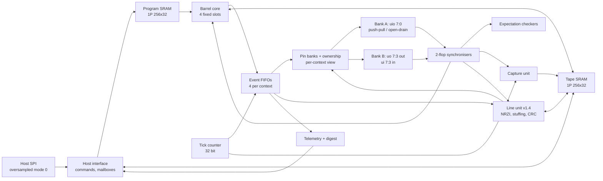

# Architecture

Escapement is built around one idea: **a program prepares an output event early, and a
timing unit applies it at an absolute tick or refuses it when it is queued. It never
applies it late.** Everything else (input checks, sampling, capture, telemetry) reuses
that one timebase and that one queue discipline.

This page describes the blocks. The cycle-exact definition is
[11-SEMANTICS](11-SEMANTICS.md), which wins wherever the two differ.

## Core

- **Four contexts in a fixed barrel.** Context k fetches in every cycle t with
  `t mod 4 == k` and commits at t + 3, so each context issues one instruction every four
  ticks. There are no same-context hazards, no forwarding and no stalls between
  contexts: a context that is waiting simply leaves its slot empty.
- **Per-context state:** four 32-bit registers, a 32-bit shift register `sh`, a 16-bit
  loop counter, a 32-bit deadline register `tmr`, an 8-bit PC and link register, flags
  Z and C, and a 32-bit input shift register `ish` filled by SAMPLE events.
- **Program store:** IHP `RM_IHPSG13_1P_256x32_c2_bm_bist`, single port, synchronous,
  shared by all contexts. The address is presented in the fetch cycle and the word is
  available the next cycle. The host writes it only while the core is stopped.
- **Wait-class instructions** (WAITT, WAITP, POP, PUSH, HALT, GETI, and event
  instructions while their FIFO is full) keep their PC and are re-evaluated at each of
  the context's slots, so their completion is quantised to the 4-tick grid. Exact-tick
  I/O always goes through events.

## Events

Each context has a four-entry FIFO. Every entry takes its deadline from `tmr`:

| Kind | Instruction | At its deadline |
| --- | --- | --- |
| DRIVE | EMIT, EMITR, EMITX | Sets value and output enable on the masked pins together |
| EXPECT | EXPECT | Starts the context's checker: the masked inputs must HOLD a level, or ARRIVE at it, within a window of up to 127 ticks |
| SAMPLE | SAMPLE | Shifts one synchronised input bit into `ish` |

**Admission** happens at the commit edge, after that edge's retirement. An entry is
accepted only if the FIFO has space (otherwise the instruction waits), its mask is
nonempty and selects only pins the context owns (DRIVE), and its deadline is strictly
after the commit tick and strictly after the FIFO tail, both within half the 32-bit
range. A rejected entry changes nothing: the context faults with ADMIT and a subcode
(MASK, OWNER, PAST, ORDER, OVERLAP), its pins release, and other contexts carry on.

**Retirement** applies the head entry on the edge whose tick equals its deadline. A
head observed past due would fault with LATE_HEAD; admission makes this unreachable,
and that is proved formally ("never late", [verification](04-VERIFICATION.md)).

At 25 MHz the counter wraps after 171.8 s, and the admission horizon is 85.9 s.

## Telemetry and faults

At every admitted enqueue the core computes `lead = deadline − commit tick`. Per context
it keeps the minimum lead since the run started, the maximum FIFO occupancy, and a count
of waits on a full FIFO. A static timing certificate (`sw/escert`) predicts bounds on
the same quantities, so the hardware checks the certificate: a measured value outside a
certified bound is a checker or hardware bug.

Each checker keeps pass and fail counts and the first failure (tick, observed level,
mask, expected level). The global first-fault register records cause, subcode, context,
PC and tick of the first context fault. Firmware raises host interrupts with
`IRQ code`.

## Pins

There are 13 physical protocol pins in two banks:

| Bank | Pins | Kind |
| --- | --- | --- |
| A | `uio[7:0]` | Bidirectional, push-pull or open-drain |
| B (v1.2) | B0–B4: output `uo_out[3+i]`, input `ui_in[3+i]` | Split: push-pull, one direction per pin; released means high |

Every instruction names eight **logical** pins, and each context is configured to one
bank: its pins 0–7 are `uio[7:0]`, or its pins 0–4 are B0–B4. The mapping sits at the
edge of the core (the input view, the ownership masks, DRIVE retirement, fault release),
so decode, admission and the event queues are the same for both banks, and a firmware
module written for one bank runs on the other unchanged. Each physical pin has one owner
context or none; ownership, open-drain and banks are configured while stopped.

Bank B uses the chip's dedicated inputs and outputs, which a host interface on three pins
leaves free, so protocol signals go from 8 to 18. The banks run at the same time: in
[`combo_two_banks.asm`](../firmware/combo_two_banks.asm), PS/2 and JTAG run on bank A
while SPI and UART run on bank B, 11 signals at once.

On an **open-drain** pin the event's value is the requested bus level: value 0 with
output enable drives low, and value 1 releases. No register state can drive an
open-drain pin high, so data-dependent SDA needs no inversion code and the "never drives
high" property holds by construction.

Inputs pass through a two-flop synchroniser. Every input-side feature (WAITP, GETP,
EXPECT, SAMPLE, capture) sees the synchronised vector of its bank, which lags the pad by
two ticks. The capture unit watches the bank its CAPT operand names.

## The tape and the capture unit

A second `RM_IHPSG13_1P_256x32` macro, the **tape**, has three users and no stall that
firmware can see:

- **Firmware**: `LDT` / `STT` at address `R[rb] + imm8`. A context owns the port only in
  its own commit cycle, and one context commits per cycle, so loads and stores never
  conflict. (v1.4: the line unit uses its owner's commit cycles, so only the owner's
  loads and stores can wait, and only for one of the unit's own accesses.)
- **Capture unit**: when a watched pin changes, it writes the record
  `{levels[7:0], tick[23:0]}` into a region `[base, lim)`, linear or ring. A two-record
  staging FIFO drains into any cycle without a load or store. If it would overflow,
  capture stops and latches the overflow tick; nothing is dropped silently. An epoch
  record at every 2^24-tick boundary lets absolute time be recovered from the words
  alone. In stream mode (v1.3) the ring is shared with the host, which acknowledges
  the records it has read; a record is never written over an unacknowledged one.
- **Host**: `WRITE_TAPE` only while stopped. `READ_TAPE` at any time (v1.3): each word
  is fetched in a cycle the core leaves free, so a host read never delays the core, and
  a capture can stream to the host for as long as the host keeps up.

A capture record has the shape of a DRIVE event (levels and a tick), so a captured trace
replays tick for tick after adding an offset ([tape and digest](13-TAPE-AND-DIGEST.md)).

## Line unit (v1.4)

Some protocols need more work per bit than a context can do: at 24 MHz a low-speed USB
bit lasts 16 ticks, four instructions, too few for NRZI, bit stuffing and a running
CRC-16. The line unit does that bit work for one owner context, half duplex, one job at
a time:

- **Transmit**: `SEND` queues a packet as an event. At its deadline the unit sends an
  optional sync byte and header, stream bits read from the tape, and the CRC, with NRZI
  and stuffing, then an end-of-packet, on one pin or a differential pair it claims.
  A monitor can stop the packet at the first bit that reads back wrong.
- **Receive**: `LINE` RECV arms a receiver that recovers the clock from transitions,
  destuffs, finds the sync pattern, runs the CRC, writes the bits to the tape, and
  records the tick the packet ended. `GETL` waits for it and sets `tmr` to that tick, so
  a reply's deadline is "the end of the host's packet plus a constant", exact to the
  tick whatever the instruction timing in between.
- **CRC jobs** run the CRC engine over tape words: the USB firmware computes its own
  token CRC-5 when it gets an address.

A `SEND` that would be late is dropped instead of faulting the context, since its
deadline comes from the line. The unit reads and writes the tape only in its owner's
commit cycles, so the other contexts' timing is unchanged. The USB keyboard firmware and
its certified reply timing are in [19-LINE-UNIT](19-LINE-UNIT.md).

## Execution digest

On every edge where something happens (a commit, a loaded register, or an output
change), the core folds the pin state, the commit's outcome, context and PC, and any
register write data into a 32-bit MISR. It stops changing once every context has
stopped, so after a run one SPI read gives a signature that the instruction-set
simulator predicts exactly from the same image and inputs.

## Host interface

The host link is SPI mode 0 on `ui[2:0]` and `uo[0]`, oversampled in the core clock
domain through 2-flop synchronisers, so the design has a single clock domain. SCK may run
at up to f_clk / 8. Commands load and verify both memories, configure contexts and pins,
start and stop runs, move words through per-context mailboxes (two 32-bit entries each
way), and read any debug register ([host protocol](12-HOST-PROTOCOL.md)). `uo[1]` is the
interrupt line and `uo[2]` shows that the core is running.

## Power structure

The design is built so that idle hardware costs little ([power](15-POWER.md)):

- **Clock-gated register banks.** 68 latch-and-AND clock gates, built from standard
  cells, cover about 2,600 flops that are written rarely: registers, FIFO entries,
  mailboxes and checker records. A formal proof shows each gated bank behaves exactly
  like an enable flop and that the gated clock cannot glitch.
- **SRAMs read only on demand.** The program store is read only for running contexts,
  the tape only for LDT, and either one for the host only during a read command. On
  idle cycles the macro is deselected, which costs no read energy.

## Reset and lifecycle

Reset halts every context, clears the pin registers, empties all queues and mailboxes
and clears the fault record. START initialises every context's architectural state, so
every run begins identically; the tape keeps its contents. STOP halts all contexts,
flushes the queues and releases every pin. A context fault flushes only that context's
queue and releases only its pins. A deselected Tiny Tapeout design is powered down, so
the host reloads both memories after every reselect.

## Implementation

| File | Block |
| --- | --- |
| `src/project.v` | Tiny Tapeout top level: pins, memories, host and core |
| `src/escapement_host.v` | Host SPI interface and command decoder |
| `src/escapement_sram.v` | SRAM macro wrapper with on-demand select |
| `src/esc_core.v` | Barrel pipeline, decode, execute and admission, pins and synchronisers, first-fault register, digest |
| `src/esc_ctx.v` | Per-context state, event FIFO, checker, telemetry, mailboxes |
| `src/esc_cap.v` | Capture unit |
| `src/esc_greg.v` | Clock-gated register bank |
