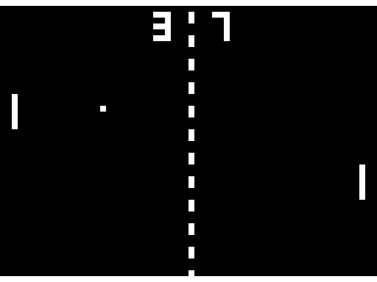

# VGA Pong

[`firmware/vga_pong.asm`](../firmware/vga_pong.asm) plays Pong on a VGA monitor,
640x480 at 60 Hz, from pin bank B. It uses no new hardware: two contexts, five pins, 251
of the 256 program words and 168 tape words. The chip plays both paddles until
someone presses a button.



The picture is what the instruction-set simulator's pins show, cut into lines and frames
by their HSYNC and VSYNC pulses the way a monitor would, and the tests check that
picture pixel for pixel on the RTL and on the gate-level netlist too
([verification](#verification)).

## Pins

The Tiny VGA Pmod on `uo_out` takes the five bank B outputs as they are:

| Bank B | Pad | Tiny VGA |
| --- | --- | --- |
| B0 | `uo_out[3]` | VSYNC |
| B1 | `uo_out[4]` | R0 |
| B2 | `uo_out[5]` | G0 |
| B3 | `uo_out[6]` | B0 |
| B4 | `uo_out[7]` | HSYNC |

The buttons are `ui_in[4]` and `ui_in[5]` (left paddle up and down) and `ui_in[6]` and
`ui_in[7]` (right), active high: the demo board's DIP switches, or any push buttons.

## Timing

The pixel clock is the core clock. At 25 MHz against the standard 25.175 MHz the frame
rate is 59.5 Hz and the line rate 31.25 kHz, which monitors accept; the
[VESA](https://en.wikipedia.org/wiki/Video_Graphics_Array#Signal_timings) porches and
pulse widths are kept to the pixel:

| | Visible | Front porch | Sync | Back porch | Total |
| --- | ---: | ---: | ---: | ---: | ---: |
| Pixels per line | 640 | 16 | 96 | 48 | 800 |
| Lines per frame | 480 | 10 | 2 | 33 | 525 |

Both syncs are active low. VSYNC changes with the HSYNC fall of lines 490 and 492.

## How it works

Context 0 makes the syncs: two DRIVE events per line, HSYNC down and up, and VSYNC on the
same edges. Context 1 makes the picture and runs the game.

The screen is 64 x 48 cells of 10 x 10 pixels, one bit per cell, in 96 tape words: row
*r* is words 2*r* and 2*r* + 1, bit *c* of a word is column *c* of that half. For each
line the video context loads a word into `sh`, and `EMITX` drives the three colour pins
together from the bit it shifts out, at a deadline 10 ticks after the last:

```asm
v_left:
    EMITX RGB, 0, RGB             ; colour pins = the next bit of the row, LSB first
    ADDT  CELL                    ; 10 pixels later
    EMITX RGB, 0, RGB
    ADDT  CELL
    DJNZ  v_left
```

Five instructions take 20 ticks and produce two cells of 10 ticks, so the loop runs at
exactly the speed of the beam and the four-entry FIFO absorbs the reload in the middle
of the line. Each row is drawn for ten lines.

**What is data and what is time.** The deadlines never depend on the picture: every edge
is at a constant offset from the start of the run, in both contexts, so the two stay
locked to each other by arithmetic alone and a picture can never shift or tear. Only the
levels come from the tape. Bits the game sets are white; nothing else changes.

**The game runs in the vertical blank** (45 lines, 36,000 ticks), in the same context,
so the framebuffer is never written while it is shown. A step moves the paddles on odd
frames and the ball on even frames, then waits until a fixed time, 2,000 ticks before the
frame, and redraws the whole buffer without branches. Whatever the game did, every frame
does the same redraw at the same time.

**The game.** The ball moves one cell per two frames. It bounces off the top and bottom
borders. A paddle's top two rows send it up, the bottom two down, and the middle two keep
its angle. A missed ball scores for the other side and is served from the centre,
towards the side that missed, on a random row. At 10 points a new game starts.

A paddle whose buttons are idle is played by the chip. It watches only its own half of
the court, and steers a randomly chosen row of the paddle to meet the ball, moving at the
ball's vertical speed. It misses when the ball comes too steeply to reach in time. A
16-bit LFSR, stepped once per ball move, chooses the serve rows and paddle rows.

## The proof

```text
$ python -m escert ../firmware/vga_pong.asm
ctx 0: CHECKED, min_lead >= 1597 (169 event sites, 424 states)
ctx 1: CHECKED, min_lead >= 8 (231 event sites, 1833 states)
```

For every input, every edge of the video signal is queued at least 8 ticks before its
deadline. The game always finishes inside the blank, and no edge is ever late. The chip
measures the same quantity (`min_lead`, READ_DBG sel 9). On the simulator, the RTL and
the gate-level netlist it reads exactly 1597 and 8, so the bounds are tight.

Two choices made the proof possible, and both make the firmware more regular:

- **A fixed redraw time.** Game paths of different lengths reached the redraw loop at
  different times. Waiting for one fixed time first gives the loop a single starting
  state.
- **A redraw without branches.** It writes the background four rows at a time, then
  draws the paddles, the score and the ball into it.

## On a real board

Bank B carries the low bit of each colour (R0, G0, B0). The Tiny VGA Pmod's high bits
(R1, G1, B1) are wired to `uo_out[0..2]`, which this chip uses for the host link (MISO,
IRQ, RUN). While the chip runs:

- RUN is high, so B1 is high.
- Between SPI frames, MISO holds the top bit of the status byte, which is RUN. It is
  sampled when the host's last frame ended, so after any SPI frame during the run, R1
  is high too.
- G1 is low unless an interrupt or a fault is pending.

The picture is therefore drawn at a third of full brightness (the low bits), on top of a
constant offset in red and blue. Monitors that take the black level from the back porch
remove that offset. Others show a tinted background. The picture is not on silicon yet.
Silicon is the first hardware this design will run on.

## Verification

| Test | What it checks |
| --- | --- |
| `sw/tests/test_vga_pong.py` (`make sw-test`) | Both contexts CHECKED and the telemetry equal to the bounds; sync timing as above; two frames pixel for pixel against [`pong_model.py`](../sw/tests/pong_model.py), a model written from the rules in the firmware's header; black in every blanking interval; 14 game steps, each against the model and an outcome stated by hand (hits with each part of a paddle, a miss, scoring, the new game at 10, both borders, the chip's steering, buttons) |
| `test/test_firmware_pins.py::test_vga_pong_on_chip` (`make pin-test`, `make gl-pin-test`) | The first frame and VSYNC pulse on the chip's pins, on the RTL and on the gate-level netlist: the same sync, picture and blanking checks, and the hardware's min_lead equal to the certificate |
