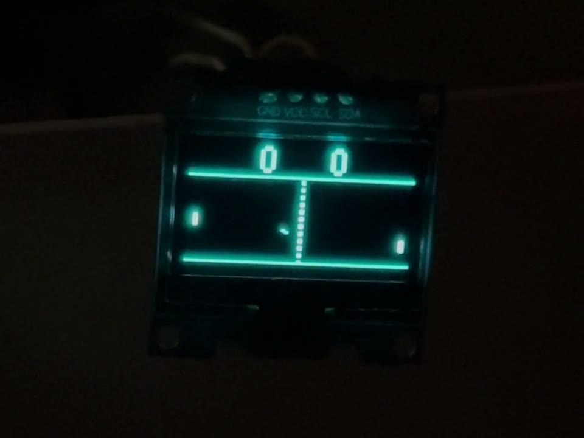
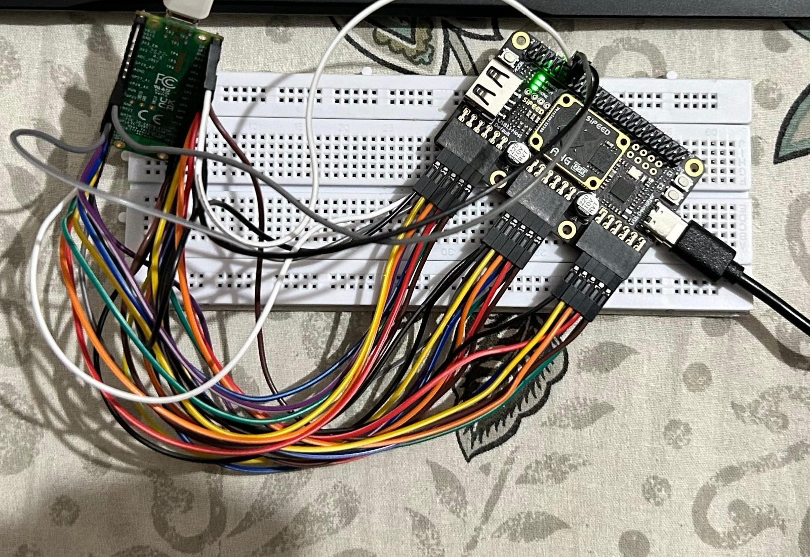
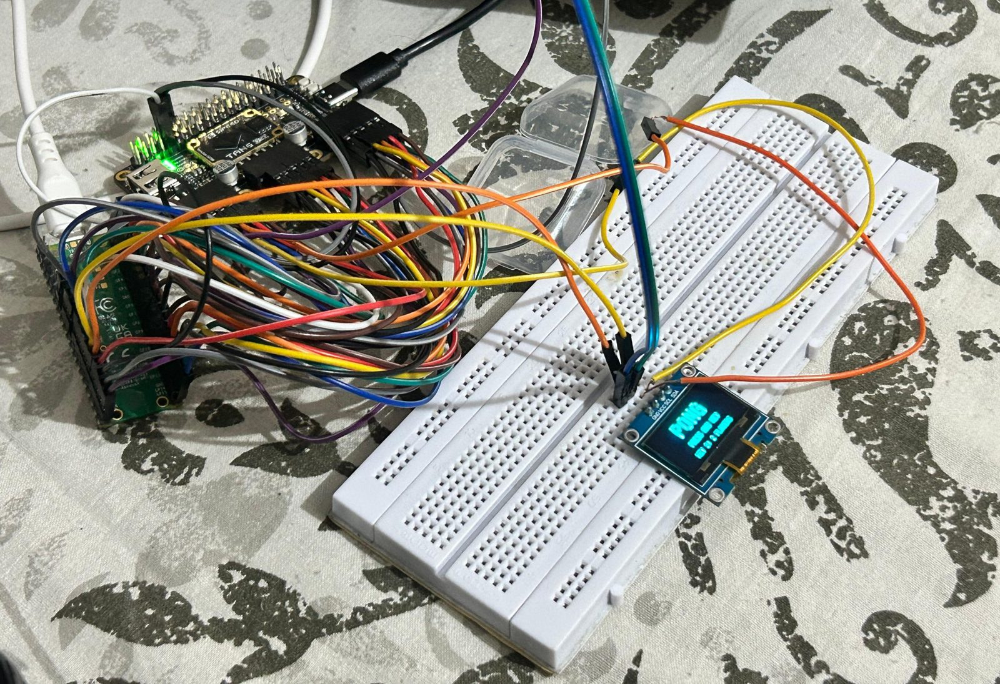

# OLED Pong

[](img/oled-pong.mp4)

*Pong on a 128×64 SSD1306 OLED, played on the FPGA bench. The picture links to a
27-second recording.*

OLED Pong is a whole small system running on the chip by itself: a display driver that
speaks I2C to the screen, a text layer with its own font, the game, and a menu with a
title screen, a countdown and a winner screen. Each of those is one program in one
context, on its own page of the program store, and they talk to each other only through
queues on the tape. The host loads the four programs and then does nothing but pass on
the players' key presses. It is a demonstration of three things at once: four independent
programs sharing the chip without disturbing each other's timing, program pages letting
four full-size programs coexist with no linking, and an I2C controller whose every edge is
certified while a game runs beside it.

It plays the same game as [VGA Pong](21-VGA-PONG.md), step for step, on a different
display. The VGA version shows that the chip can generate video timing; this one shows
that it can run a display that has its own controller and memory, with the work split
across all four contexts.

## How the work is divided

| Context | Page | Program | Job |
| --- | --- | --- | --- |
| 0 | 0 | `oled_disp.asm` | The display engine: draws rectangles on the OLED over I2C at 400 kHz, from a command queue |
| 1 | 1 | `oled_pong.asm` | The game: the paddles and the ball, the score, the end of a game |
| 2 | 2 | `oled_text.asm` | Text: turns each text command into the column strips the engine draws, from a font on the tape |
| 3 | 3 | `oled_menu.asm` | The title screen, the countdown, a new game's first picture, the winner screen |

**The display keeps the picture.** An SSD1306 has its own 1 KB of display memory, so the
chip needs no framebuffer of its own. The engine's commands each rewrite one rectangle of
that memory: FILL clears or paints whole rows, and STRIP writes a run of identical
columns. A game step therefore redraws only what may have moved: after a paddle step,
the columns of both paddles, and after a ball step, the ball's old and new columns, each
drawn whole with whatever borders, net or paddle they contain.

**Queues on the tape connect the contexts.** Context 0 knows nothing about what it
draws; it reads commands from a queue of eight words on the tape. Context 2 is the only
producer for that queue. It takes commands from a second queue, which the game and the
menu fill, passes drawing commands straight through, and expands each TEXT command into
the strips for its characters, at one to four times the font's size. Each queue has a
head index written only by its reader and a tail index written only by its writer, so no
two contexts ever write the same word, and the program that filled a queue knows its
commands are all drawn when the head reaches the tail.

**The menu and the game take turns.** A tape word says whose turn it is. The menu shows
the title until a button is pressed (after all buttons have been released, so a button
held over from the last game does not count), counts down 3, 2, 1, GO, draws the opening
court, and hands over to the game. The game ends at ten points, or when Esc is pressed,
and hands back to the menu, which shows the winner for four seconds and returns to the
title.

**The buttons are bank B inputs.** The five dedicated inputs `ui_in[3]` to `ui_in[7]` are
Esc and the two paddles' up and down buttons. A paddle whose buttons nobody presses is
played by the chip, so one person can play against the chip, or two against each other.
On the bench a laptop's keyboard stands in for the buttons (below).

## Timing

The game steps at 60 Hz, as the VGA version's frames do. The display engine uses the same
bit timing as the chip's general I2C controller, `i2c_ctrl.asm`: every SCL and SDA edge is
an event with an absolute deadline, the high phase of the clock is measured from the
observed SCL rise (so a target that stretches the clock is respected), and the code
between bytes can only ever lengthen a low phase, never shorten one. The certificate
checker confirms this for the whole image: all four contexts are CHECKED, which for the
engine means that none of its I2C edges can ever be late, and for the other three that
they queue no pin events at all.

## On the bench



*The bench: a Raspberry Pi Pico W (left) is the host; the Sipeed Tang Primer 25K Dock
(right) runs the chip's RTL, built for the FPGA, on its 24 Tiny Tapeout pins.*



*The SSD1306 OLED on the breadboard, wired to `uio[2]` (SCL) and `uio[3]` (SDA), showing
the title screen.*

The bench runs the chip's own RTL, built for a Sipeed Tang Primer 25K FPGA, with a
Raspberry Pi Pico W as the host on the chip's SPI link
([`fpga/tangprimer25k`](../fpga/tangprimer25k/README.md)). The OLED is wired to two bank A
pins with its own pull-up resistors, since both I2C lines are open-drain. To play:

```sh
cd sw
python -m eschost.pong_keys --bundle oled_pong.json   # assemble the four pages into one image
python -m eschost.pong_keys --port COM8 --bare        # load it, start it, and play from the keyboard
```

The second command starts `sw/rp2350/oled_pong_host.py` on the Pico, which loads the
image, starts the chip and then holds the five button inputs as the laptop's keyboard
says. W or Up moves the left paddle up and S or Down moves it down, while the chip plays
the right; pressing 2 switches to two players, with W and S for the left paddle and the
arrow keys for the right. Esc returns to the title. `--sim` plays the reference model in a window instead, without a chip.

## How it is checked

[`sw/tests/test_oled_pong.py`](../sw/tests/test_oled_pong.py) runs the four programs on
the instruction-set simulator with a model of the SSD1306 that checks I2C Fast-mode
timing on every edge. After each step it compares the whole display memory with a
reference model, which draws the screens from the rules in the firmware headers and plays
the game with the same Python model that checks VGA Pong. The tests cover:

- the font, against the drawings it was made from, and every name the four files share
  on the tape, which must agree;
- the engine and the text layer at every scale, and a display that does not acknowledge
  a byte, which must cost one command and not stop the engine;
- game steps against the model, ten points ending the game, the winner screen for each
  side, a game ended by Esc with no winner, Esc in the countdown and on the winner
  screen, and the whole sequence from the title through the countdown into a game;
- the certificate of all four contexts.

The tests run with shorter steps than the chip uses, so a run takes seconds; the pictures
are the same. On the FPGA bench, the game was played on the chip's RTL by hand, through
the title screen, games to ten points, the winner screen and Esc.
