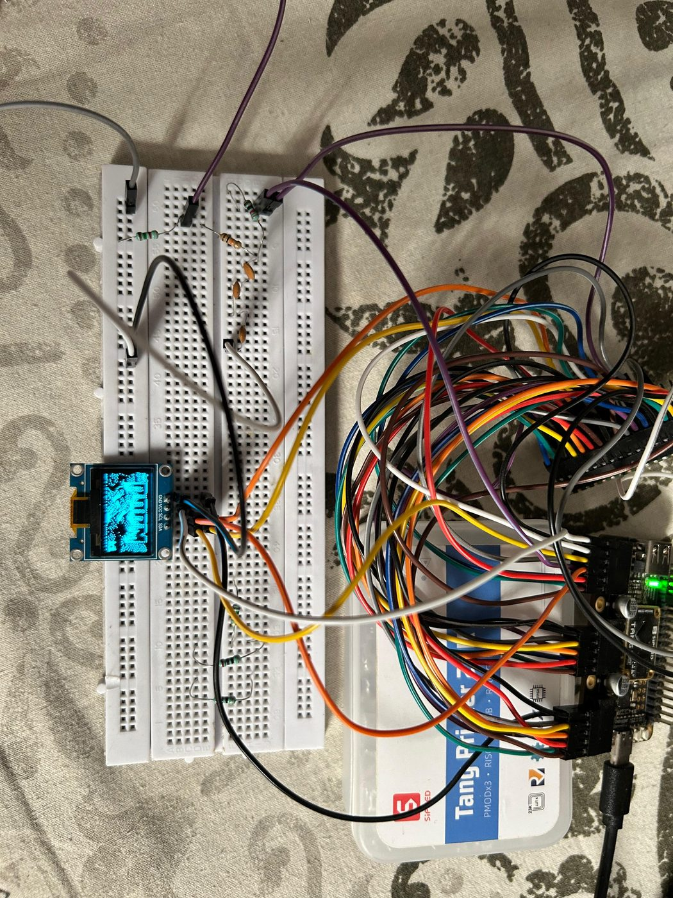

# DOOM console



*DOOM on the FPGA bench. A Raspberry Pi Pico W runs the game; the chip's RTL on the Tang
Primer 25K Dock (bottom right) drives the OLED and plays the sound, which leaves through the
resistors and capacitors on the breadboard for a laptop's headset jack.*

The DOOM console is the shareware DOOM played on a Raspberry Pi Pico W, with Escapement as its
input/output processor. The Pico runs the game and drives no device itself: every frame it
draws and every sound it mixes goes to the chip as words on the host link, and the chip turns
them into the signals. One context streams the frames to an SSD1306 OLED over I2C, a
second plays the sound as pulse-width modulation, a third watches the I2C bus for timing
violations, and a fourth can capture the sound pin. The keyboard and mouse are a laptop's.

It is a test of the chip as a peripheral under a real program's load. The game produces
data at its own pace, the chip consumes it at the protocols' pace, and the host link between
them has to carry both without losing a word. The I2C and PWM timing is certified as in every
other program, so a busy game cannot make an edge late: the worst the host can do is fall
behind, which the chip turns into a held clock or a stretch of silence.

## How the work is divided

| Where | Program | Job |
| --- | --- | --- |
| Pico W, core 0 | [rp2040-doom](https://github.com/kilograham/rp2040-doom) | The game: rendering, the sound mixer, the keyboard and mouse |
| Pico W, core 1 | the console's host loop | Helps render, turns frames into panel pictures, and feeds the chip's mailboxes every millisecond |
| Context 0, page 0 | `i2c_burst.asm` | Streams each picture to the OLED: 1,025 bytes over I2C at 400 kHz |
| Context 1, page 1 | `pwm_audio.asm` | Plays 8-bit samples at 11,025 a second as a PWM signal on one pin |
| Context 2, page 2 | `i2c_timing.asm` | The bus monitor: checks every SCL and SDA edge against Fast-mode limits |
| Context 3, page 3 | `logic_analyzer.asm` | The capture unit, recording the sound pin into a ring on the tape |
| Laptop | a small window | Sends the keys and the mouse to the Pico over USB serial |

The game is rp2040-doom, Graham Sanderson's port of Chocolate Doom to the RP2040, which plays
the shareware episode from a compressed copy of its data in the Pico's flash. It normally
draws VGA with the RP2040's PIO and plays sound over I2S; the console replaces both with one
backend that sends everything to the chip. The game side (the backend, a PIO driver for the
chip's SPI link and the input window) is kept in a separate repository, because rp2040-doom
is GPL-licensed and the game data is id Software's. Everything on the chip's side is here: the
two new firmware features, the models, the tests and the load model
[`sw/tools/console_load.py`](../sw/tools/console_load.py), which assembles the four-page image
the Pico loads.

## The picture

**The panel has an eighth of the game's pixels.** DOOM draws 320×200 pixels in 256
colours; the SSD1306 has 128×64 pixels, each on or off. rp2040-doom never holds a finished
320×200 frame: it draws the 3D view into a frame buffer and lays the status bar and menus over
it line by line, as a VGA beam reaches each line. The console calls the same per-line
compositor for all 200 lines and averages them into 128×64 grey levels. Five columns become
two, weighted 2, 2, 1 and 1, 2, 2, so each source column counts the same, and the 200 rows
are averaged down to 64.

**Grey becomes black and white by dithering.** DOOM's picture is mostly dark, in a narrow band
of the grey scale, so a fixed threshold shows almost nothing. Each frame is first stretched
from its 2nd to its 98th percentile of brightness. The percentiles come from the previous frame,
because a frame is processed row by row, and move a quarter of the way each frame, so the
brightness does not flicker. Then Atkinson dithering spreads each pixel's rounding error over
six neighbours, three-quarters of it in all, which keeps dark areas black and bright ones white
instead of filling them with noise. Corridors, doors and monsters stay recognisable at
128×64.

**A frame goes out as a stream.** The 128×64 bits pack into the SSD1306's 1,024 bytes of
display memory, eight rows a byte. `i2c_burst` already sent whole frames from the tape, but
the host may write the tape only while the chip is stopped, so it gained a stream mode: one
command word (`[31:30] = 11`, a prefix byte, a word count) and then that many words, each taken
from the mailbox as it arrives and sent as four bytes. If a word has not arrived when the next
byte is due, the controller holds SCL low, which only lengthens a low phase; I2C sets no
maximum, and the next byte's timing starts again from where the bus is. A target that answers
a byte with a NACK ends the transaction with a STOP, and the controller then drains the words
still owed, so the mailbox stays in step with the commands.

At 400 kHz a frame takes about 24 ms, so the panel could show about 40 frames a second. The
Pico takes a new frame for the panel only when the last one has gone out.

## The sound

**The mixer runs at the chip's rate.** rp2040-doom mixes its sound effects at 11,025 samples a
second for the console, instead of the 49,716 its music synthesiser needs; the console plays
effects only. The backend averages the two channels, raises the level four times (the game's
mix rarely uses more than a fifth of the 8-bit range) with clipping at the ends, and packs four
samples into each 32-bit word.

**`pwm_audio` turns samples into a pulse train.** Each sample lasts 2,268 ticks of the 25 MHz
clock (11,023 samples a second, 0.02% slow) and is played as eight PWM periods of 283 and 284
ticks, an 88 kHz carrier far above hearing. In each period the pin is high for 8 + *s* ticks,
*s* the sample, so the average level is linear in the sample and both edges exist in every
period. Every edge is an event at an absolute deadline, and the high time is added to the
period's start one bit of the sample at a time, so every path through the code adds a
constant and the certificate checker proves that no edge can be late.

**A ring on the tape absorbs the host's timing.** The program takes at most one word a sample
from its mailbox into a ring of 128 words (512 samples, 46 ms). When the ring is full it leaves
the word in the mailbox, and the full mailbox holds the host back. When the ring runs empty it
plays the mid level, 128, as silence, and counts each such sample on the tape, so a host that
falls behind is heard as a gap and never makes an edge late. The Pico keeps the mixer paced the
same way from its side: it holds a mixed buffer back while more than 64 words wait to go.

**A low-pass filter makes the pulses into sound.** On the bench the pin drives a laptop's
headset jack:

```text
uio[6] ── 1 kΩ ──┬── 10 kΩ ──┬──────────── mic contact (the plug's sleeve)
                 │           │
            33 nF (three     1.5 kΩ
            100 nF in series)│
                 │           │
GND ─────────────┴───────────┴──────────── plug ground (ring 2)
```

The 1 kΩ and 33 nF form a low-pass filter at 4.8 kHz, which passes the sound (up to 5.5 kHz
at this sample rate) and cuts the 88 kHz carrier by 25 dB. The 10 kΩ and 1.5 kΩ divide the
3.3 V swing down to a microphone's level, about 270 mV peak to peak at full scale. The
connection is DC-coupled: the 1.5 kΩ to ground looks to the laptop like the electret
microphone it expects, so the laptop recognises a headset, and no coupling capacitor cuts
the low frequencies. Windows plays the input through the laptop's speakers.

## The host link

Everything travels over the chip's SPI host link ([host protocol](12-HOST-PROTOCOL.md)). At
full speed the console would need 11,716 words a second: 35 picture frames of 256 words and
2,756 sound words. A PIO program on the Pico runs the link at the protocol's limit, an SCK of
the chip's clock divided by eight (3.125 MHz). On the bench it pushed 35,413 words a second,
three times that load, with no word lost in 400 blocks of 256.

**A mailbox can hold two words, and a push into a full one is lost.** STATUS tells the host
whether a context's receive mailbox is full, but not whether it holds one word or none. The
Pico's feeder therefore reads STATUS once per round and pushes at most one word to each
context that has room, so it never pushes into a full mailbox; it pops the bus monitor's and the
display controller's reports in the same round. Core 1 runs these rounds for up to 0.4 ms of
every millisecond. A word that is lost anyway shows up as the host error flag in the next
STATUS, and the Pico stops with an error: the link is lossless by construction, and checked
rather than assumed.

## Keys and mouse

The chip plays no part in the input. A small window on the laptop takes the keyboard and, once
clicked, the mouse, and sends each change over USB serial as two to four bytes: a key's USB
usage code going down or up, a mouse report with the buttons and 7-bit motion, a message to
release every key, and a heartbeat twice a second. The Pico turns these into DOOM's own key
and mouse events, and releases every key if the heartbeat stops for 1.5 seconds, so a closed
window cannot leave the player running into a wall.

## Memory

The RP2040 has 264 KB of RAM, and rp2040-doom uses most of it: two 320×168 frame buffers
(107,520 bytes, so one can be drawn while the other is shown) and a zone of memory for the
level's data. The console adds its queues, its picture and the USB serial driver. With the
music synthesiser left out, the zone has about 54 KB, and while a level was played on the
bench at least 23,944 bytes of it were always free.

## Changes to rp2040-doom

The port is changed in place, not forked into a new design. Everything the console needs is
behind one compile-time switch, `DOOM_CONSOLE`, in a build target of its own,
`doom_tiny_console`, so the port's VGA and I2S targets build and behave as before. Apart from
the new backend, `src/pico/i_console.c`, the change is about 300 lines in 11 files:

| Area | Change | Why |
| --- | --- | --- |
| Clock | 250 MHz instead of 270 | A multiple of 25 MHz: a PWM output divides it by ten to make the chip's clock |
| Video | The per-line compositor (frame buffer, then status bar and menus) moved out of the VGA scanline loop into a function of its own, which both paths call | The panel's picture is made by exactly the code that makes the VGA picture |
| Video | No scanvideo. Core 1 renders its share as before; the console's poll runs in the low-priority interrupt the VGA path used, raised every millisecond by a hardware alarm | The feeder runs on time whatever the renderer is doing, and never waits for it |
| Sound | Mixed at 11,025 Hz into three buffers of 128 samples (12 ms each), all refilled on each pass; the backend holds a buffer while the chip's queue is full | The rate is the chip's, so nothing is resampled, and the held buffer paces the mixer as the I2S output did |
| Sound | No music | Its OPL synthesiser runs at 49,716 Hz, and its state and songs would take zone memory |
| Input | Keys and mouse read from USB serial in place of the UART. Keys enter as USB usage codes, which are SDL's scancodes, through the port's own key path; mouse motion is summed and posted once a tic | The game sees the same events as from a keyboard and mouse of its own |
| Network | The port's I2C link to a second Pico replaced by its host-build stand-in | Its pins, GP18 and GP19, are wired to the chip on the bench; a network game plays alone |
| Saving | Off, as a build option | Writing flash would stall the console's poll, which runs from flash on core 1 |
| Memory | The game's data moved to 0x10048000 in flash; the default alarm pool kept for USB serial, whose worker interrupt moves from 31 to 26 | The console's code passes 256 KB; the SDK claims user interrupts from 31 down on each core, and the two cores share one vector table |

Two fixes are to the game itself. The first frame was rendered before the title loop had set
the game state, which starts at the value for a level, so the renderer read a player that did
not exist yet: address 0, harmless ROM on the RP2040, but a crash in the laptop build of the
same code, where the console is tested. It now waits for the player. And a build without
saving failed to link, because loading uses a flag declared only for saving.

Putting the game on the Pico needed one more tool. The game and its compressed data go into
one UF2 file, and the RP2040's boot ROM decides which 4 KB flash sector to erase from a block's
position in the file rather than from its address ([pico-bootrom-rp2040 issue
19](https://github.com/raspberrypi/pico-bootrom-rp2040/issues/19)). It is right only when the
blocks come in whole sectors, as the SDK's own tool writes them. The first merged file did
not, and the game booted to find its data's header erased. The merge tool now pads every
sector it touches. Finding that took a crash reporter: a hard fault or a panic is written to
the watchdog's scratch registers, which survive a reset, and the next boot prints it over USB
instead of starting the game.

## On the bench

The bench is the one described under [the FPGA bench](../fpga/tangprimer25k/README.md): the
chip's RTL, version 3.1, built for the Tang Primer 25K, with the Pico W as the host and the
chip's 25 MHz clock coming from a Pico pin. The OLED taps the breadboard rows of the wires to `uio[2]`
(SCL) and `uio[3]` (SDA), and the sound circuit taps the row of `uio[6]`. The Pico leaves its
own pins on those rows as inputs without pulls.

| Measure | Result |
| --- | --- |
| Picture | 12.4 frames a second on the panel; every transaction acknowledged |
| Sound | 11,040 samples a second played; the Pico, sampling the pin, sees the 88 kHz carrier with its duty moving with the sound |
| Host link | 2,760 words a second, none lost and none dropped, in a three-minute run: 2,342 frames and 523,797 words |
| Level | 36 of about 2.1 million samples clipped by the gain of four |
| Memory | at least 23,944 bytes of the zone always free |

The panel's rate is set on the Pico's side, not by the chip: the I2C bus is busy for less
than a third of each second, and the link carries about a sixth of what it can.

## How it is checked

[`sw/tools/console_load.py`](../sw/tools/console_load.py) runs the whole console on the
instruction-set simulator: all four contexts loaded as on the bench, and a host that behaves
like the Pico, rendering frames on its own clock, mixing sound a game tic (1/35 s) at a time
and pushing only into mailboxes with room, at the link's real speed. Everything is checked from
outside the chip: every frame that went out is on the simulated panel byte for byte, the sound
pin decodes to exactly the samples sent and on schedule to the tick, the ring never runs dry
once playing, the bus monitor reports nothing, no context faults, every context's measured
lead is at or above its certificate, and the capture unit's edges fall on the receiver's
ticks. At 30 frames a second the load takes 17% of the host link.
[`sw/tests/test_console_load.py`](../sw/tests/test_console_load.py) runs it for 40 ms.

The two new firmware features are checked as every program is:

- `sw/tests/test_pwm_audio.py` decodes the pin with a receiver written from the format, which
  checks that every rise falls on its schedule and every sample spans eight equal periods,
  with the extremes 0 and 255 among the samples; `test_i2c_burst.py` checks the stream mode,
  including a NACK in the middle of a stream;
- the certificate checker passes both as CHECKED, `pwm_audio` at 24, 25, 33 and 50 MHz;
- the co-simulation cases `pwm_audio` and `i2c_stream` run the programs on the RTL in
  lockstep with the simulator;
- sigrok's decoders judge both from the pins: its `pwm` decoder must read the case's 32
  samples, eight equal periods each, and its `i2c` decoder the streamed bytes, each with a
  control that must fail.

## On the way

The first picture was mostly noise: a fixed mid-grey threshold with Floyd–Steinberg
dithering spreads DOOM's dark, narrow range evenly into speckle. Five ways of making the grey
frames black and white were compared on frames recorded from the game, and the stretch with
Atkinson dithering was clearly the most readable. In the simulator, the sound underran at the
edges of game tics until the host mixed one tic ahead, as a game's mixer does. The stream mode
first left the words of a stream that ended in a NACK in the mailbox, where they were read as
commands; it now drains them. On the bench the sound first reached the laptop at a fifth of its
range, which the gain of four fixed without changing the circuit.

## Credits

The game the console plays is other people's work:

- **DOOM** is id Software's. The shareware episode and its data are theirs; id Software
  released the engine's source code, which is under the GNU GPL.
- **[Chocolate Doom](https://github.com/chocolate-doom/chocolate-doom)**, by Simon Howard and
  its contributors, is the source port that rp2040-doom is derived from.
- **[rp2040-doom](https://github.com/kilograham/rp2040-doom)**, by Graham Sanderson, is the
  port the console runs. Its compressed data format, which fits the shareware episode in the
  Pico's 2 MB of flash, its renderer split across both cores, its sound mixer and the per-line
  compositor that the panel's picture comes from are all used as they are; the console changes
  only what is listed under [Changes to rp2040-doom](#changes-to-rp2040-doom). It is licensed
  under the GNU GPL, version 2.
- **[pico-sdk](https://github.com/raspberrypi/pico-sdk)** and
  **[pico-extras](https://github.com/raspberrypi/pico-extras)**, by Raspberry Pi, provide the
  Pico's drivers, its USB serial and the audio buffer pools the mixer fills.
- The picture's dithering is Bill Atkinson's, from the original Apple Macintosh.
