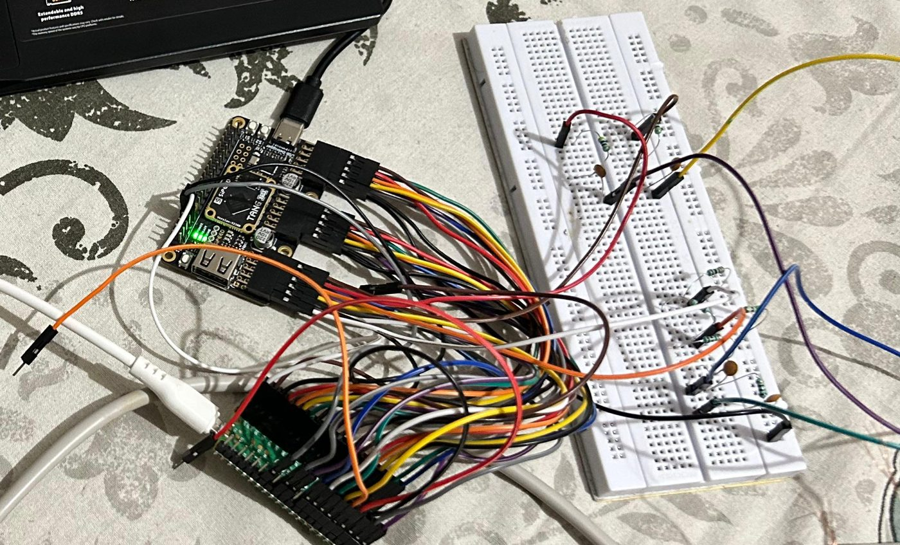

# Hardware bench: Pico W + Tang Primer 25K Dock

The chip's RTL running on an FPGA, driven through its 24 Tiny Tapeout pins, its clock and its
reset by a Raspberry Pi Pico W that runs the repository's own bring-up script
(`sw/rp2350/bringup.py`). `barepico.py` stands in for the Tiny Tapeout demo board's firmware,
so the script runs unchanged.

| Part | Board |
| --- | --- |
| Host | Raspberry Pi Pico W (RP2040, MicroPython 1.24.1), soldered headers |
| Chip | Sipeed Tang Primer 25K Dock (GW5A-LV25MG121NC1/I0), loaded over its onboard USB debugger |
| Build | `fpga/escapement_board.v` with `ESC_NO_CG` and `fpga/escapement_sram_fpga.v`, as in `fpga/README.md` |

## Result, 2026-11-15 (version 3)

The bitstream was built from commit fa0491a and the firmware bundles from 72a74f7, which
adds OLED Pong and changes no RTL.

| Step | Result | Evidence |
| --- | --- | --- |
| 0 board and project | PASS | `results/2026-11-15/bringup.log` |
| 1 clock and reset | PASS: 25 MHz from the Pico, outputs correct in and after reset | same |
| 2 host link | PASS: STATUS reports protocol version 10, fast and slow SCK | same |
| 3 memories | PASS: 4 patterns x 256 words in each of the four program pages and the tape, tape reads during a run | same |
| 4 pins and clock rate | PASS: every uio, input and bank B pin; chip clock 25.0031 MHz | same |
| 5 firmware | PASS: 71 of 71 firmware match the model's digest or final state and their certificates | same |

The run also has limits, and they are recorded:

- **The bitstream failed two of `build.sh`'s own checks and was packed by hand.** The
  half-tick input sampler is a bank of falling-edge flip-flops. Yosys built it from
  rising-edge flip-flops behind an inverter in a LUT, so the clock is not wholly on the
  global network (one LUT input), and the skew to that input is 0.682 ns against the
  0.05 ns the build allows (`results/2026-11-15/clkskew.txt`). nextpnr times the rest
  of the design and passes setup at 25 MHz (57.39 MHz possible), but it treats the
  inverted clock as its own domain and does not time the half-cycle path from the sampler
  into the core. The fix is to map the bank onto the FPGA's falling-edge flip-flops. The
  chip's own layout does not have this problem: its sampler is signed off at every corner
  with the rest of the design ([03-PHYSICAL-DESIGN](../../docs/03-PHYSICAL-DESIGN.md)).
- **The new receivers ran with nothing on their pins.** `eth_rx`, `spi_sniff` and
  `i2c_timing` run and stay in step with the model, but this run had no Ethernet line, no
  SPI bus and no I2C traffic on those pins, so it does not show them decoding or measuring.
  That is shown in simulation, on the simulator and on the RTL
  ([04-VERIFICATION](../../docs/04-VERIFICATION.md)). `eth_rx` has since received a
  laptop's frames on this bitstream (Ethernet, below).
- An earlier run of the same bitstream, before two wires (uio[2] and uio[3]) were
  reconnected, failed stage 4 on exactly those pins ("pins 2,3 never read 0") and three
  firmware in stage 5 that use them (68 of 71); the log above is the run after.

OLED Pong was also played on this bitstream with an SSD1306 display on uio[2] and uio[3]
([23-OLED-PONG](../../docs/23-OLED-PONG.md)).

## What a bench run does not show

Three parts of the chip are not on the FPGA, so no bench run covers them:

- **The hardened netlist.** It comes from a different synthesis tool and cell library.
- **The clock gates and latch banks.** `ESC_NO_CG` makes them plain flip-flops.
- **The IHP SRAM macros.** Block RAM with the same timing contract replaces them.

Those stay covered by the gate-level suites, the RTL-to-netlist equivalence checks and timing
signoff.

## Earlier result, 2026-11-08 (version 1.6, commit d3b5dbc)

The first run on this bench, with the released version 1.6 (6x4).

| Step | Result | Evidence |
| --- | --- | --- |
| Wiring check (`pinid`) | `WIRING: PASS`, all 26 signals on the expected GPIOs | `results/2026-11-08/pinid.txt` |
| 0 board and project | PASS | `results/2026-11-08/bringup.log` |
| 1 clock and reset | PASS: 25 MHz from the Pico, outputs correct in and after reset | same |
| 2 host link | PASS: STATUS over SPI, fast and slow SCK | same |
| 3 memories | PASS: 4 patterns x 256 words in both SRAMs, tape reads during a run | same |
| 4 pins and clock rate | PASS: every uio, input and bank B pin; chip clock 25.0094 MHz | same |
| 5 firmware | PASS: 48 of 48 firmware match the model and their certificates | same, and `proof.json` |

The bitstream (sha256 16e5da57...) and the firmware bundles were built from commit d3b5dbc with
clean sources: `chip.MANIFEST` and `bundles.MANIFEST` record the commit and the sha256 of every
input. `chip-pnr.log` is the place-and-route log of that bitstream.

## Files

| File | What |
| --- | --- |
| `tangprimer25k.cst` | Dock pins: the 24 Tiny Tapeout pins on the three Pmod sockets, clk and rst_n on the 40-pin header |
| `build.sh` | `pinid`, `chip` and `bundles` builds, each with a MANIFEST |
| `clkskew.py` | nextpnr post-route check: clock delay to every sink |
| `pinid.v`, `pinid.py` | wiring check: the FPGA sends each signal's index on its pin; the Pico decodes every GPIO |
| `barepico.py` | the demo board's `tt` object on plain MicroPython GPIO, for `bringup.py` |
| `ethbench.py` | 10BASE-T at 40 MHz with a laptop (Ethernet, below): `eth_tx` sending numbered frames, `eth_rx` receiving the laptop's, and the receive line check |
| `eth_link.asm`, `eth_rx_bench.asm` | the receive bench: `eth_rx` in context 0, link pulses from timed pin events in context 1 |
| `eth_edges.asm` | the receive line check: the capture unit on RXP, with the same link pulses |
| `eth_bundles.py` | their bundles (`build.sh bundles` runs it) |
| `ethdemo.ps1` | the transmit demo, end to end: the laptop's counters and a pktmon capture, PASS or FAIL |
| `test_pinid.py`, `test_barepico.py` | software tests: pinid.v simulated through pinid.py; bring-up through barepico's wiring on the simulated chip |
| `test_ethbench.py` | software test: `ethbench.py` on the simulated chip, every frame decoded from TD+ and TD- and checked with its CRC; the receive bench and the line check against a simulated link partner |
| `swdbench.py`, `test_swdbench.py` | the SWD bench (`swd_idcode` debugging a second Pico) and its test through the bare Pico against the RP2040 model |
| `swdjudge.py` | the SWD bench judged by an outside analyser and sigrok's `swd` decoder (runs on Windows; sigrok-cli in WSL) |
| `bench.ps1` | Windows helper: build, deploy, load, run (the Dock's USB goes to WSL with usbipd-win) |
| `hierarchy.sh`, `hierarchy.py` | block-level LUT, flip-flop and bus counts of the FPGA build |
| `results/2026-11-15/` | the version 3 run above: the bring-up log, the bitstream's and bundles' MANIFESTs, the clock skew report |
| `results/2026-11-17/` | the Ethernet transmit demo (`ethdemo.ps1 -SaveTo`): its log, and the laptop's capture of the 20 frames (`eth-tx.pcapng`, EtherType 0x88B5 only; the capture header's machine fields removed); the SWD session against an RP2040 (`swd.log`), and the same session judged by an outside analyser and sigrok (`swd-judge/`) |
| `results/2026-11-16/` | the Ethernet receive bench: the receive log (the laptop's MAC address masked) and the line captures |
| `results/2026-11-08/` | the earlier version 1.6 run |

## Running it

Tools: OSS CAD Suite (yosys, nextpnr-himbaechel, gowin_pack, openFPGALoader) and `mpremote`.
`build.sh bundles` needs a Python 3 with PyYAML (the assembler's). It takes `PYTHON`, else the first
of `python3` and the virtual environments in your home folder that has it.

    fpga/tangprimer25k/build.sh pinid && fpga/tangprimer25k/build.sh chip && fpga/tangprimer25k/build.sh bundles

1. MicroPython on the Pico W (RPI_PICO_W 1.24.1 UF2), then copy `sw/rp2350/bringup.py`,
   `sw/eschost/protocol.py`, `barepico.py`, `pinid.py`, `ethbench.py` and `build/bundles/*.json` (into `bundles/`)
   onto it. `bench.ps1 deploy` does this and checks every file by sha256.
2. Wire it with both boards unplugged (below). Each board has its own USB to the same computer.
3. `openFPGALoader -b tangprimer25k build/pinid/pinid.fs`, then on the Pico `import pinid; pinid.run()`.
   It must print `WIRING: PASS`; otherwise it names each wire that is swapped, open, shorted or
   bridged. The Pico drives nothing in this step.
4. `openFPGALoader -b tangprimer25k build/chip/chip.fs`, then
   `import barepico, bringup; bringup.run(io=barepico.open_io(), keep_going=True)`.
   Never run bring-up with pinid loaded: both drive pins.
5. Stage 5 leaves its telemetry in `proof.json` on the Pico.

Bitstreams load into the FPGA's SRAM: a power cycle clears them.

## Wiring

Every signal is 3.3 V on both boards and no power wire is used. Lay the Dock component side up
with the 40-pin header J3 on the far edge and the three Pmod sockets facing you: J6 on the left,
J5 in the middle, J4 on the right.

The Dock prints no pin numbers on its Pmod sockets, and Sipeed's schematic numbers them 1 to 12
with pins 1 and 2 = 3V3, 3 and 4 = GND (not the standard Pmod numbering in the `.cst` comments).
So the table goes by position, looking into the openings: **column 1 (both rows) is 3V3 and stays
empty** (only the Ethernet receive bench's bias resistor uses it), column 2 is GND, columns 3 to 6 are signals, bit 0 is the top row's rightmost hole.
**J3 pin 11 is +5V** and stays bare; pin 12 is J3's only GND. J3 pin 1 is at the left end of the
inner row (the board marks 1, 2, 39 and 40); odd pins are the inner row.

| # | Suggested colour | Pico pin | Signal | Dock | Hole (facing the socket) | Ball / Sipeed pin |
| --- | --- | --- | --- | --- | --- | --- |
| 1 | black | 8 GND | GND | J4 | top row, col 2 | GND / 3 |
| 2 | brown | 2 GP1 | ui_in[0] CS_n | J4 | top row, col 6 | G11 / 11 |
| 3 | red | 4 GP2 | ui_in[1] SCK | J4 | top row, col 5 | D11 / 9 |
| 4 | orange | 5 GP3 | ui_in[2] MOSI | J4 | top row, col 4 | B11 / 7 |
| 5 | yellow | 6 GP4 | ui_in[3] | J4 | top row, col 3 | C11 / 5 |
| 6 | green | 7 GP5 | ui_in[4] | J4 | bottom row, col 6 | G10 / 12 |
| 7 | blue | 9 GP6 | ui_in[5] | J4 | bottom row, col 5 | D10 / 10 |
| 8 | purple | 10 GP7 | ui_in[6] | J4 | bottom row, col 4 | B10 / 8 |
| 9 | grey | 11 GP8 | ui_in[7] | J4 | bottom row, col 3 | C10 / 6 |
| 10 | black | 13 GND | GND | J5 | top row, col 2 | GND / 3 |
| 11 | black | 18 GND | GND | J5 | bottom row, col 2 | GND / 4 |
| 12 | brown | 14 GP10 | uo_out[0] MISO | J5 | top row, col 6 | A11 / 11 |
| 13 | red | 15 GP11 | uo_out[1] IRQ | J5 | top row, col 5 | E11 / 9 |
| 14 | orange | 16 GP12 | uo_out[2] RUN | J5 | top row, col 4 | K11 / 7 |
| 15 | yellow | 17 GP13 | uo_out[3] | J5 | top row, col 3 | L5 / 5 |
| 16 | green | 19 GP14 | uo_out[4] | J5 | bottom row, col 6 | A10 / 12 |
| 17 | blue | 20 GP15 | uo_out[5] | J5 | bottom row, col 5 | E10 / 10 |
| 18 | purple | 21 GP16 | uo_out[6] | J5 | bottom row, col 4 | L11 / 8 |
| 19 | grey | 22 GP17 | uo_out[7] | J5 | bottom row, col 3 | K5 / 6 |
| 20 | black | 23 GND | GND | J6 | top row, col 2 | GND / 3 |
| 21 | black | 28 GND | GND | J6 | bottom row, col 2 | GND / 4 |
| 22 | brown | 12 GP9 | uio[0] | J6 | top row, col 6 | F5 / 11 |
| 23 | red | 24 GP18 | uio[1] | J6 | top row, col 5 | G7 / 9 |
| 24 | orange | 25 GP19 | uio[2] | J6 | top row, col 4 | H8 / 7 |
| 25 | yellow | 26 GP20 | uio[3] | J6 | top row, col 3 | H5 / 5 |
| 26 | green | 27 GP21 | uio[4] | J6 | bottom row, col 6 | G5 / 12 |
| 27 | blue | 29 GP22 | uio[5] | J6 | bottom row, col 5 | G8 / 10 |
| 28 | purple | 31 GP26 | uio[6] | J6 | bottom row, col 4 | H7 / 8 |
| 29 | grey | 32 GP27 | uio[7] | J6 | bottom row, col 3 | J5 / 6 |
| 30 | black | 3 GND | GND (twist with clk) | J3 | pin 12 (outer row, col 6) | GND |
| 31 | white | 1 GP0 | clk 25 MHz | J3 | pin 9 (inner row, col 5) | L3 |
| 32 | grey | 34 GP28 | rst_n | J3 | pin 10 (outer row, col 5) | L4 |

Never wired: Pico pins 30 RUN, 33 AGND, 35 ADC_VREF, 36 3V3(OUT), 37 3V3_EN, 38 GND, 39 VSYS,
40 VBUS; Pmod column 1 on all three sockets (except the Ethernet receive bias); J3 pin 11 and every J3 pin other than 9, 10 and 12.
Pin positions were checked against Sipeed's Dock schematic (v1.0, 2023, and Rev v1.1,
2025-08-28), its interactive BOM (pad positions) and litex-boards' Dock connector table.

## Ethernet (10BASE-T), 2026-11-16

The chip sends and receives 10BASE-T Ethernet on this bench, with a laptop's Ethernet port
as the link partner and nothing between them but resistors, capacitors and a patch cable cut
open at one end. Each direction runs as its own program load: `firmware/eth_tx.asm` to send,
`firmware/eth_rx.asm` to receive. The bitstream is the version 3 build of the result above
(`build/chip`, from commit fa0491a).

| Direction | Result | Evidence |
| --- | --- | --- |
| Transmit | PASS: 20 of 20 test frames arrived intact. Windows' packet capture shows each one with its text `escapement eth_tx 1` to `20`, and the port counts no receive error. With the cable unplugged, the same run gives 0 of 20. | `ethdemo.ps1`, filmed; `results/2026-11-17/` (log and capture) |
| Receive | PASS: 20 of 20 frames the laptop sent by itself were received with a good FCS: DHCP Discover (342 bytes), ARP probes, IGMP, SSDP and IPv6 multicast, each from the laptop's own MAC address. With the laptop's Energy-Efficient Ethernet, Green Ethernet and Power Saving Mode on, 10 of 10 in 30 s. | `results/2026-11-16/eth-rx.log` |
| Receive line | clean: 50 and 100 ns runs only, as many low as high, no missed edge | `results/2026-11-16/eth-edges.txt` |

| Transmit | Receive |
| --- | --- |
|  |  |

**The clock.** Each Manchester half-bit is exactly 2 ticks, so the chip runs at 40 MHz for
Ethernet, not the bench's usual 25 MHz. The Pico's PWM divides its system clock by a whole
number, so `ethbench` first sets the system clock to 160 MHz, which the RP2040's PLL makes
exactly from the 12 MHz crystal, and the PWM divides it by 4 with a 50% duty. The chip build
passes setup timing up to 57 MHz, and 10BASE-T allows the bit rate to be 100 ppm off, far more
than the crystal's error.

### Transmit

A network port normally reaches the cable through a transformer, which blocks the pins' DC
level and isolates the board. This bench uses a capacitor on each line instead. The
capacitors block the DC level; the laptop's own transformer provides the isolation. That is
enough for a bench link to one laptop, but not for long cables, and never for a PoE port.

| From | Through | To |
| --- | --- | --- |
| J6 top row, col 6: uio[0], TD+ | 33 to 47 Ω, then 100 nF ceramic | cable green-white (T568B pin 3) |
| J6 top row, col 5: uio[1], TD- | 33 to 47 Ω, then 100 nF ceramic | cable green (T568B pin 6) |

Unplug wires 22 and 23 (the Pico's GP9 and GP18) from those two holes first, and plug them back
for bring-up. The other end of the cable goes into the laptop. No ground wire goes to the
cable. With 3.3 V outputs the laptop sees about 1.3 to 1.5 V peak, below the 2.2 V the standard
asks of a transmitter but well above the 585 mV every receiver must accept. The circuit sends
on pins 3 and 6, as a switch port does, which is where a laptop receives.

`eth_tx` sends a link pulse every 16 ms while idle, and the laptop reports a 10 Mb/s link from
them alone. `ethbench` then pushes each frame into `eth_tx`'s mailbox. `POP` waits for each
word, so `eth_tx` sends no link pulse while a frame arrives, and a receiver drops the link after
50 to 150 ms without one. The bring-up link takes about 105 ms for a 60-byte frame (68 µs per
SCK half period), so `ethbench` sends the 16 pushes from a precomputed table of GPIO writes, in
a MicroPython viper loop that writes the GPIO register through a pointer: 0.9 ms a frame on the
bench (the versions are below). `eth_tx` reads its mailbox again only
after the link pulse that follows a frame, 16 ms later, so frames are at least 20 ms apart.

Three points matter on the bench:

- **The line unit's SEND OK does not mean the frame arrived.** It reports that the frame left
  the pins. The laptop's own counters, or a capture, are the end-to-end check, and
  `ethdemo.ps1` uses both.
- **Polarity.** TD+ goes to pin 3 and TD- to pin 6. This laptop received nothing from a
  reversed pair.
- **A twisted pair all the way.** The two wires from the Dock to the cable are twisted together,
  as the pair is inside the cable.

The upload went through three versions, for one reason: no link pulse goes out while a frame
uploads, and the laptop drops the link after 50 to 150 ms without one.

| Upload | Time for a 60-byte frame | Why the next |
| --- | --- | --- |
| the bring-up link (`bringup.Link`) | about 105 ms | over the laptop's limit |
| a precomputed table of GPIO writes, a bytecode loop | 11.3 ms | inside the limit; the compiled loop is cheaper still |
| the same table, a viper loop writing through a pointer | 0.9 ms | (kept) |

### Receive

`eth_rx` was written for a line receiver (a comparator) behind a transformer. This bench has
neither: the laptop's transmit pair reaches one FPGA pin through a coupling capacitor and a
bias network, and the pin's own input threshold acts as the comparator.

    laptop TX+  orange-white ──┬──┤├ 100 nF ──[100 Ω]──┬── J6 top col 4 (uio[2], RXP)
                            [100 Ω]                    ├──[1.5 kΩ]── J6 col 1 (3V3)
    laptop TX-  orange ────────┴──┤├ 100 nF ── GND     └──[1 kΩ ∥ 1.5 kΩ]── GND
    GND: J4 bottom row, col 2

Unplug wire 24 (the Pico's GP19) from J6 top col 4 first. The 100 Ω across the pair terminates
it. The divider holds the idle pin at about 0.94 V, which reads high; the laptop's signal
swings around that, and the pin's input diodes clip the bottom of the swing. J6 column 1 is the
one 3V3 hole the bench uses, for the bias resistor alone.

The bias is set by the pin, not by the standard's thresholds (the versions below). This is a
bench circuit for a short cable to one laptop. A receiver for anything else needs the
comparator and the transformer.

#### How the receive circuit got there

The circuit went through four versions. Each was judged by the line check (below): the
capture unit's record of the high and low times at the pin. A clean line at 40 MHz shows only
50 and 100 ns runs, as many low as high.

| Version | Why | What the pin showed |
| --- | --- | --- |
| 1 kΩ series, bias 2.0 V (1 kΩ up, 1.5 kΩ down) | 0.375 of the laptop's swing, about ±0.9 V around 2 V, stays inside the pin's supply and idles high, as `eth_rx` expects. This assumed that the pin switches near half its supply. | Never low in 25 s while the laptop sent about 40 frames. The swing never reached the real switching point. |
| 100 Ω series, bias 2.0 V | 0.86 of the swing instead of 0.375, to cross the switching point wherever it is. The pin's input diodes clip the excess. | Frames arrived, and `eth_rx` locked onto them (the first bytes decoded were the broadcast address), then lost sync. The preamble's lows were 25 ns and its highs 75 ns, so the bias was far above the switching point. |
| bias 1.32 V (1.5 kΩ up, 1 kΩ down) | Move the idle level toward the switching point. The divider is still 600 Ω, so the swing does not change. | Lows of 25 to 50 ns, and some missed altogether (175 ns highs), so every FCS was bad. |
| bias 0.94 V (1 kΩ ∥ 1.5 kΩ down) | One step further down, with the swing about the same (430 Ω). | Only 50 and 100 ns runs, as many low as high. 20 of 20 frames came with a good FCS. |

So the GW5A's 3.3 V input switches near 1 V. Its datasheet guarantees only below 0.8 V and
above 2.0 V, so another board may need another bias. The line check shows which way to move it.

`eth_rx` needs the chip's line unit, and the chip has one. So `eth_rx_bench.asm` runs `eth_rx`
in context 0 and `eth_link.asm` in context 1: link pulses made of timed pin events (`EMIT`),
100 ns long and 16 ms apart, which keep the laptop's link up so that it sends. After each
frame, `eth_rx` arms again only once the Pico has popped the frame's words, and the Pico's link
takes about 0.7 s for a 342-byte frame. A frame that arrives meanwhile is missed, never
corrupted.

The receive bench samples RXP on both clock edges (`BOTH = 1`, `eth_rx`'s default). Its
falling-edge register is the one this FPGA build does not time (the result above). It received
every frame here. The bundle `eth_rx_bench_one` samples once a tick instead, but it was tried
only on the unfixed line.

**The link flaps on the receive bench.** About 0.6 s up and 2.3 s down. During this, the chip
read its own state: context 1's timer advanced exactly 1 s every second, so the link pulses
never stopped. The laptop's power-saving settings made no difference. The cause is not known.
With `eth_tx`, the same laptop held the link after the first seconds. Each up interval is long
enough for the laptop to send several frames, so receiving works regardless.

### What this is, and is not

The chip does the Ethernet link layer: whole frames in and out at 10 Mb/s half duplex, each
checked or sealed with its CRC-32. What the laptop sent were internet protocol packets (DHCP,
ARP, IGMP, IPv6), and they arrived byte for byte. But taking part in a network needs more:

- **A protocol stack.** Something has to answer ARP, keep an IP address, and reply to a ping.
  On this bench that would be the host's job (the Pico), as the chip hands it each frame.
- **Both directions in one load.** `eth_tx` and `eth_rx` each take the chip's one line unit for
  as long as they run. A program that sends and receives must reconfigure the unit between
  frames. 10BASE-T is half duplex, so that is allowed: `eth_trx.asm` does it, and with
  `ethbench.ping()` answers ARP and ping in simulation. On the bench it waits for the receive
  line to be rebuilt.
- **A faster host link.** The bit-banged SPI drains a large frame in about 0.7 s. That is fine
  for a ping, but not for real traffic.

Answering a laptop's ping is the natural next step. No chip change is needed for it, only that
program and host software.

### The line check

`eth_edges.asm` arms the capture unit on RXP and sends link pulses. The capture fills the
tape with the edges of the first frame the laptop sends, and `ethbench.edges()` measures the
high and low runs. A clean line at 40 MHz shows only 2- and 4-tick runs (50 and 100 ns), as many
low as high. A run over 5 ticks means an edge was missed, which `eth_rx` cannot decode. The
check names the likely fix: a bias above the pin's switching point makes the lows short, and
an open coupling capacitor lets only the edges through. With the laptop's Energy-Efficient
Ethernet on, the lows came out about 48 ns shorter than the highs in one capture, but no edge
was missed, and `eth_rx` decoded every frame.

### Commands

With `chip.fs` loaded and the files deployed:

    .\bench.ps1 eth                         # transmit: 10 frames, one a second
    .\bench.ps1 eth -Opts "count=60"        # 60 frames
    .\ethdemo.ps1                           # transmit, end to end: 20 frames, PASS or FAIL
                                            # (as administrator, with a pktmon capture)
    .\bench.ps1 ethedges                    # the receive line check
    .\bench.ps1 ethrx -Opts "seconds=60"    # receive: every frame for 60 s, with its FCS

For transmit, Wireshark (display filter `eth.type == 0x88b5`) shows each frame. Each one is
broadcast, from 02:00:00:00:00:01, with EtherType 0x88B5 (IEEE local experimental) and the text
`escapement eth_tx <n>`. For receive, the laptop needs no setup. Once the link is up it sends
its own traffic: DHCP, ARP, multicast.

## SWD: the chip debugs an RP2040, 2026-11-17

`swd_idcode.asm` is an Arm Serial Wire Debug host in firmware. Here it talks to a second
Raspberry Pi Pico through that Pico's 3-pin debug header, as a debug probe would. The bench
Pico W only pushes host commands to the chip's mailbox and reads the replies; every SWCLK and
SWDIO edge comes from the chip, at 25 MHz with SWCLK at 781 kHz.

The RP2040's debug port is multi-drop (SWD protocol version 2): core 0, core 1 and a rescue
port share the two wires, they start dormant, and a probe must wake them and select one
before any of them answers. `swd_idcode` gained that for this bench. Command bit 30 sends the
SWD-to-dormant and dormant-to-SWD sequences and a line reset, and a DP write to 0xC is sent
as TARGETSEL, which no target acknowledges. The sequences are the ones OpenOCD sends.

| Run | What the chip read | Result |
| --- | --- | --- |
| Core 0 (TARGETSEL 0x01002927) | DPIDR 0x0BC12477; DLPIDR 0x00000001 (protocol version 2, instance 0); AHB-AP IDR 0x04770031; the boot ROM word at 0x10, 0x0301754D (`Mu`, 0x01, ROM version 3: RP2040-B2) | PASS |
| Core 1 (TARGETSEL 0x11002927) | The same, with DLPIDR 0x10000001: instance 1, so the chip selects between the ports | PASS |
| Control: TARGETSEL naming instance 2, which does not exist | No port answers the DPIDR read (ACK 111, the pull-up) | fails, as it must |

Log: `results/2026-11-17/swd.log`. Nothing is written to the target and no core is halted:
the session reads the debug port, powers up the debug domain, and reads one ROM word through
the AP.

**Judged from outside.** `swdjudge.py` runs the same session one step at a time while a
second recorder takes down SWCLK and SWDIO: the target Pico itself, running gusmanb's
LogicAnalyzer firmware (v6.0, 25 MS/s) beside its debug port, driven by that project's
command-line client. sigrok's `swd` decoder then reads each step from the recording. In every
step after the wake-up (15 of 16), the decoder took off the wire exactly the data the chip
reported to its host (DPIDR 0x0BC12477 through the ROM word) or the data the host asked it to
write, each with ACK OK. Every SWCLK high and low phase measured 640 ns, which is H = 16 ticks
at 25 MHz, to within the 40 ns sample. The control fails as it must: the DPIDR recording with
one SWDIO pulse inverted no longer decodes to the chip's value. The wake-up step is judged on
its clock only, because sigrok's decoder (0.7.2) has no dormant state or TARGETSEL; the next
step shows its effect. Log and recordings (VCD): `results/2026-11-17/swd-judge/`.

    python fpga\tangprimer25k\swdjudge.py --la COM12 --host COM8 --tc <TerminalCapture.exe> --out <dir>

For it, the analyser's GP2 (pin 4) shares a breadboard row with SWCLK and GP3 (pin 5) one
with SWDIO; it is grounded already through the target's debug GND.

In simulation the same host routine runs against a model of the RP2040's three ports on one
bus (`sw/escmodels/swd.py`, `test_swdbench.py`), and `sw/tests/test_firmware.py` checks the
firmware alone: each port selected in turn, and no answer without the wake or with a
TARGETSEL that names none.

**Wiring.** Unplug the Pico W's wires 26 (GP21) and 27 (GP22) at the Dock, then:

| Target Pico debug pin | To |
| --- | --- |
| SWCLK | J6 bottom row, col 6 (uio[4]) |
| SWDIO | J6 bottom row, col 5 (uio[5]) |
| GND | the Pico W's pin 38 (GND) |

The target is powered from its own USB. If it runs MicroPython too, two Picos answer to
`mpremote`, and `bench.ps1` then needs `-Port` for the bench host:

    .\bench.ps1 load chip
    .\bench.ps1 swd -Port COM8
    .\bench.ps1 swd -Port COM8 -Opts "targetsel=0x11002927"     # core 1

Afterwards plug wires 26 and 27 back in; `.\bench.ps1 pinid` (with `pinid.fs` loaded) then
finds all 26 wires again.

## Why the clock is on L3

The clock enters on ball L3 (J3 pin 9), a clock-capable pin. nextpnr-0.11.1-47 cannot put the
neighbouring L4 (GCLKT_4) on the GW5A-25's global clock network: a build with the clock there fell
back to general routing, with 5.5 ns of clock skew and 191 hold violations. From L3 the clock goes
through a BUFG to all 4,600 sinks with 0.000 ns measured skew (`clkskew.py`).

nextpnr still flags hold at the block RAM address pins (40 flags). A single counter feeding a block
RAM gets the same 40 flags, also with the clock on the Dock's own oscillator pin, which the router
puts entirely on global resources: it comes from the tool's block RAM timing model, not the design.
`build.sh chip` therefore allows timing failures only after its own checks pass (clock on the
global network, skew at most 0.05 ns, setup at 25 MHz, no hold flag anywhere else), and bring-up
stage 3 exercises both block RAMs on the board.
