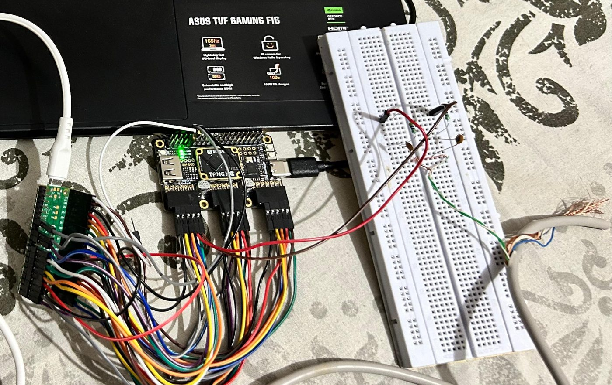
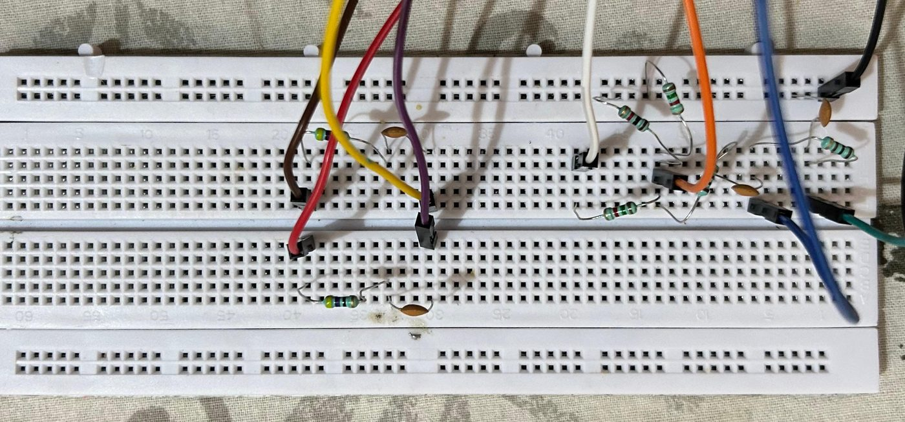
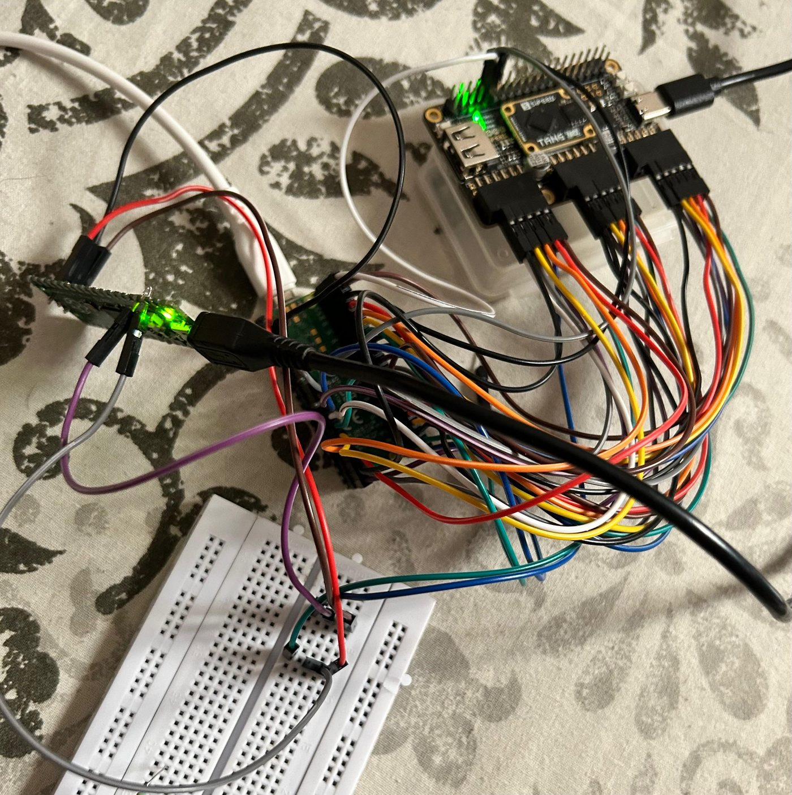
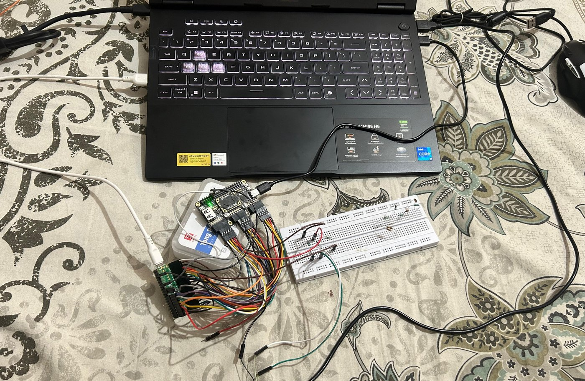
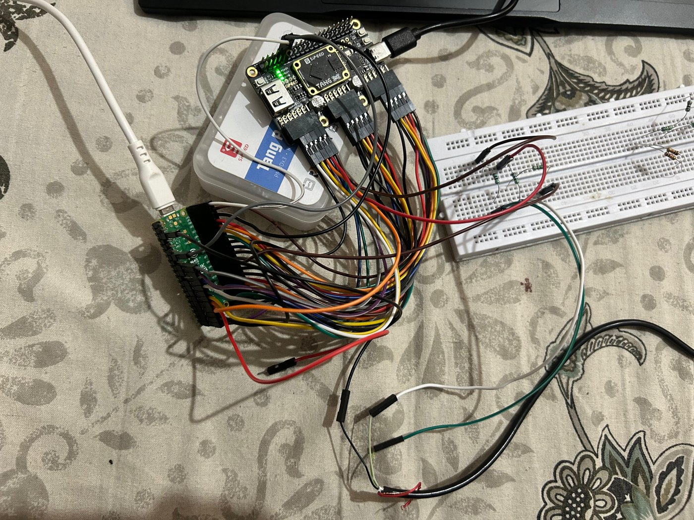
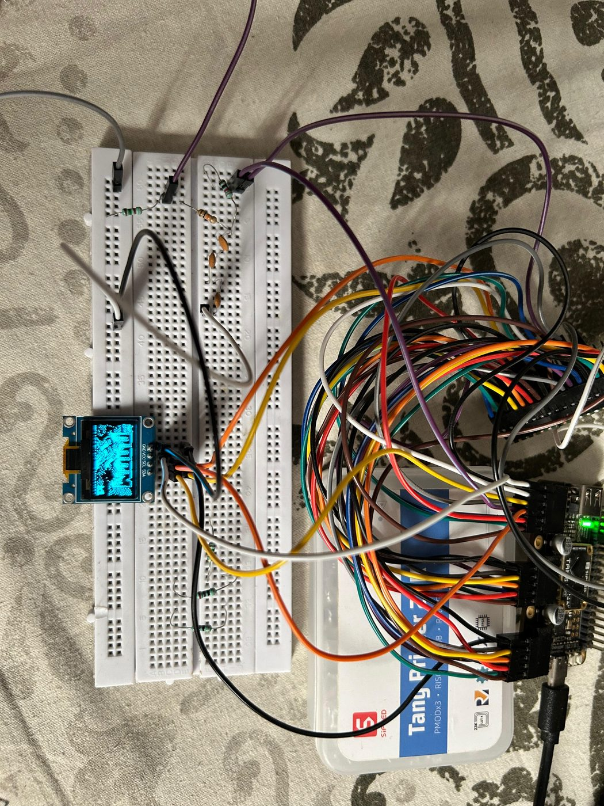

# Hardware bench: Pico W + Tang Primer 25K Dock

The chip's RTL running on an FPGA, driven through its 24 Tiny Tapeout pins, its clock and its
reset by a Raspberry Pi Pico W that runs the repository's own bring-up script
(`sw/rp2350/bringup.py`). `barepico.py` stands in for the Tiny Tapeout demo board's firmware,
so the script runs unchanged.

| Part | Board |
| --- | --- |
| Host | Raspberry Pi Pico W (RP2040, MicroPython 1.24.1), soldered headers |
| Chip | Sipeed Tang Primer 25K Dock (GW5A-LV25MG121NC1/I0), loaded over its onboard USB debugger |
| Build | `fpga/escapement_board.v` with `ESC_NO_CG` and `fpga/escapement_sram_fpga.v`, as in `fpga/README.md` |

## Result, 2026-11-26 (version 3.2)

Version 3.2 lowers the chip's power without changing what it does: registers are clocked only
when they are written, a context waiting on a `WAIT` is parked and reissues its held instruction
instead of reading the program store again, and the pipeline loads only a stage that holds an
instruction (D-73 to D-77 in [06-DECISIONS](../../docs/06-DECISIONS.md)). On the FPGA every clock
gate is an enable (`ESC_NO_CG`), as it is in the proofs, so this run checks the new logic on the
board and says nothing about the gates themselves or the power. The bitstream and the bundles
were built from the sources committed as version 3.2, `57db3c3`: the sha256 of each of the 12
HDL files in `chip.MANIFEST` (the ten from `src/` and the two from `fpga/`) is that of the file
in that commit. They were built before the commit was made, so the MANIFESTs name its parent,
`2a4ba1f`, and say "src modified: v3.2 uncommitted"; the hashes are what ties them to
`57db3c3`. Later commits change only comments in five of the files (`esc_core.v`, `esc_ctx.v`,
`esc_cap.v`, `esc_mon.v` and `escapement_host.v`).

| Step | Result | Evidence |
| --- | --- | --- |
| 0 board and project | PASS | `results/2026-11-26/bringup.log` |
| 1 clock and reset | PASS: 25 MHz from the Pico, outputs correct in and after reset | same |
| 2 host link | PASS: STATUS reports protocol version 11, fast and slow SCK | same |
| 3 memories | PASS: 4 patterns x 256 words in each of the four program pages and the tape, tape reads during a run | same |
| 4 pins and clock rate | PASS: every uio, input and bank B pin; chip clock 24.9844 MHz | same |
| 5 firmware | PASS: 94 of 94 bundles match the model's digest or final state and their certificates, the same set as on 25 November | same, and `proof.json` |

The wiring check was not repeated; stage 4 drives and reads every pin. The bitstream was
built by `build.sh` with every check passing: the clock is on the global network to all 5,266
of its clock pins (5,113 on version 3.1) with no measured skew, setup passes at 25 MHz
(54.76 MHz possible, 58.00 on version 3.1), and nextpnr's 8 hold flags are all at block RAM
address pins (below).

On 28 November the same bitstream ran `westminster`, the one library program without a bundle
until then: it halts after 15.65 s with the model's digest and the smallest lead its
certificate proves, so all 90 of the library's programs have matched on version 3.2
([the run](results/2026-11-28-westminster/README.md)).

## Earlier result, 2026-11-21 (version 3.1, span)

Version 3.1 adds span: a context whose partner is switched off can run one program of up to
512 words across both of their program pages. This run loaded the RTL of commit c49c1c0 and
firmware bundles built from the same tree.

| Step | Result | Evidence |
| --- | --- | --- |
| wiring check | PASS: all 26 signals on the expected GPIOs | `results/2026-11-21/pinid.txt` |
| 0 board and project | PASS | `results/2026-11-21/clean-build/bringup.log` |
| 1 clock and reset | PASS: 25 MHz from the Pico, outputs correct in and after reset | same |
| 2 host link | PASS: STATUS reports protocol version 11, fast and slow SCK | same |
| 3 memories | PASS: 4 patterns x 256 words in each of the four program pages and the tape, tape reads during a run | same |
| 4 pins and clock rate | PASS: every uio, input and bank B pin; chip clock 24.9938 MHz | same |
| 5 firmware | PASS: 85 of 85 bundles match the model's digest or final state and their certificates: 80 library programs and 5 bench programs | same, and `proof.json` |

Two programs ran here for the first time. `modbus_full` is the first that spans two pages: a
419-word Modbus RTU device on context 0, with context 2 switched off to lend it its page, and
its smallest lead on the board was 9 ticks, the bound its certificate gives. `eth_trx`, the
one program the run of 19 November refused, now passes with its fix (below): its smallest
lead was 29 ticks against a certified 13.

The bitstream was built by `build.sh` with every one of its checks passing: the clock is on
the global network all the way to its 5,111 clock pins with no measured skew, setup passes at
25 MHz (58.16 MHz possible), and nextpnr reports no hold violation (the bitstream of
19 November had 8, all at block RAM address pins; see below). Earlier bitstreams failed two of these checks and were
packed by hand. The cause was the half-tick input sampler, a bank of falling-edge
flip-flops: Yosys's Gowin flow for the GW5A legalizes every flip-flop to a rising-edge clock
and puts an inverter for this bank in a LUT, which takes the bank's clock off the global
network. `build.sh` now maps the falling-edge flip-flops onto the FPGA's own `DFFNC` cells
first, so their clock stays global, and nextpnr then times the sampler's half-cycle path into
the core, which it did not before. A first run the same evening, on a bitstream built before
this change and packed by hand (`results/2026-11-21/`, whose `chip.MANIFEST` says so), also
passed 85 of 85.

On 22 November the bitstream was rebuilt with the reset synchroniser (D-63), and the same
run passed 85 of 85 again (`results/2026-11-22/`). That build then answered a laptop's ping
over 10BASE-T and enumerated on its USB port as a keyboard (Ethernet and USB keyboard,
below). On the same bitstream, bring-up passed 86 of 86 on 24 November with `pwm_audio`
bundled, and 94 of 94 on 25 November with the eight held-out programs added (held-out round,
below).

## Earlier result, 2026-11-19 (version 3, every program)

The same bitstream as on 15 November (`chip.fs` sha256 a495ad2e..., `results/2026-11-19/chip.MANIFEST`):
the RTL has changed since only in its comments. The firmware bundles were built from the tree of
this commit, and include the ten programs written since the last run.

| Step | Result | Evidence |
| --- | --- | --- |
| wiring check | PASS: all 26 signals on the expected GPIOs | `results/2026-11-19/pinid.txt` |
| 0 board and project | PASS | `results/2026-11-19/bringup.log` |
| 1 clock and reset | PASS | same |
| 2 host link | PASS | same |
| 3 memories | PASS | same |
| 4 pins and clock rate | PASS: chip clock 24.9875 MHz | same |
| 5 firmware | 83 of 84 bundles match the model's digest or final state and their certificates: all 79 library programs, and four of the five bench programs. `eth_trx` is refused | same, and `proof.json` |

The ten programs on the chip for the first time all match: `flexray_tx`, `j1850_vpw`, `oregon_tx`,
`panasonic_tx`, `samsung_tx`, `sharp_tx`, `swim_host`, `ws2801_tx`, `xy2_100` and `vga_pong`.
`westminster` (a 14-second tune) and `replay` (a template) have no bundle.

`eth_trx`, the ping bench's program (Ethernet, below), is the one bundle stage 5 does not pass.
Its state matched the model, but escert gives it no certificate (NOT_PROVEN), and stage 5 passes
no program without one. Its findings pointed at a real fault in `send`: after waiting on a slow
host, the program counted its next deadline from before the wait. The bit-banged host link
takes about 0.7 s to push a large frame, longer than the 0.42 s (2^24 ticks) by which `send`
bounds its wait for the line unit, so the frame's deadline could already be past. On the
simulator, with the host pausing 0.45 s inside a frame, the old program's frame was late and the
line unit dropped it; with the host slow to read a status word, it faulted at its next link
pulse. `send` now takes the time again after each wait on the host. It also waits for the host
in 10 µs slices, as listening does, so the link pulses keep their 16 ms through a slow host:
before, they stopped for as long as the host took, and a link partner drops the link after 50
to 150 ms without them. With two precision fixes in escert
([verification](../../docs/04-VERIFICATION.md#planted-timing-bugs)) the program is CHECKED
with a minimum lead of 13 ticks, and `test_ethbench.py` runs both slow hosts. This run
predates the fix; the run of 21 November loaded it, and it passed.

Getting to this run took three tries, and each fixed something:

- **Loads lost to the host-link wires.** In three earlier runs that day, 2, 2 and 5 loads read
  back words from the wrong addresses, as if the chip had seen an extra or a missing SCK edge.
  The readback check caught every one, so no wrong program ran, and each passed when loaded
  again. The chip's host link has no timeout, so a pause on the Pico cannot cause it. Reseating
  the CS_n, SCK, MOSI, MISO and ground jumpers cleared it: the run above lost none in 84 loads.
- **Old files on the Pico.** Three images left from the Ethernet receive bench sat among the
  bundles and stopped stage 5 with an error. Stage 5 now names such a file and goes on.
- **The Pico's heap.** After about 80 bundles it was too fragmented for XY2-100's prediction
  (1,204 folds and 1,204 phases). Each load now frees the one before, and long lists live in
  `.folds` and `.phases` files beside the bundle, read a value at a time.

## Earlier result, 2026-11-15 (version 3, 71 programs)

The bitstream was built from commit fa0491a and the firmware bundles from 72a74f7, which
adds OLED Pong and changes no RTL.

| Step | Result | Evidence |
| --- | --- | --- |
| 0 board and project | PASS | `results/2026-11-15/bringup.log` |
| 1 clock and reset | PASS: 25 MHz from the Pico, outputs correct in and after reset | same |
| 2 host link | PASS: STATUS reports protocol version 10, fast and slow SCK | same |
| 3 memories | PASS: 4 patterns x 256 words in each of the four program pages and the tape, tape reads during a run | same |
| 4 pins and clock rate | PASS: every uio, input and bank B pin; chip clock 25.0031 MHz | same |
| 5 firmware | PASS: 71 of 71 firmware match the model's digest or final state and their certificates | same |

The run also has limits, and they are recorded:

- **The bitstream failed two of `build.sh`'s own checks and was packed by hand.** The
  half-tick input sampler is a bank of falling-edge flip-flops. Yosys built it from
  rising-edge flip-flops behind an inverter in a LUT, so the clock is not wholly on the
  global network (one LUT input), and the skew to that input is 0.682 ns against the
  0.05 ns the build allows (`results/2026-11-15/clkskew.txt`). nextpnr times the rest
  of the design and passes setup at 25 MHz (57.39 MHz possible), but it treats the
  inverted clock as its own domain and does not time the half-cycle path from the sampler
  into the core. Mapping the bank onto the FPGA's falling-edge flip-flops fixed this on
  21 November (above). The chip's own layout does not have this problem: its sampler is signed off at every corner
  with the rest of the design ([03-PHYSICAL-DESIGN](../../docs/03-PHYSICAL-DESIGN.md)).
- **The new receivers ran with nothing on their pins.** `eth_rx`, `spi_sniff` and
  `i2c_timing` run and stay in step with the model, but this run had no Ethernet line, no
  SPI bus and no I2C traffic on those pins, so it does not show them decoding or measuring.
  That is shown in simulation, on the simulator and on the RTL
  ([04-VERIFICATION](../../docs/04-VERIFICATION.md)). `eth_rx` has since received a
  laptop's frames on this bitstream (Ethernet, below).
- An earlier run of the same bitstream, before two wires (uio[2] and uio[3]) were
  reconnected, failed stage 4 on exactly those pins ("pins 2,3 never read 0") and three
  firmware in stage 5 that use them (68 of 71); the log above is the run after.

OLED Pong was also played on this bitstream with an SSD1306 display on uio[2] and uio[3]
([23-OLED-PONG](../../docs/23-OLED-PONG.md)).

## What a bench run does not show

Three parts of the chip are not on the FPGA, so no bench run covers them:

- **The hardened netlist.** It comes from a different synthesis tool and cell library.
- **The clock gates and latch banks.** `ESC_NO_CG` makes them plain flip-flops.
- **The IHP SRAM macros.** Block RAM with the same timing contract replaces them.

Those stay covered by the gate-level suites, the RTL-to-netlist equivalence checks and timing
signoff.

## Earlier result, 2026-11-08 (version 1.6, commit d3b5dbc)

The first run on this bench, with the released version 1.6 (6x4).

| Step | Result | Evidence |
| --- | --- | --- |
| Wiring check (`pinid`) | `WIRING: PASS`, all 26 signals on the expected GPIOs | `results/2026-11-08/pinid.txt` |
| 0 board and project | PASS | `results/2026-11-08/bringup.log` |
| 1 clock and reset | PASS: 25 MHz from the Pico, outputs correct in and after reset | same |
| 2 host link | PASS: STATUS over SPI, fast and slow SCK | same |
| 3 memories | PASS: 4 patterns x 256 words in both SRAMs, tape reads during a run | same |
| 4 pins and clock rate | PASS: every uio, input and bank B pin; chip clock 25.0094 MHz | same |
| 5 firmware | PASS: 48 of 48 firmware match the model and their certificates | same, and `proof.json` |

The bitstream (sha256 16e5da57...) and the firmware bundles were built from commit d3b5dbc with
clean sources: `chip.MANIFEST` and `bundles.MANIFEST` record the commit and the sha256 of every
input. `chip-pnr.log` is the place-and-route log of that bitstream.

## Files

| File | What |
| --- | --- |
| `tangprimer25k.cst` | Dock pins: the 24 Tiny Tapeout pins on the three Pmod sockets, clk and rst_n on the 40-pin header |
| `build.sh` | `pinid`, `chip` and `bundles` builds, each with a MANIFEST |
| `clkskew.py` | nextpnr post-route check: clock delay to every sink |
| `pinid.v`, `pinid.py` | wiring check: the FPGA sends each signal's index on its pin; the Pico decodes every GPIO |
| `barepico.py` | the demo board's `tt` object on plain MicroPython GPIO, for `bringup.py` |
| `ethbench.py` | 10BASE-T at 40 MHz with a laptop (Ethernet, below): `eth_tx` sending numbered frames, `eth_rx` receiving the laptop's, the receive line check, and `eth_trx` answering ARP, ping and UDP echo |
| `eth_link.asm`, `eth_rx_bench.asm` | the receive bench: `eth_rx` in context 0, link pulses from timed pin events in context 1 |
| `eth_edges.asm` | the receive line check: the capture unit on RXP, with the same link pulses |
| `eth_bundles.py` | their bundles (`build.sh bundles` runs it) |
| `udpecho.py` | UDP echo from the laptop while `ethbench.ping()` runs: numbered datagrams of bytes drawn for the run, each checked on its return |
| `ethdemo.ps1` | the transmit demo, end to end: the laptop's counters and a pktmon capture, PASS or FAIL |
| `test_pinid.py`, `test_barepico.py` | software tests: pinid.v simulated through pinid.py; bring-up through barepico's wiring on the simulated chip |
| `test_ethbench.py` | software test: `ethbench.py` on the simulated chip, every frame decoded from TD+ and TD- and checked with its CRC; the receive bench and the line check against a simulated link partner |
| `swdbench.py`, `test_swdbench.py` | the SWD bench (`swd_idcode` debugging a second Pico) and its test through the bare Pico against the RP2040 model |
| `swdjudge.py` | the SWD bench judged by an outside analyser and sigrok's `swd` decoder (runs on Windows; sigrok-cli in WSL) |
| `heldoutbench.py`, `heldoutjudge.py`, `test_heldoutbench.py` | the held-out round's programs on the bench (below): the Pico W's side, including an M-Bus master; the judge of the two-channel analyser's captures (Windows, with sigrok-cli in WSL); and their tests against the simulated chip and on captures made from the ISS |
| `usbbench.py`, `test_usbbench.py` | the USB keyboard bench (`usb_hid` at 24 MHz on a laptop's USB port, below) and its test through the bare Pico against the USB host model |
| `late_bundles.py`, `refuse_owner.asm`, `latebench.py`, `test_latebench.py` | the refusal bench (The chip refuses, below): two programs escert refutes, built into `build/refused/`, run on the chip and checked against the model, with the pins and the tripwires; its test on the simulated chip |
| `learnhost.py`, `learnbench.py`, `test_learnbench.py` | the learning bench (Learned on the bench, below): the laptop's steps, the Pico's steps, and the whole loop on the simulated chip |
| `bench.ps1` | Windows helper: build, deploy, load, run (the Dock's USB goes to WSL with usbipd-win) |
| `hierarchy.sh`, `hierarchy.py` | block-level LUT, flip-flop and bus counts of the FPGA build |
| `results/2026-11-27/` | version 3.2: the refusal bench (`late.log`) and the learning bench (`learn.log` and `learn/`, as on 24 November), on the bitstream of 26 November (`chip.MANIFEST`) |
| `results/2026-11-28-westminster/` | version 3.2: `westminster` through bring-up (`westminster.log`), its bundle and the halt-only prediction that made it ([its README](results/2026-11-28-westminster/README.md)) |
| `results/2026-11-28-sump/` | version 3.2: PulseView's driver (sigrok-cli's `ols`) capturing from the chip through `sump.py` on the Pico W, two `.sr` captures and the scripts that made them ([its README](results/2026-11-28-sump/README.md)) |
| `results/2026-11-26/` | version 3.2: the bring-up log and telemetry, the bitstream's and bundles' MANIFESTs, the place-and-route log, the clock skew report and the block hierarchy (`hierarchy.json`) |
| `results/2026-11-24/` | the refusal bench (`late.log`) and the learning bench (`learn.log`, with the playback, the chip's capture, the learned table, both generated programs and the timed marks in `learn/`), after a bring-up of 86 of 86 programs; the bundles' MANIFEST and the bitstream's (built 2026-11-22) |
| `results/2026-11-22/` | version 3.1 with the reset synchroniser: the bring-up log and telemetry, the bitstream's and bundles' MANIFESTs, the place-and-route log and the block hierarchy (`hierarchy.json`); the Ethernet transmit, receive (at three bias levels), line-check and ping logs (the laptop's MAC address replaced by LAPTOP-MAC); the USB keyboard runs (`usb-keyboard.log`) |
| `results/2026-11-21/` | the first version 3.1 (span) runs: the wiring check, and two bring-up runs with their logs, telemetry and MANIFESTs, one on a bitstream packed by hand (this folder) and one on the bitstream `build.sh` now builds unaided (`clean-build/`) |
| `results/2026-11-19/` | the version 3 run with every program: the wiring check, the bring-up log, the telemetry, the MANIFESTs (the bitstream's copied from 2026-11-15, the same build) |
| `results/2026-11-15/` | the earlier version 3 run: the bring-up log, the bitstream's and bundles' MANIFESTs, the clock skew report |
| `results/2026-11-17/` | the Ethernet transmit demo (`ethdemo.ps1 -SaveTo`): its log, and the laptop's capture of the 20 frames (`eth-tx.pcapng`, EtherType 0x88B5 only; the capture header's machine fields removed); the SWD session against an RP2040 (`swd.log`), and the same session judged by an outside analyser and sigrok (`swd-judge/`) |
| `results/2026-11-16/` | the Ethernet receive bench: the receive log (the laptop's MAC address masked) and the line captures |
| `results/2026-11-08/` | the earlier version 1.6 run |

## Running it

Tools: OSS CAD Suite (yosys, nextpnr-himbaechel, gowin_pack, openFPGALoader) and `mpremote`.
`build.sh bundles` needs a Python 3 with PyYAML (the assembler's). It takes `PYTHON`, else the first
of `python3` and the virtual environments in your home folder that has it.

    fpga/tangprimer25k/build.sh pinid && fpga/tangprimer25k/build.sh chip && fpga/tangprimer25k/build.sh bundles

1. MicroPython on the Pico W (RPI_PICO_W 1.24.1 UF2), then copy `sw/rp2350/bringup.py`,
   `sw/eschost/protocol.py`, `barepico.py`, `pinid.py`, `ethbench.py` and `build/bundles/*.json` with any `*.phases` and `*.folds` beside them (into `bundles/`)
   onto it. `bench.ps1 deploy` does this and checks every file by sha256.
2. Wire it with both boards unplugged (below). Each board has its own USB to the same computer.
3. `openFPGALoader -b tangprimer25k build/pinid/pinid.fs`, then on the Pico `import pinid; pinid.run()`.
   It must print `WIRING: PASS`; otherwise it names each wire that is swapped, open, shorted or
   bridged. The Pico drives nothing in this step.
4. `openFPGALoader -b tangprimer25k build/chip/chip.fs`, then
   `import barepico, bringup; bringup.run(io=barepico.open_io(), keep_going=True)`.
   Never run bring-up with pinid loaded: both drive pins.
5. Stage 5 leaves its telemetry in `proof.json` on the Pico.

Bitstreams load into the FPGA's SRAM: a power cycle clears them.

## Wiring

Every signal is 3.3 V on both boards and no power wire is used. Lay the Dock component side up
with the 40-pin header J3 on the far edge and the three Pmod sockets facing you: J6 on the left,
J5 in the middle, J4 on the right.

The Dock prints no pin numbers on its Pmod sockets, and Sipeed's schematic numbers them 1 to 12
with pins 1 and 2 = 3V3, 3 and 4 = GND (not the standard Pmod numbering in the `.cst` comments).
So the table goes by position, looking into the openings: **column 1 (both rows) is 3V3 and stays
empty** (only the Ethernet receive bench's bias resistor uses it), column 2 is GND, columns 3 to 6 are signals, bit 0 is the top row's rightmost hole.
**J3 pin 11 is +5V** and stays bare; pin 12 is J3's only GND. J3 pin 1 is at the left end of the
inner row (the board marks 1, 2, 39 and 40); odd pins are the inner row.

| # | Suggested colour | Pico pin | Signal | Dock | Hole (facing the socket) | Ball / Sipeed pin |
| --- | --- | --- | --- | --- | --- | --- |
| 1 | black | 8 GND | GND | J4 | top row, col 2 | GND / 3 |
| 2 | brown | 2 GP1 | ui_in[0] CS_n | J4 | top row, col 6 | G11 / 11 |
| 3 | red | 4 GP2 | ui_in[1] SCK | J4 | top row, col 5 | D11 / 9 |
| 4 | orange | 5 GP3 | ui_in[2] MOSI | J4 | top row, col 4 | B11 / 7 |
| 5 | yellow | 6 GP4 | ui_in[3] | J4 | top row, col 3 | C11 / 5 |
| 6 | green | 7 GP5 | ui_in[4] | J4 | bottom row, col 6 | G10 / 12 |
| 7 | blue | 9 GP6 | ui_in[5] | J4 | bottom row, col 5 | D10 / 10 |
| 8 | purple | 10 GP7 | ui_in[6] | J4 | bottom row, col 4 | B10 / 8 |
| 9 | grey | 11 GP8 | ui_in[7] | J4 | bottom row, col 3 | C10 / 6 |
| 10 | black | 13 GND | GND | J5 | top row, col 2 | GND / 3 |
| 11 | black | 18 GND | GND | J5 | bottom row, col 2 | GND / 4 |
| 12 | brown | 14 GP10 | uo_out[0] MISO | J5 | top row, col 6 | A11 / 11 |
| 13 | red | 15 GP11 | uo_out[1] IRQ | J5 | top row, col 5 | E11 / 9 |
| 14 | orange | 16 GP12 | uo_out[2] RUN | J5 | top row, col 4 | K11 / 7 |
| 15 | yellow | 17 GP13 | uo_out[3] | J5 | top row, col 3 | L5 / 5 |
| 16 | green | 19 GP14 | uo_out[4] | J5 | bottom row, col 6 | A10 / 12 |
| 17 | blue | 20 GP15 | uo_out[5] | J5 | bottom row, col 5 | E10 / 10 |
| 18 | purple | 21 GP16 | uo_out[6] | J5 | bottom row, col 4 | L11 / 8 |
| 19 | grey | 22 GP17 | uo_out[7] | J5 | bottom row, col 3 | K5 / 6 |
| 20 | black | 23 GND | GND | J6 | top row, col 2 | GND / 3 |
| 21 | black | 28 GND | GND | J6 | bottom row, col 2 | GND / 4 |
| 22 | brown | 12 GP9 | uio[0] | J6 | top row, col 6 | F5 / 11 |
| 23 | red | 24 GP18 | uio[1] | J6 | top row, col 5 | G7 / 9 |
| 24 | orange | 25 GP19 | uio[2] | J6 | top row, col 4 | H8 / 7 |
| 25 | yellow | 26 GP20 | uio[3] | J6 | top row, col 3 | H5 / 5 |
| 26 | green | 27 GP21 | uio[4] | J6 | bottom row, col 6 | G5 / 12 |
| 27 | blue | 29 GP22 | uio[5] | J6 | bottom row, col 5 | G8 / 10 |
| 28 | purple | 31 GP26 | uio[6] | J6 | bottom row, col 4 | H7 / 8 |
| 29 | grey | 32 GP27 | uio[7] | J6 | bottom row, col 3 | J5 / 6 |
| 30 | black | 3 GND | GND (twist with clk) | J3 | pin 12 (outer row, col 6) | GND |
| 31 | white | 1 GP0 | clk 25 MHz | J3 | pin 9 (inner row, col 5) | L3 |
| 32 | grey | 34 GP28 | rst_n | J3 | pin 10 (outer row, col 5) | L4 |

Never wired: Pico pins 30 RUN, 33 AGND, 35 ADC_VREF, 36 3V3(OUT), 37 3V3_EN, 38 GND, 39 VSYS,
40 VBUS; Pmod column 1 on all three sockets (except the Ethernet receive bias); J3 pin 11 and every J3 pin other than 9, 10 and 12.
Pin positions were checked against Sipeed's Dock schematic (v1.0, 2023, and Rev v1.1,
2025-08-28), its interactive BOM (pad positions) and litex-boards' Dock connector table.

## Ethernet (10BASE-T), 2026-11-16

The chip sends and receives 10BASE-T Ethernet on this bench, with a laptop's Ethernet port
as the link partner and nothing between them but resistors, capacitors and a patch cable cut
open at one end. Each direction runs as its own program load: `firmware/eth_tx.asm` to send,
`firmware/eth_rx.asm` to receive. The bitstream is the version 3 build of the result above
(`build/chip`, from commit fa0491a).

| Direction | Result | Evidence |
| --- | --- | --- |
| Transmit | PASS: 20 of 20 test frames arrived intact. Windows' packet capture shows each one with its text `escapement eth_tx 1` to `20`, and the port counts no receive error. With the cable unplugged, the same run gives 0 of 20. | `ethdemo.ps1`, filmed; `results/2026-11-17/` (log and capture) |
| Receive | PASS: 20 of 20 frames the laptop sent by itself were received with a good FCS: DHCP Discover (342 bytes), ARP probes, IGMP, SSDP and IPv6 multicast, each from the laptop's own MAC address. With the laptop's Energy-Efficient Ethernet, Green Ethernet and Power Saving Mode on, 10 of 10 in 30 s. | `results/2026-11-16/eth-rx.log` |
| Receive line | clean: 50 and 100 ns runs only, as many low as high, no missed edge | `results/2026-11-16/eth-edges.txt` |

| Transmit | Receive |
| --- | --- |
|  |  |

**The clock.** Each Manchester half-bit is exactly 2 ticks, so the chip runs at 40 MHz for
Ethernet, not the bench's usual 25 MHz. The Pico's PWM divides its system clock by a whole
number, so `ethbench` first sets the system clock to 160 MHz, which the RP2040's PLL makes
exactly from the 12 MHz crystal, and the PWM divides it by 4 with a 50% duty. The chip build
passes setup timing up to 57 MHz, and 10BASE-T allows the bit rate to be 100 ppm off, far more
than the crystal's error.

### Transmit

A network port normally reaches the cable through a transformer, which blocks the pins' DC
level and isolates the board. This bench uses a capacitor on each line instead. The
capacitors block the DC level; the laptop's own transformer provides the isolation. That is
enough for a bench link to one laptop, but not for long cables, and never for a PoE port.

| From | Through | To |
| --- | --- | --- |
| J6 top row, col 6: uio[0], TD+ | 33 to 47 Ω, then 100 nF ceramic | cable green-white (T568B pin 3) |
| J6 top row, col 5: uio[1], TD- | 33 to 47 Ω, then 100 nF ceramic | cable green (T568B pin 6) |

Unplug wires 22 and 23 (the Pico's GP9 and GP18) from those two holes first, and plug them back
for bring-up. The other end of the cable goes into the laptop. No ground wire goes to the
cable. With 3.3 V outputs the laptop sees about 1.3 to 1.5 V peak, below the 2.2 V the standard
asks of a transmitter but well above the 585 mV every receiver must accept. The circuit sends
on pins 3 and 6, as a switch port does, which is where a laptop receives.

`eth_tx` sends a link pulse every 16 ms while idle, and the laptop reports a 10 Mb/s link from
them alone. `ethbench` then pushes each frame into `eth_tx`'s mailbox. `POP` waits for each
word, so `eth_tx` sends no link pulse while a frame arrives, and a receiver drops the link after
50 to 150 ms without one. The bring-up link takes about 105 ms for a 60-byte frame (68 µs per
SCK half period), so `ethbench` sends the 16 pushes from a precomputed table of GPIO writes, in
a MicroPython viper loop that writes the GPIO register through a pointer: 0.9 ms a frame on the
bench (the versions are below). `eth_tx` reads its mailbox again only
after the link pulse that follows a frame, 16 ms later, so frames are at least 20 ms apart.

Three points matter on the bench:

- **The line unit's SEND OK does not mean the frame arrived.** It reports that the frame left
  the pins. The laptop's own counters, or a capture, are the end-to-end check, and
  `ethdemo.ps1` uses both.
- **Polarity.** TD+ goes to pin 3 and TD- to pin 6. This laptop received nothing from a
  reversed pair.
- **A twisted pair all the way.** The two wires from the Dock to the cable are twisted together,
  as the pair is inside the cable.

The upload went through three versions, for one reason: no link pulse goes out while a frame
uploads, and the laptop drops the link after 50 to 150 ms without one.

| Upload | Time for a 60-byte frame | Why the next |
| --- | --- | --- |
| the bring-up link (`bringup.Link`) | about 105 ms | over the laptop's limit |
| a precomputed table of GPIO writes, a bytecode loop | 11.3 ms | inside the limit; the compiled loop is cheaper still |
| the same table, a viper loop writing through a pointer | 0.9 ms | (kept) |

### Receive

`eth_rx` was written for a line receiver (a comparator) behind a transformer. This bench has
neither: the laptop's transmit pair reaches one FPGA pin through a coupling capacitor and a
bias network, and the pin's own input threshold acts as the comparator.

    laptop TX+  orange-white ──┬──┤├ 100 nF ──[100 Ω]──┬── J6 top col 4 (uio[2], RXP)
                            [100 Ω]                    ├──[1.5 kΩ ∥ 10 kΩ ∥ 10 kΩ]── J6 col 1 (3V3)
    laptop TX-  orange ────────┴──┤├ 100 nF ── GND     └──[1 kΩ ∥ 1.5 kΩ]── GND
    GND: J4 bottom row, col 2

Unplug wire 24 (the Pico's GP19) from J6 top col 4 first. The 100 Ω across the pair terminates
it. The divider holds the idle pin at about 1.12 V, which reads high; the laptop's signal
swings around that, and the pin's input diodes clip the bottom of the swing. J6 column 1 is the
one 3V3 hole the bench uses, for the bias resistor alone.

The bias is set by the pin, not by the standard's thresholds (the versions below). This is a
bench circuit for a short cable to one laptop. A receiver for anything else needs the
comparator and the transformer.

#### How the receive circuit got there

The circuit went through five versions. The first four were judged by the line check (below):
the capture unit's record of the high and low times at the pin. A clean line at 40 MHz shows
only 50 and 100 ns runs, as many low as high. The fifth was judged by the receive count itself,
for the reason under the table.

| Version | Why | What the pin showed |
| --- | --- | --- |
| 1 kΩ series, bias 2.0 V (1 kΩ up, 1.5 kΩ down) | 0.375 of the laptop's swing, about ±0.9 V around 2 V, stays inside the pin's supply and idles high, as `eth_rx` expects. This assumed that the pin switches near half its supply. | Never low in 25 s while the laptop sent about 40 frames. The swing never reached the real switching point. |
| 100 Ω series, bias 2.0 V | 0.86 of the swing instead of 0.375, to cross the switching point wherever it is. The pin's input diodes clip the excess. | Frames arrived, and `eth_rx` locked onto them (the first bytes decoded were the broadcast address), then lost sync. The preamble's lows were 25 ns and its highs 75 ns, so the bias was far above the switching point. |
| bias 1.32 V (1.5 kΩ up, 1 kΩ down) | Move the idle level toward the switching point. The divider is still 600 Ω, so the swing does not change. | Lows of 25 to 50 ns, and some missed altogether (175 ns highs), so every FCS was bad. |
| bias 0.94 V (1 kΩ ∥ 1.5 kΩ down) | One step further down, with the swing about the same (430 Ω). | Only 50 and 100 ns runs, as many low as high. 20 of 20 frames came with a good FCS. |
| bias 1.12 V (two 10 kΩ across the 1.5 kΩ up), 22 November | On the version 3.1 build the 0.94 V bias (measured 0.93 V) gave 13 good frames of 38, and the line check found the highs short: the bias now sat below the switching point. One 10 kΩ across the pull-up (1.04 V) gave 41 of 47. The divider stays near 400 Ω, so the swing is unchanged. | 25 of 25 frames with a good FCS. |

So the GW5A's 3.3 V input switches between about 1.0 and 1.2 V. Its datasheet guarantees only
below 0.8 V and above 2.0 V, so another board may need another bias. The point also moved on
this board: the same pin and circuit wanted 0.94 V on 16 November and 1.12 V on 22 November.
Between those limits a pin's switching point is held to no value and drifts with temperature
and supply. The FPGA build changed in between, but it could not have moved the point: every
sample is taken after the pin's input buffer. The line check shows which way to move the
bias; the receive count shows when to stop.

`eth_rx` needs the chip's line unit, and the chip has one. So `eth_rx_bench.asm` runs `eth_rx`
in context 0 and `eth_link.asm` in context 1: link pulses made of timed pin events (`EMIT`),
16 ms apart, which keep the laptop's link up so that it sends. After each
frame, `eth_rx` arms again only once the Pico has popped the frame's words, and the Pico's link
takes about 0.7 s for a 342-byte frame. A frame that arrives meanwhile is missed, never
corrupted.

The receive bench samples RXP on both clock edges (`BOTH = 1`, `eth_rx`'s default). Its
falling-edge register is the one this FPGA build does not time (the result above). It received
every frame here. The bundle `eth_rx_bench_one` samples once a tick instead, but it was tried
only on the unfixed line.

**The link flapped with timed-event pulses, and a low lead fixed it.** On the receive bench the
laptop's link went about 0.6 s up and 2.3 s down. During this, the chip read its own state:
context 1's timer advanced exactly 1 s every second, so the link pulses never stopped, and the
laptop's power-saving settings made no difference. With `eth_tx`, whose pulses come from the
line unit, the same laptop held the link. Each up interval was long enough for the laptop to
send several frames, so receiving worked regardless. On 22 November, after the breadboard was
reseated, the flap got worse: `eth_trx`'s link was up 1 s and down 2 s or never came up, and
`eth_rx_bench` got no link in 40 s, while `eth_tx` still held it. In simulation the two kinds
of pulse are the same at the pins: 100 ns of TD+ high and TD- low, from released pins and back.
So the difference is in the analogue circuit, which was not measured. A build of `eth_trx`
whose pulses first drive both pins low for 100 ns held the link from its first second to the
end of the run, about three minutes. `eth_link` and `eth_trx` now send that shape. Why the lead
helps is not known. In that first run the laptop counted none of the chip's ARP replies. In a
later run, checked by hand and not logged, the link no longer flapped and the chip answered 99
of 100 pings; only the 59th went unanswered.

### What this is, and is not

The chip does the Ethernet link layer: whole frames in and out at 10 Mb/s half duplex, each
checked or sealed with its CRC-32. What the laptop sent were internet protocol packets (DHCP,
ARP, IGMP, IPv6), and they arrived byte for byte. But taking part in a network needs more:

- **A protocol stack.** Something has to answer ARP, keep an IP address, and reply to a ping.
  On this bench that would be the host's job (the Pico), as the chip hands it each frame.
- **Both directions in one load.** `eth_tx` and `eth_rx` each take the chip's one line unit for
  as long as they run. A program that sends and receives must reconfigure the unit between
  frames. 10BASE-T is half duplex, so that is allowed: `eth_trx.asm` does it, and with
  `ethbench.ping()` it answers ARP, ping and UDP echo (port 7) in simulation, and ARP and
  ping on the bench (below).
- **A faster host link.** The bit-banged SPI drains a large frame in about 0.7 s. That is fine
  for a ping, but not for real traffic.

### Ping, 2026-11-22

The chip answers a laptop's ping. `ethbench.ping()` loads `eth_trx` at 40 MHz and has the Pico
act as the protocol stack for 169.254.0.42, a link-local address beside the laptop's own. The
laptop's `ping -n 10 169.254.0.42` got the ARP reply and then 7 echo replies, 154 to 178 ms
each; the first took 1,968 ms because it waited for the ARP exchange. The time is almost all
the host link: each request crosses the bit-banged SPI into the Pico and each reply crosses
back. The last three of the ten failed when the link dropped and the laptop restarted its
address (a DHCP Discover from 0.0.0.0, then an ARP probe of its own address), the flap
described above, which this run's pulses still had. Over the run the chip received 100
frames, 1 with a bad FCS, and no tripwire fired. The build was version 3.1 with the reset synchroniser (D-63), and the same session
passed transmit (20 of 20 frames counted by the laptop, no receive error) and receive (25 of
25 good FCS). Logs: `results/2026-11-22/` (the laptop's MAC address replaced by LAPTOP-MAC).

The same load also answers UDP echo (port 7, RFC 862), and `udpecho.py` sends it from the
laptop. The chip's part is the one it plays for a ping, which the bench has shown: `eth_trx`
receives the frame, hands it to the Pico and sends the reply the Pico gives back. Only the
Pico's reply code is new, and `test_ethbench.py` checks it end to end on the simulated chip,
with the reply decoded from TD+ and TD- and checked with its CRC. It has not been run on
the bench.

### The line check

`eth_edges.asm` arms the capture unit on RXP and sends link pulses. The capture fills the
tape with the edges of the first frame the laptop sends, and `ethbench.edges()` measures the
high and low runs. A clean line at 40 MHz shows only 2- and 4-tick runs (50 and 100 ns), as many
low as high. A run over 5 ticks means an edge was missed, which `eth_rx` cannot decode. The
check names the likely fix: a bias above the pin's switching point makes the lows short, and
an open coupling capacitor lets only the edges through. With the laptop's Energy-Efficient
Ethernet on, the lows came out about 48 ns shorter than the highs in one capture, but no edge
was missed, and `eth_rx` decoded every frame.

On 22 November every capture had odd run lengths, 1 and 3 ticks high and 3 and 5 low, and
the check read the highs 29 to 38 ns short at 0.93, 1.04 and 1.12 V alike, including the
bias that then decoded 25 of 25 frames. That is the check's resolution, not the line. It
times runs in whole ticks of 25 ns, and over the 15 µs or so of one frame's start that fills
the tape, the laptop's edges keep nearly one phase against the chip's clock: within the
100 ppm 802.3 allows, the two drift apart by under 2 ns. A skew of a few ns then moves every
run by the same tick. On the simulator `eth_rx` decodes every frame with the highs 10 ns
short and loses most at 15 ns, so the line that gave 25 of 25 was skewed by well under that,
and read as 38. Nor is it the chip: the capture unit takes RXP through one register for both
edge directions, and the falling-edge sampler feeds only the line unit. The check still finds
missed edges and gives the direction to move the bias, which took the count from 13 of 38 to
25 of 25 that day; the receive count from `ethbench.listen()` says when to stop. The laptop takes 5
to 9 s to bring the link up, so the check now waits up to 60 s for a frame; its earlier 15 s
could end before the first one.

### Commands

With `chip.fs` loaded and the files deployed:

    .\bench.ps1 eth                         # transmit: 10 frames, one a second
    .\bench.ps1 eth -Opts "count=60"        # 60 frames
    .\ethdemo.ps1                           # transmit, end to end: 20 frames, PASS or FAIL
                                            # (as administrator, with a pktmon capture)
    .\bench.ps1 ethedges                    # the receive line check
    .\bench.ps1 ethrx -Opts "seconds=60"    # receive: every frame for 60 s, with its FCS
    .\bench.ps1 ethping -Opts "seconds=150" # answer ARP, ping and UDP echo for 169.254.0.42
    ping -n 10 169.254.0.42                 # from the laptop, while ethping runs
    python udpecho.py 20                    # UDP echo from the laptop, while ethping runs

For transmit, Wireshark (display filter `eth.type == 0x88b5`) shows each frame. Each one is
broadcast, from 02:00:00:00:00:01, with EtherType 0x88B5 (IEEE local experimental) and the text
`escapement eth_tx <n>`. For receive, the laptop needs no setup. Once the link is up it sends
its own traffic: DHCP, ARP, multicast.

## SWD: the chip debugs an RP2040, 2026-11-17

`swd_idcode.asm` is an Arm Serial Wire Debug host in firmware. Here it talks to a second
Raspberry Pi Pico through that Pico's 3-pin debug header, as a debug probe would. The bench
Pico W only pushes host commands to the chip's mailbox and reads the replies; every SWCLK and
SWDIO edge comes from the chip, at 25 MHz with SWCLK at 781 kHz.

The RP2040's debug port is multi-drop (SWD protocol version 2): core 0, core 1 and a rescue
port share the two wires, they start dormant, and a probe must wake them and select one
before any of them answers. `swd_idcode` gained that for this bench. Command bit 30 sends the
SWD-to-dormant and dormant-to-SWD sequences and a line reset, and a DP write to 0xC is sent
as TARGETSEL, which no target acknowledges. The sequences are the ones OpenOCD sends.

| Run | What the chip read | Result |
| --- | --- | --- |
| Core 0 (TARGETSEL 0x01002927) | DPIDR 0x0BC12477; DLPIDR 0x00000001 (protocol version 2, instance 0); AHB-AP IDR 0x04770031; the boot ROM word at 0x10, 0x0301754D (`Mu`, 0x01, ROM version 3: RP2040-B2) | PASS |
| Core 1 (TARGETSEL 0x11002927) | The same, with DLPIDR 0x10000001: instance 1, so the chip selects between the ports | PASS |
| Control: TARGETSEL naming instance 2, which does not exist | No port answers the DPIDR read (ACK 111, the pull-up) | fails, as it must |

Log: `results/2026-11-17/swd.log`. Nothing is written to the target and no core is halted:
the session reads the debug port, powers up the debug domain, and reads one ROM word through
the AP.

**Judged from outside.** `swdjudge.py` runs the same session one step at a time while a
second recorder takes down SWCLK and SWDIO: the target Pico itself, running gusmanb's
LogicAnalyzer firmware (v6.0, 25 MS/s) beside its debug port, driven by that project's
command-line client. sigrok's `swd` decoder then reads each step from the recording. In every
step after the wake-up (15 of 16), the decoder took off the wire exactly the data the chip
reported to its host (DPIDR 0x0BC12477 through the ROM word) or the data the host asked it to
write, each with ACK OK. Every SWCLK high and low phase measured 640 ns, which is H = 16 ticks
at 25 MHz, to within the 40 ns sample. The control fails as it must: the DPIDR recording with
one SWDIO pulse inverted no longer decodes to the chip's value. The wake-up step is judged on
its clock only, because sigrok's decoder (0.7.2) has no dormant state or TARGETSEL; the next
step shows its effect. Log and recordings (VCD): `results/2026-11-17/swd-judge/`.

    python fpga\tangprimer25k\swdjudge.py --la COM12 --host COM8 --tc <TerminalCapture.exe> --out <dir>

For it, the analyser's GP2 (pin 4) shares a breadboard row with SWCLK and GP3 (pin 5) one
with SWDIO; it is grounded already through the target's debug GND.

In simulation the same host routine runs against a model of the RP2040's three ports on one
bus (`sw/escmodels/swd.py`, `test_swdbench.py`), and `sw/tests/test_firmware.py` checks the
firmware alone: each port selected in turn, and no answer without the wake or with a
TARGETSEL that names none.

**Wiring.** Unplug the Pico W's wires 26 (GP21) and 27 (GP22) at the Dock, then:

| Target Pico debug pin | To |
| --- | --- |
| SWCLK | J6 bottom row, col 6 (uio[4]) |
| SWDIO | J6 bottom row, col 5 (uio[5]) |
| GND | the Pico W's pin 38 (GND) |

The target is powered from its own USB. If it runs MicroPython too, two Picos answer to
`mpremote`, and `bench.ps1` then needs `-Port` for the bench host:

    .\bench.ps1 load chip
    .\bench.ps1 swd -Port COM8
    .\bench.ps1 swd -Port COM8 -Opts "targetsel=0x11002927"     # core 1

Afterwards plug wires 26 and 27 back in; `.\bench.ps1 pinid` (with `pinid.fs` loaded) then
finds all 26 wires again.

## USB keyboard, 2026-11-22

`firmware/usb_hid.asm` makes the chip a USB 1.1 low-speed keyboard (1.5 Mb/s). On this bench
the chip's two data pins go to a laptop's USB port through two resistors, Windows enumerates
the chip as a keyboard, and the chip types a line of text into a window. The chip has no USB
hardware. Its line unit does the bit work (NRZI coding, bit stuffing, the CRCs, SYNC and the
end-of-packet), and the firmware does everything above it: the enumeration requests, the
descriptors, the address change and the key reports ([19-LINE-UNIT](../../docs/19-LINE-UNIT.md#a-usb-keyboard)).
Every reply leaves the pins exactly 75 ticks after the end of the computer's packet, and
`escert` proves it on time on every path through the program where the computer keeps to USB's
timing. The bench Pico W pushes the key reports
into the chip's mailbox and does nothing else on the bus.

| Run | What the chip typed | Windows | Result |
| --- | --- | --- | --- |
| 1 to 5 | `escapement usb_hid` and a six-digit number drawn on the laptop for that run: 26 characters, 52 key reports (each key pressed, then released) | a "USB Input Device", status OK, with the product string `Escapement` read from the chip | PASS, 5 of 5 |
| 6 | the same, followed by `the quick brown fox jumps over the lazy dog 0123456789. escapement types this through usb_hid on the fpga bench, 22 nov 2026`: 151 characters, 302 key reports | the same | PASS |

`bench.ps1 usb` judges each run from the laptop's side. It draws the number, opens a window to
take the line, and watches Windows' device list for the chip (`USB\VID_1209&PID_0001`) while
the Pico starts it. The run passes only if the window receives exactly the line the chip was
given, so a dropped, doubled or wrong key fails it, and so does a keyboard that never
enumerates. Windows listed the chip 7 to 9 s after the run began, a time that includes loading
the program over the bit-banged host link. Log: `results/2026-11-22/usb-keyboard.log`. The
build was version 3.1 with the reset synchroniser, the same bitstream as the Ethernet results
above.

**The clock.** Low-speed USB allows 25 ns of jitter on each data edge, so `usb_hid` runs at
24 MHz, where a bit is exactly 16 ticks (D-37). The Pico's PWM divides its system clock by a
whole number, so `usbbench` first sets the system clock to 144 MHz, which the RP2040's PLL
makes exactly from its 12 MHz crystal, and divides by 6 with a 50% duty.

**The circuit.**

| From | Through | To |
| --- | --- | --- |
| USB D+ (green) | 27 Ω | J6 top row, col 6 (uio[0]) |
| USB D− (white or grey) | 27 Ω | J6 top row, col 5 (uio[1]) |
| USB D−, on the cable side of its 27 Ω | 1.5 kΩ | the Pico W's GP9 (the Dock end of wire 22) |
| USB GND (black) | | the Pico W's pin 38 (GND) |
| USB VBUS (red) | | nothing: taped off |

The cable is an ordinary USB cable cut open at its far end; its plug goes into the laptop.
Unplug wires 22 and 23 (the Pico's GP9 and GP18) from J6's col 6 and col 5 first. Wire 22 then
supplies the pull-up, and wire 23 stays loose. The 27 Ω resistors are the series resistance
a low-speed driver normally has, and both boards keep their own USB power, so the 5 V line
from the laptop is not used.

The 1.5 kΩ resistor from D− to 3.3 V is how a low-speed device tells the computer that it has
been plugged in. Tied to a fixed 3.3 V, it would announce the keyboard as soon as the Dock had
power, while the chip was still stopped, and Windows gives up on a device that does not answer
its first requests. So the pull-up hangs from a Pico pin instead. `usbbench` drives GP9 high
once `usb_hid` is running, which is the moment Windows sees the keyboard plugged in, and drives
it low again at the end, so the keyboard is unplugged cleanly before the chip stops.

In simulation `test_usbbench.py` runs the same bench path: `usbbench` on the bare Pico's wiring,
`usb_hid` on the simulated chip at 24 MHz, and the USB host model of `sw/escmodels/usb.py` on
D+ and D−, which enumerates the keyboard as Linux does and checks every packet's timing and
CRC. It also checks that a keyboard nobody polls is reported as not enumerated, and that a
system clock the PWM cannot divide to 24 MHz is refused. The firmware's own tests and the run
on a real Linux kernel are in [19-LINE-UNIT](../../docs/19-LINE-UNIT.md#on-a-real-linux-kernel).

This is USB 1.1 at low speed, which is what keyboards, mice and most simple devices use. Full
speed (12 Mb/s) would need 4 ticks a bit at 48 MHz and has not been tried. VID:PID 1209:0001
is the pid.codes test ID, for test environments only.

    .\bench.ps1 load chip
    .\bench.ps1 deploy
    .\bench.ps1 usb                          # a line with a fresh number, PASS or FAIL
    .\bench.ps1 usb "and some more text"     # letters, digits, space and . , - = ; /

When the window titled "escapement keyboard" opens, it should have the focus: the chip types
into whichever window has it. Plug wires 22 and 23 back into J6 for bring-up.

## DOOM console, 2026-11-23

The bench Pico W runs the shareware DOOM (rp2040-doom, with a backend that sends its output
to the chip) and the chip is its input/output processor: `i2c_burst` streams the frames to an
SSD1306, `pwm_audio` plays the sound into a laptop's headset jack, `i2c_timing` watches the
I2C bus, and `logic_analyzer` can record the sound pin, one program per context and page
([25-DOOM-CONSOLE](../../docs/25-DOOM-CONSOLE.md)). The Pico drives the chip's host link
from a PIO program at SCK = 3.125 MHz, the chip's 25 MHz clock divided by eight (the protocol's
limit), and the 32 jumpers of the bring-up wiring stay as they are.

| Measure | Result |
| --- | --- |
| Host link alone, the Pico at 250 MHz | 35,413 words a second pushed, 400 blocks of 256 words summed back by the chip, none lost and no host error |
| Panel | 12.4 frames a second, every I2C transaction acknowledged |
| Sound | 11,040 samples a second; the Pico, reading the pin, sees the 88 kHz carrier, its duty moving with the sound |
| Host link, in play | 2,760 words a second; 2,342 frames and 523,797 words in a three-minute run, none lost or dropped |

The game ran its demo loop and was played from the laptop's keyboard and mouse. Log:
`results/2026-11-23/doom-console.txt`, the Pico's status lines over 60 s of the run.

**The circuit.** Everything taps the breadboard rows of the bring-up wiring, so no jumper
moves: the Pico leaves its own pins on those rows as inputs without pulls.

| From | Through | To |
| --- | --- | --- |
| OLED SCL | | the row of the Pico W's GP19 (wire 24, uio[2]) |
| OLED SDA | | the row of the Pico W's GP20 (wire 25, uio[3]) |
| OLED VCC | | J6 col 1 (3.3 V) |
| OLED GND | | J4 bottom row, col 2 |
| the row of the Pico W's GP26 (wire 28, uio[6]) | 1 kΩ | node A |
| node A | 33 nF (three 100 nF in series) | GND: a low-pass filter at 4.8 kHz |
| node A | 10 kΩ | node M |
| node M | 1.5 kΩ | GND |
| node M | | the headset plug's sleeve (the microphone contact) |
| GND, the Pico W's pin 38 | | the plug's second ring (ground); its tip and first ring are taped off |

The OLED module carries its own I2C pull-ups. The sound reaches the laptop as a headset
microphone, at about 270 mV peak to peak at full scale; Windows' "Listen to this device"
plays it through the speakers.

**Order.** Load the chip's bitstream into the Dock first (`.\bench.ps1 load chip`), then
start the Pico. Handling the boards can lose the bitstream, which lives in the FPGA's
configuration RAM; the Pico then reads a STATUS of 0x00 and stops before the game starts.

## The chip refuses

Every other run on this bench is a program that works. This one is two programs that ask the
chip for something it must not do, to show the refusal happens on the FPGA build where the
model and the certificate checker said it would, and that nothing late or unowned reaches a
pin. `late_bundles.py` builds them into `build/refused/`, away from the bring-up's stage 5,
which expects every bundle it finds to pass.

| Bundle | What it asks for | escert, before the run | What the model predicts |
| --- | --- | --- | --- |
| `uart_tx_late` | `uart_tx.asm` with a bit 5 ticks long (BAUD = 5 MHz at 25 MHz): its second edge is due before it can be queued | REFUTED | ADMIT, PAST, context 0, pc 8 (first fault 0x83300008), tick 35 |
| `refuse_owner` | `refuse_owner.asm`: context 0 owns uio[0] and asks for a DRIVE on uio[1], which no context owns | REFUTED | ADMIT, OWNER, context 0, pc 3 (0x83200003), tick 15 |

`latebench.run()` (`.\bench.ps1 late`) then, for each bundle:

1. checks escert's verdict and finding, carried in the bundle;
2. loads and starts it, and compares the chip's first-fault record (READ_DBG 14), fault tick
   (15), digest (16) and every context's state and registers with the model's;
3. while the run is still on, swaps the Pico's pull-ups on the program's pins for pull-downs:
   each must read 0, so the faulted context let go of its pin and the unowned pin was never
   driven;
4. reads the proof tripwires (READ_DBG 27), which must be 0: the chip's own monitors saw no
   FIFO head past its deadline, no unowned pin driven and no faulted context driving.

Wiring: the bring-up's, with nothing but the Pico W's GPIOs on uio[0] and uio[1]; a pull-up
there would read as a driven pin.

**Result, 2026-11-24.** Both programs were refused on the FPGA build exactly where escert and
the model said, and neither reached a pin it should not have:

| Bundle | escert, before the run | The chip | Digest | Pins, pulled down during the run | Tripwires |
| --- | --- | --- | --- | --- | --- |
| `refuse_owner` | REFUTED, OWNER at pc 3 | ADMIT OWNER, context 0, pc 3, tick 15: the model's | 0xc7b0c24e, the model's | uio[1:0]: none driven | 0 |
| `uart_tx_late` | REFUTED, PAST at pc 8 (lead -14 ticks) | ADMIT PAST, context 0, pc 8, tick 35: the model's | 0x56b72a7a, the model's | uio[0]: none driven | 0 |

Log: `results/2026-11-24/late.log`, after a bring-up that passed every stage with 86 of 86
programs (`bringup.log` there). The bitstream is the one built 2026-11-22
(`chip.MANIFEST`), from version 3.1's sources.

**Rerun on version 3.2, 2026-11-27.** On the version 3.2 bitstream (built 26 November from
the sources committed as `57db3c3`, the one that passed bring-up with 94 of 94), both
programs were refused again with every value in the table unchanged: the same cause,
instruction and tick, the same digests, no pin driven and the tripwires at 0. Version 3.2
changed how a waiting context fetches (the parked fetch, D-73), which is the path a late
event takes, so this is the run that shows the refusal on the release version. Log:
`results/2026-11-27/late.log`.

## Learned on the bench

`esclearn` learns a protocol from a recording, and `escgen` turns what it learned into a
certified transmitter and receiver. Here the recording is made by the chip itself, with its
own capture unit, of a transmitter it was never programmed for: a PT2262 433 MHz socket
remote (`sw/tests/data/sigrok/pt2262_abcd.sr`, buttons A to D, from sigrok-dumps). The Pico
plays the remote's frames onto uio[2] from a PIO program at one microsecond a cycle; the chip
never sees the file, only the pin.

`.\bench.ps1 learn [REC.sr]` runs the whole loop, the Pico's steps in `learnbench.py` and the
laptop's in `learnhost.py`:

| Step | Where | What |
| --- | --- | --- |
| source | laptop | the first frame of each distinct word in the recording, as (level, microseconds) segments: four frames of 50 segments, 40.4 ms each |
| capture | Pico + chip | `logic_analyzer` records uio[7:0] into the whole tape while the four frames play back to back; read once after STOP, so reading never stretches a gap: 201 records, the line's level at START and 200 edges |
| learn | laptop | `esclearn` on the chip's capture; the words it decodes must include the recording's four; `escgen` writes a transmitter on uio[3] and a receiver on uio[2], escert must certify both (CHECKED), and `make_bundle.py` builds them |
| receive | Pico + chip | the learned receiver hears the frames played again; every word it pushes must be its frame's word |
| transmit | Pico + chip | the learned transmitter sends 0x0A8888, an address the recording never has, twice, as a remote repeats its frames; the Pico times every mark on uio[3] |
| judge | laptop | the marks decoded with the learned model, and by rc-switch's receiver when `outside_decoders.sh` has built it |

Wiring: the bring-up's, with nothing else on uio[2] (GP19) and uio[3] (GP20). The DOOM
console's OLED sits on those two rows, so its SCL and SDA come off for this run.

**Result, 2026-11-24.** The whole loop passed on the FPGA build:

| Step | Result |
| --- | --- |
| capture | 201 records: the level at START and the 200 edges of the four frames |
| learn | pulse width, 25 bits a frame, idle low; zero = 290 µs mark, 970 µs space; one = 920 µs mark, 340 µs space; 9.85 ms between frames. The capture decodes to the recording's four words |
| programs | transmitter 23 words, CHECKED with a lead of at least 9 ticks; receiver 67 words, CHECKED |
| receive | 8 of 8 frames (two rounds of four) pushed as their own word |
| transmit | 0x0A8888 sent twice; the learned model reads 0x0A8888 from the frames the Pico timed |

The chip starts a frame 64 ticks (2.6 µs) after it takes the word from its mailbox, sooner
than MicroPython returns from the push to start timing, so the Pico times only the tail of the
first frame (18 of its 25 marks in this run) and all of the second, which it was already
waiting for. On the first run, with one frame, the Pico timed 24 of 25 marks and the judge
rightly read nothing.

Files: `results/2026-11-24/learn.log`, and in `learn/` the playback (`source.json`), the
chip's capture, the learned table, both generated programs and the timed marks.

**Rerun on version 3.2, 2026-11-27.** On the version 3.2 bitstream the loop passed again,
every step as in the table: the same 201 records, code and four words, the same program
sizes and certificates, 8 of 8 frames received and 0x0A8888 read back. The one difference
is the gap between frames, learned as 9.84 ms against 9.85, because it is the Pico's
playback as the chip captured it; the generated programs differ only in that constant
(`GAP`, 250 ticks shorter). Files: `results/2026-11-27/`, laid out as above.

## Held-out round on the bench, 2026-11-25

The held-out round ([`heldout/RESULTS.md`](../../heldout/RESULTS.md)) wrote eight protocols
drawn at random from a public pool by a sealed draw. Here each one runs on the chip with no device on the other
end of its bus: only the two boards, and a second Pico as a logic analyser (for M-Bus, the
Pico W also acts as the bus master). All eight passed: seven by their captures, and the 1553B
terminal, which makes no edge without a bus controller, by bring-up alone.

First, bring-up passed all six stages, and in stage 5 the eight held-out programs matched the
model with the rest, 94 of 94. Then [`heldoutjudge.py`](heldoutjudge.py) ran each program
while the analyser recorded two of its pins, and judged each capture in up to three ways:

- **Against the ISS.** The instruction-set simulator runs the same program image with the same
  host words, the pins pulled up as the Pico W pulls them. Every edge the analyser saw after
  the trigger must be one the ISS made, at the same time within two samples plus 100 ppm (the
  two crystals), and none may be missing.
- **Against the protocol's limits**, from the specification each program cites, such as the
  CD4021B's minimum pulse widths for the SNES pad.
- **By sigrok**, where a decoder can judge a run with no device.

Every capture also has a control, the same capture with one pulse inverted, which each judge
must refuse.

| Program | Channel 0 | Channel 1 | Result |
| --- | --- | --- | --- |
| `spdif_tx` | uio[0], the line | uio[1], a marker the Pico drives | sigrok `spdif`: two pushed words came out as valid samples, in order, among some 380 silent sub-frames flagged not valid; unit interval 320 ns |
| `dht22` | uio[0], DQ | | ISS; the start signal low for 1 ms, then released; the reply "no response" |
| `snes_pad` | uio[0], latch | uio[1], clock | ISS; a 12 us latch, 17 clocks of 6 us phases within the CD4021B's 5 V limits; the reply 0 (no pad) |
| `biss_c` | uio[0], MA | uio[1], SL | ISS; MA at 250 kHz, 13 clocks with no ACK, MA left high; the replies "no ACK" and 0 |
| `ps2_host` | uio[0], CLK | uio[1], DATA | ISS; the request to send (CLK low 105 us, DATA low at 100 us), the 15 ms wait for a keyboard, the 100 us inhibit that ends it; the reply "no device clock" |
| `microwire_93c46` | uio[0], CS, then uio[2], DI | uio[1], SK | ISS for each capture; sigrok `microwire` and `eeprom93xx` on the two captures of each command merged on SK: EWEN, WRITE 0x05 0x1234, READ 0x05 (0xFFFF, the pull-up) |
| `mbus_slave` | uio[0], master to slave | uio[1], slave to master | live, with the Pico W as the master: sigrok `uart` (8E1) read 20 characters sent and 28 answered (E5h, then a 27-byte RSP_UD), no reply to another address or to a bad checksum, each reply 22.0 bit times after its telegram |

`am230x` prints nothing for a start signal that no sensor answers, and sigrok has no BiSS,
SNES or PS/2-request decoder, so those four are judged by the ISS and their limits alone. The
1553B terminal waits for a bus controller and makes no edge here, so stage 5's digest alone
judges it. The logs and every capture (as VCD) are in
[`results/2026-11-25-heldout/`](results/2026-11-25-heldout); `judge-four/` also keeps the
first S/PDIF attempt, which failed for the reason given below.

The judge was restructured after that run and run again on the same afternoon, from a fresh
chip load: all seven captured programs passed again, both Microwire halves included. Its logs
and captures are in [`results/2026-11-25-heldout-rerun/`](results/2026-11-25-heldout-rerun).

**M-Bus with the Pico W as its master.** M-Bus at logic level is 8E1 serial at 2400 baud,
half duplex. `heldoutbench.mbus_master` bit-bangs each telegram on uio[0], the slave's
receive line, timing every bit from the telegram's start against the microsecond timer with
interrupts off, so that no error builds up. It leaves uio[1], the slave's reply, to the
analyser, and collects the slave's notes to its host from the mailbox. The four telegrams are
SND_NKE and REQ_UD2 to the slave's address, SND_NKE to another address, and REQ_UD2 with a
wrong checksum. The physical layer, which a TSS721 transceiver would add, is not tested.

**What the bench taught the judge.** Four things shaped the S/PDIF capture.

- The bit-banged host link pushes a mailbox word in about 9.4 ms, far longer than a 41 us
  S/PDIF frame. So the Pico pushes one word and then pulses uio[1] low as a marker, a pin the
  S/PDIF program does not own, and the analyser triggers on the marker.
- The word goes out on the line about two frames after the push, before the marker. The
  capture therefore keeps 8,000 samples before the trigger, the most the analyser takes:
  20,000 never triggered.
- The analyser's rising-edge trigger fires at once on a line that rests high, so every
  trigger here is a falling edge.
- sigrok's `spdif` decoder never synchronises from some starting points in a running stream
  ("Unknown Preamble", then a Python ValueError), so the judge then starts it one sub-frame
  later.

**Wiring.** The analyser has headers on only two of its inputs, GP2 and GP3, besides its debug
port, so it has two channels.

| Analyser | To |
| --- | --- |
| GP2 (pin 4), channel 0 | uio[0]: wire 22's net (the Pico W's GP9, J6 top row col 6) |
| GP3 (pin 5), channel 1 | uio[1]: wire 23's net (the Pico W's GP18, J6 top row col 5) |
| debug header GND | the Pico W's pin 38 (GND) |

Each channel shares its pin's net through a breadboard, with no solder. Take the wire's end out
of its Dock hole and put it in a free breadboard row; bridge that row back to the same Dock hole
with a male-to-male jumper; put the analyser's wire in the row too. Microwire needs its DI line
as well: after the first half of its captures, channel 0 moves to uio[2] (wire 24, the Pico
W's GP19, J6 top row col 4), spliced the same way. With `pinid.fs` loaded, `.\bench.ps1 pinid`
must still find all 26 wires through the splices.

    .\bench.ps1 load chip
    .\bench.ps1 deploy
    python fpga\tangprimer25k\heldoutjudge.py --la COM12 --host COM8 --tc <TerminalCapture.exe> --out <dir> --mw-half A
    (move channel 0 to uio[2], run pinid, load chip again)
    python fpga\tangprimer25k\heldoutjudge.py --la COM12 --host COM8 --tc <TerminalCapture.exe> --out <dir> --only microwire_93c46 --mw-half B

The Pico W runs at 100 MHz, from which its PWM makes the chip's 25 MHz exactly.
[`test_heldoutbench.py`](test_heldoutbench.py) runs the Pico W's side against the simulated
chip, and each judge on captures made from the ISS.

## Why the clock is on L3

The clock enters on ball L3 (J3 pin 9), a clock-capable pin. nextpnr-0.11.1-47 cannot put the
neighbouring L4 (GCLKT_4) on the GW5A-25's global clock network: a build with the clock there fell
back to general routing, with 5.5 ns of clock skew and 191 hold violations. From L3 the clock goes
through a BUFG to all of its clock pins (5,266 on version 3.2) with 0.000 ns measured skew
(`clkskew.py`).

nextpnr has flagged hold at the block RAM address pins: 40 flags when this was first measured,
8 in the bitstream of 19 November, none in those of 21 November. A single counter feeding a block
RAM gets the same 40 flags, also with the clock on the Dock's own oscillator pin, which the router
puts entirely on global resources: they come from the tool's block RAM timing model, not the design.
`build.sh chip` therefore allows timing failures only after its own checks pass (clock on the
global network, skew at most 0.05 ns, setup at 25 MHz, no hold flag anywhere else), and bring-up
stage 3 exercises both block RAMs on the board.

Two more pins sit on clock-capable balls: `rst_n` on L4 (GCLKT_4) and `ui_in[3]` on C11
(GCLKT_13). For a net from such a ball, nextpnr first tries the dedicated clock wiring, which
reaches flip-flop clock, enable and reset pins but not LUT inputs. Both signals also feed logic,
so the build log warns "Failed to route net ... using dedicated routing" for those few
connections (5 for `rst_n`, 2 for `ui_in[3]`), and the general router then routes them like any
other signal. The warnings are expected, and bring-up checks both signals on the board: stage 1
the reset, stage 4 every bank B input, `ui_in[3]` among them.
